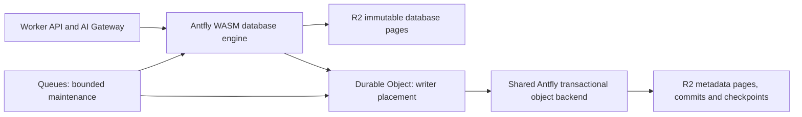

# Antfly object-storage backend for Cloudflare

This implements the Antfly-owned coordination path for
[#1278](https://github.com/antflydb/antfly/issues/1278). R2 persists both database
artifacts and coordinator metadata. Durable Objects provide compute placement
and a warm writer; application correctness does not depend on their SQLite or
key-value storage.

The existing SQLite coordinator remains available for compatibility and frozen
migration. Fresh deployments can select `wrangler.r2.jsonc`. This is a separate
profile; changing the binding on an existing database without migration is not
supported.

## Shared engine, not a remote filesystem

The shared engine lives in `zig/lib/objectstore/src/`:

- `ordered_tree.zig`: the existing authenticated copy-on-write page tree,
  extracted without a wire-format change. Its old serverless path reexports the
  same types and functions.
- `ordered_pages.zig`: bounded object-store page I/O, immutable conditional
  uploads, cancellation and integrity validation.
- `immutable_log.zig`: ownership, serial commits, checkpoints and recovery.
- `transactional_store.zig`: ordered reads, bounded batches and atomic root
  publication.

Lite's public Zig surface exports `object_database` and `object_commit_log`,
including `db.object_database`. The hosted WASM `coordinate` operation uses that
same backend. There is one page engine and one commit protocol.

This is an object-native transactional KV surface. It does not emulate append,
rename or fsync over R2, convert `.aflite` files into objects, or change the
existing local Lite SQL/LSM APIs. Hosted document/search operations continue to
use the existing Antfly serverless WAL, facts, indexes and manifests. The new
backend owns their small mutable coordination records.

## Transaction domain and layout

One physical coordinator database is one serial commit domain. Independent
partitions use distinct coordinator storage IDs and Durable Object routing.
Cross-partition atomic transactions are not provided. Adding more actors to the
same domain does not increase its write throughput: takeover fences the old
owner.

The metadata root is one ordered Antfly tree. It contains WAL HEADs, published
HEAD/progress records, work leases, read pins, model identity, adaptive budgets,
reindex pointers, collector state, pending tasks and exact mark sets. Thus the
existing guarded HEAD/progress operation and the collector's parent/children
update are native multi-key transactions under one root.

All object names are beneath `antfly/coord-v1/<storage-id-sha256>/`:

| Object | Meaning |
| --- | --- |
| `artifacts/graph/<domain>/<revision-and-nonce>/<digest>` | Authenticated immutable metadata page |
| `epochs/<epoch>/<20-digit-slot>.json` | Create-once commit or seal record |
| `epochs/<epoch>/START` | Authenticated starting state for a cached epoch cursor |
| `epochs/<epoch>/SEALED` | Recoverable shortcut to the epoch's winning seal |
| `CHECKPOINT` | Monotonic recovery floor containing a complete root/cursor |
| `CHECKPOINT_REQUIRED` | Permanent prohibition on empty bootstrap after reclamation |

Epochs and owners are random 128-bit identities. Revisions increase across
commits and seals; slots restart in each epoch. JSON-facing revisions are bounded
to the exact integer range of the host. Page identities include revision and a
fresh nonce, so a failed attempt cannot share a reclaimed name with a later
attempt.

The deployment authority descriptor lives separately at
`antfly/authority-v1/<logical-incarnation-sha256>/CURRENT`. It selects SQLite or
R2 and binds the R2 storage ID. It changes during explicit migration, not for
every transaction. A missing descriptor over existing namespace data fails
closed. A storage-ID mismatch also fails closed.

## Commit and batching

The adapter serializes RPC callbacks explicitly, including across R2 awaits.
Independent queued callbacks may share a bounded native commit. Each callback
sees preceding successful callbacks' writes; a failed callback rolls back its
own overlay. Returned values are copied so one callback cannot mutate another's
state. Every successful result waits for the durable group commit.

The native write sequence is:

1. Recover/validate the current owner, cursor and root.
2. Evaluate metadata conditions and construct a sorted mutation batch.
3. Upload the changed immutable page paths; drain started batch uploads.
4. Conditionally create the next log slot with the new root and parent revision.
5. Recheck the checkpoint floor and ownership before acknowledging success.

The append itself validates the expected cursor/root and the conditional slot;
the commit path does not repeat a tail recovery immediately before that append.
A failed condition publishes nothing. A failure before step 4 leaves collectible
pages. A lost response after step 4 leaves a recoverable committed outcome;
callers use their existing idempotency/conditional-write protocols. Queue
admission is never the durability boundary.

The adapter bounds queued requests, callbacks per group, mutations, request
memory, cumulative object operations and transferred bytes. Dependent calls
that await an earlier result remain separate commits. A large maintenance
callback ends a group before another large callback is admitted. Backpressure
returns a retryable error rather than accumulating an unbounded actor queue.

This avoids updating one R2 HEAD for every metadata change. R2's same-key write
limit makes that important. Slots and pages have fresh names; the checkpoint
is rate-limited to at most one successful update per second. See
[R2 limits](https://developers.cloudflare.com/r2/platform/limits/) and
[atomic conditional writes](https://developers.cloudflare.com/r2/reference/consistency/).

## Takeover and seals

A new actor has a fresh owner ID. It recovers the authoritative tail, then
conditionally creates a seal in the next slot. That slot races with the old
owner's next commit: exactly one conditional create wins. The seal preserves
the last root, advances the revision and names the next epoch/owner.

The winning seal creates the next epoch's `START` and the old epoch's `SEALED`
shortcut. Recovery repairs an interrupted seal publication from the immutable
slot. An old owner never automatically reacquires ownership while processing
an existing session. It fails closed when it encounters the new owner.

Ordinary rotation uses the same protocol, retaining the owner and starting a
fresh epoch after a bounded number of commits. A checkpoint can skip already
committed prefixes without scanning from database creation.

Cached cursors are authenticated against the checkpoint or their recorded start
or preceding commit. A caller cannot manufacture an unrelated root/epoch and
receive a successful commit acknowledgement. Mutable checkpoints are never
cached. The coordinator may cache immutable frame/start/seal bytes only under
the checkpoint-floor protocol below.

## Recovery and checkpoint safety

Recovery starts at the latest checkpoint and walks a bounded number of slots
and seals per call. If more remain, the actor retains a small recovery cursor
and reports retryable backpressure. It does not load the full database or all
commit history. Once the tail is reached, the actor claims ownership before
serving new writes.

A checkpoint contains the complete state needed to resume: epoch, owner, next
slot, revision and root reference. Conditional replacement plus monotonic
revision checks prevents an older writer rolling it back. A hint failure after
a durable commit cannot replace that commit's receipt with an error.

Before collection may prune history, a confirmed checkpoint is required and
`CHECKPOINT_REQUIRED` is persisted. If that checkpoint subsequently disappears,
recovery returns an error. It must never interpret the missing checkpoint as a
new, empty database.

## The late-PUT/ABA case

Deleting immutable log objects creates an important race:

1. An old owner's conditional PUT is delayed in the provider.
2. A replacement seals that owner and advances the checkpoint.
3. Collection removes the old slot.
4. The delayed PUT now succeeds at the recreated name.

The final checkpoint-floor check rejects acknowledgement of that write. Its
revision is below the durable floor, and recovery starts beyond it. It is an
unreachable orphan, not a new committed branch. This guarantee does not rely on
the provider cancelling an in-flight PUT within the reader grace period.

Collection deletes only log/start/seal records with revisions strictly below
its confirmed checkpoint barrier. The checkpoint and required marker are never
collected. An old cursor reads the mutable floor before using cached records,
so an old cached slot cannot bypass retirement. This also permits reclaiming
old seal markers rather than retaining one forever per actor restart.

## Collection of metadata itself

The application collector's SQL tables become ordered Antfly collections for
all tasks, pending tasks and exact marks. Completing a parent, adding children,
marking its object and changing phase share one native commit. Cleanup and
frontier scans are bounded.

A separate self-collector reclaims coordinator pages and commit history:

1. Confirm a checkpoint of the current metadata root and establish its revision
   as the retirement barrier.
2. Persist a frontier for that immutable tree in newer metadata revisions.
3. Trace native pages, storing exact marks and bounded child continuations.
4. Wait a reader grace period.
5. Sweep unmarked metadata pages whose attempt revisions precede the barrier.
6. Prune log/start/seal objects authenticated below the checkpoint floor.
7. Remove the bounded frontier/mark records.

New coordinator writes use newer revisions and cannot be swept. Reused old
pages came from the traced source root and are marked. The collector's own
progress pages are newer than the barrier. A failed cursor commit can repeat
physical deletion safely. Metadata collection never scans or deletes the main
database's artifact prefix; the existing application collector owns that graph.

Queue continuations carry the collection job ID. A delivery for an absent or
replaced job returns `done` without creating another job. Cron creates or resumes
state before admitting a continuation; retrying Queue admission is safe. The
initial checkpoint phase is itself durable, including when R2's checkpoint rate
window requires a delayed retry.

The R2 application collector reads up to sixteen pending parents at once and
commits their trace results as a batch. A batch admits at most 192 child
references; a wider set is split into transactions. Each accepted transaction
atomically updates its parents, exact marks, children and retention summary.
This amortizes remote commit latency across leaf traces while keeping crash
recovery and retries at the same durable frontier boundary. A failed trace batch
rolls back every parent's changes.

Application artifact tracing also yields after a ten-second wall-clock target
or sixteen nodes for R2 (eight for the compatibility profile), whichever
comes first, so slow R2 operations do not turn a small frontier batch into an arbitrarily long collector step. An individual in-flight
operation still has its normal deadline and lease checks.

## SQLite migration

Migration is explicit and resumable; it does not turn two independently active
metadata stores into competing authorities.

1. Deploy the compatibility code while the original `CommitCoordinator`
   binding remains authoritative. This establishes its authority descriptor.
2. Add the `R2CommitCoordinator` class and a `LEGACY_COMMITS` binding to the old
   class. Preserve the original class migration history and incarnation.
3. Configure the target with `COORDINATOR_MIGRATION_REQUIRED=true` and a stable
   `COORDINATOR_STORAGE_ID`. Normal target RPCs remain unavailable until cutover.
4. An authenticated `migrate_coordinator` request durably freezes the source.
   Wait for the bounded in-flight-request grace period.
5. Import source KV records, tasks and marks in bounded count/byte batches.
   Preserve record ETags, binary bodies, model identity, leases, read pins,
   adaptive budgets, job pointers and completed/pending frontier membership.
6. Commit the target's active import marker, switch the authority descriptor
   conditionally, and retain the source's permanent frozen marker.
7. Verify original mutation receipts, visibility, profiles and frontier state.
   The legacy binding may subsequently be removed; do not delete the source's
   data as part of automatic cutover.

The source refuses writes after freezing, including a rollback to a
migration-aware release.
The target refuses normal RPCs during a partial import even if the deployment
flag is accidentally removed. A nonempty target is not overwritten. Retries
continue from the committed source cursor. Cron can discover a frozen source
if its initial response or Queue enqueue was lost; deployment alone does not
freeze an untouched source.

A crash between target activation, descriptor replacement and source finalization
leaves a frozen source and a retryable cutover. Migration-aware releases cannot
reactivate SQLite. Rollback must retain the
freeze/authority checks; deploying pre-migration code is outside the supported
rollback protocol.
The source data remains a read-only recovery/audit copy, not a live fallback.

## Operational scope

The new R2 profile makes no application calls to Durable Object storage. The
platform still provisions a Durable Object class using its supported namespace
backend; that is separate from using SQLite as Antfly's metadata engine.

The earlier recovered live `SQLITE_NOMEM` was not root-caused; the separate
SQLite soak did not reproduce it. The compatibility profile retains pressure
classification/retry handling. The R2 profile removes those application SQL/KV
queries and their growing frontier tables; this does not claim to fix a
Cloudflare platform defect. See the
[native audit and pressure investigation](cloudflare-native-audit.md).

R2 latency and request costs are in the durable write path. Batching amortizes
them; it does not promise local-SSD acknowledgement latency. Independent commit
domains can scale separately. Reads use immutable pages and bounded caches;
Queues drive resumable application and metadata maintenance.

The existing opt-in paged vector profile retains its separately documented ANN
recall limitation. Replacing the metadata engine does not resolve that routing
quality issue. This backend also does not add cross-partition transactions or
change the hosted graph/external-base capability boundaries.

## Validation contract

Tests exercise atomic batches and rollback, grouped commits, stale-owner fencing,
page-upload takeover, ambiguous commit responses, bounded recovery across 5,000
commits under a frozen checkpoint clock,
metadata collection, deletion/recreation of an old slot, missing required
checkpoints, binary/ETag-preserving import and active-frontier migration.

Real workerd tests restart the actor and Worker, erase platform storage, run
application and metadata collectors together, resume reindex and preserve
original receipts. Shared page-tree tests remain separately registered after
extraction so graph/serving tests do not lose coverage through a dependency
module boundary. Live R2 latency, throttling, cost and sustained workload evidence
must be recorded separately from in-memory contract fixtures.

## Local scale evidence (2026-10-24)

`node qualification/r2-scale.mjs 100000` exercises the compiled WASM backend with
100,000 metadata records containing 768-byte payloads, cold reopen, 128 deletions,
three complete metadata collections with intermediate reopens, and a full
paginated scan checking every surviving value. It exercised a 193-child branch.
The final run retained all 99,872 expected records, peaked at 1,234,266 native
working bytes and 20,971,520 WASM linear bytes, and used at most 91 object
operations and 794,098 transferred bytes in one native request.

Physical fixture storage after each collection was 178,229,633, 173,348,957 and
173,350,059 bytes. Collection generates newer progress/mark pages which a later
cycle reclaims, so the first collection need not reduce total stored bytes.
Repeated cycles stabilized in this fixture. This measures retained application
objects; it excludes object-store versions and billing/transport overhead.

These are an in-memory object-store fixture's correctness and admission
measurements, not live R2 throughput or total isolate memory. The script prints
wall-clock timing for reproducibility; it must not be used as a Cloudflare
latency forecast. Deployment evidence is recorded separately in
[Cloudflare qualification](cloudflare-qualification.md).
