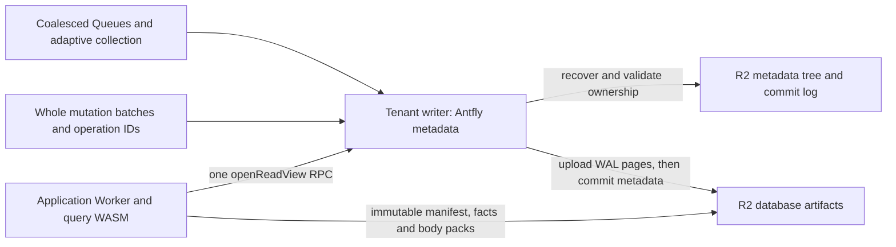
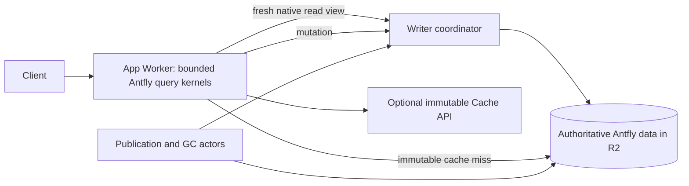

# Cloudflare object-native performance

This extends the [R2 backend design](antfly-object-storage-backend.md). It keeps
Antfly's immutable data and transactional coordination in R2 and uses Durable
Objects as warm writers. No application SQLite/KV path is added.

## Read path



`openReadView` reads the published HEAD, WAL HEAD and manifest GC floor from one
transactional metadata root. It observes or publishes a generation-shared pin
in that same transaction. The response supplies records in the existing object
ABI, so native session, visibility, checksum and lease validation still execute.

The Worker captures one view per query and uses its records for all metadata
reads in that operation. It does not reuse the view across HTTP requests.
A paginated query selects its pinned generation after native cursor validation;
the transport observes that generation's manifest request before opening the
view. The WAL cutoff remains subject to the native cursor/visibility contract.
A retired generation cannot acquire or extend protection.

Pins keep the existing ten-minute duration and five-minute reuse threshold.
Warm reads share the durable deadline instead of publishing another pin for
each query. The pin and floor test are atomic with respect to collection's
metadata changes. Native suspend-inclusive lease checks, request deadlines and
the collector's grace period still bound use of immutable objects.

## Warm state and parallel recovery

Each coordinator retains its owner/cursor, immutable byte cache and a decoded
KV cache of at most 256 entries and a 512 KiB encoding-based charge budget. Decoded values are associated with
the validated metadata revision. Known local commits update affected entries;
a recovered revision change invalidates them. Reads return owned copies and
failed callbacks cannot leak overlay changes into the cache.

A warm recovery step prefetches the checkpoint, epoch seal and next slot
concurrently. The checkpoint remains uncached. Prefetched negative results live
only for that single `begin` operation. A changed checkpoint can redirect
recovery to a different epoch. Append's before/after fencing checks use the
ordinary transport and never reuse the prefetch. Started reads are drained.
Recovery with takeover disabled rejects a different owner before returning a
bounded continuation. The adapter also retains whether its session has already
acquired ownership, so a long recovery cursor cannot turn a stale warm writer
into a new boot session. A 5,000-commit frozen-checkpoint regression exercises
both the native protocol and adapter.

The aggregate budget conservatively reserves two operations and 34 KiB for
prefetch work, including results which recovery does not consume.

The Worker additionally caches immutable, versioned manifests. Existing
content-addressed page/body caching stays bounded. Immutable model-profile
validation is reused for at most 64 namespace/storage/model identities.

## Whole mutations and group commits

The Worker submits a complete mutation operation to the tenant coordinator.
The coordinator runs the existing native mutation engine using a transaction-
local metadata transport. Native WAL pages and operation receipts are uploaded
before the enclosing Antfly metadata root is committed. HEAD conditions are
evaluated against the shared overlay; operation IDs preserve retry behavior.

Queued operations may share one durable metadata commit. Their callbacks run
in serial order and see preceding successful changes. Every accepted response
waits for the commit; a failed callback rolls back its overlay. A two-millisecond bounded admission window now combines up to sixteen callers
into one native WAL update (at most 1,024 records and 768 KiB of queued input;
a single previously admitted large caller runs alone). The native engine reads
receipts together, allocates a distinct LSN interval for each new operation,
applies the record changes once, applies sorted receipt changes once, and
conditionally writes WAL HEAD once. Replays retain their original intervals,
including duplicates inside a group. Conflicting IDs abort the native group
before any HEAD change; the adapter retries callers individually for input or
idempotency errors so one bad caller cannot reject unrelated writes. Transient
I/O, fencing and budget failures reject the group for normal caller retry,
without multiplying a failing operation into sixteen more attempts. Lost acknowledgements safely replay
through the same receipts. Queue byte/count admission is released before
resolving caller promises.

Worker HTTP admission is bounded to eight requests. Each coordinator admits at
most sixteen queued mutations and 4 MiB of serialized mutation input. Metadata
queues, byte/I/O budgets, native working memory and WASM recycling remain
bounded. Interactive callbacks are selected ahead of maintenance callbacks;
maintenance becomes equally eligible after five seconds. An executing callback
is not preempted, and a group stops admitting more callbacks after five seconds.

## Publication and collection scheduling

A mutation reserves publication admission in its own transaction. Other callers
reuse an active ticket. Queue send failure abandons that ticket conditionally;
a crash before admission is recovered through ticket expiry and cron.

Publication completion compares the published watermark with the current WAL
HEAD atomically. A concurrent write retains continuation work. Idle cron and
replayed, already-published receipts do not create redundant publication jobs.
Enrichment can explicitly request continuation without a new WAL watermark.

Metadata collection resumes active jobs. New scheduled passes require both
five minutes and 256 revisions of growth, or a one-hour maximum interval. A pass
with less than 1 MiB reclaimed and less than ten percent of scanned objects
deleted backs off to fifteen minutes and 1,024 revisions. Completion records
its revision to exclude its own progress writes from subsequent growth.
Explicit `collect_metadata` requests bypass the scheduling threshold.
Reclaimed-byte/object counters are persisted with normal collection progress.
The fresh R2 configuration enables bounded application collection every fifteen
minutes with `AUTO_GC`; qualification overrides this to measure stable workloads.

## Packed small document bodies

The R2 profile defaults `PACK_SMALL_BODIES` on. Up to eight small after-images
share an immutable `AFDBPAK1` object of at most 64 KiB. A pack holds typed
`AFDBODY1` envelopes. Facts retain each body's digest and add the containing
pack's digest, length and offset. Readers authenticate both the complete pack
and selected body. Reading the whole bounded pack lets nearby queries reuse
one cached object.

Legacy facts remain 80-byte records under `AFDFACT3` roots. Packed records are
120 bytes and upgrade the root to `AFDFACT4`/metadata version 4. A version-4
root can retain old standalone records. Metadata-only updates preserve body
and pack identities. Both native and hosted collectors mark the entire shared
pack, and removing one document cannot reclaim a pack used by another.

New readers accept versions 3 and 4. For an existing rolling deployment, first
deploy the new runtime with `PACK_SMALL_BODIES=false`, drain old query/build
executions, then enable packing. Disabling packing later stops new packs and
does not downgrade existing version-4 roots. Rollback must retain version-4
read/collection support. Older coordinator RPCs have explicit missing-method
fallbacks for snapshot reads, mutation execution and publication admission;
normal storage/fencing errors never select that fallback.

## Independent tenant domains

`ANTFLY_TENANTS` is an operator-configured JSON map:

```json
{"north":{"incarnation":"north-v1","storage_id":"north-store-v1"},"south":{"incarnation":"south-v1","storage_id":"south-store-v1"}}
```

Authenticated requests select a route with `X-Antfly-Tenant`. Each route has a
separate named Durable Object, metadata root, WAL namespace and visibility
scope. Both incarnation and storage-ID collisions are rejected. The coordinator
identifies its route by comparing its ID with the binding's `idFromName`
results; it does not rely on the transient ID `name` property. Queue messages
carry the route and incarnation, which are validated before dispatch. Cron
visits the default database and at most 32 configured routes.

`API_TOKEN` remains an operator credential. Tenant routing provides storage and
commit-domain separation; application end-user authorization must map an
identity to an allowed route before exposing this API. There are no atomic
transactions across domains. Configure tenant routes on a deployment running
the tenant-aware coordinator, using fresh tenant identities or explicit data
migration. Existing data is not repartitioned automatically.

## Measurement and validation

Logical WASM operations, actual R2 transport calls/payload bytes, aggregate R2
wait time, coordinator RPC wait, queue wait, begin/commit duration, decoded-cache
bytes and derived native CPU time are separate counters. `bucket_exists` is a binding
capability check and is excluded from physical R2 calls. `wait_ms` adds
individual waits; `wait_union_ms` measures their overlapping union. Neither
nested phase spans nor additive waits are end-to-end latency. Derived CPU time
is an estimate subject to host clock resolution/freezing; use platform CPU
observations independently. Admission bytes include conservative prefetch
reservations and are not network billing figures.

Reproduce live measurements with
`node qualification/performance.mjs RUN_JSON HTTPS_ORIGIN`, then replace the
coordinator namespace while preserving the logical incarnation/storage ID and
run it again with `--reopen`. The fixture validates 256 initial documents, 100
warm fenced point reads, eight concurrent writers and an exact final count of
264. It records whole-call latency including retries, attempts and Worker
versions. Cold recovery and maintenance interference must be measured separately.

The 100,000-record metadata fixture still passes a complete value scan after
three collection cycles and intermediate reopens. Native tests cover packed-
body integrity, mixed root formats, unchanged-body reuse and shared-pack GC.
Workerd covers erased platform storage, reindex, migration, tenant isolation
and concurrent whole-operation writes. The ANN routing recall limitation is
independent of these changes and remains documented in the native audit.


## Live fixture results (2026-10-24)

| Fixture | Samples | Median | p95 | p99 |
| --- | ---: | ---: | ---: | ---: |
| Warm, initial deployment | 100 | 124 ms | 386 ms | 499 ms |
| Warm after fresh coordinator namespace recovery | 100 | 132 ms | 350 ms | 593 ms |

Both runs had zero admission retries and checked every returned body, the
visibility fence, the original operation receipt and the final count of 264.
The eight-writer burst completed in 13.51 seconds including all acknowledgements.
Warm lookups used one coordinator snapshot RPC. The recovered measurement follows
32 warmup reads; it is not a measurement of cold-start latency.

The earlier three-sample fixture had a 7,524 ms median. The direction of the
improvement is clear, but different fixtures, deployment timing and the tiny
baseline prevent treating the ratio as a controlled production speedup. These figures predate the native multi-caller WAL update and optimistic
publication view described below; they remain a historical baseline.

The updated 100,000-record metadata run retained all 99,872 expected records
after three collections, with 1,232,862 native working bytes and 19,922,944 WASM
linear bytes at peak. Its largest reported aggregate request/group charge was
105 operations and 3,492,666 bytes, including conservative prefetch reservations.
Final collection sizes were 178,218,050, 173,316,778 and 172,971,760 bytes.
These are local fixture admission measurements, not total isolate memory or
live R2 throughput. The detailed deployment record is in
[Cloudflare qualification](cloudflare-qualification.md).


The disposable performance Worker, both Queues and bucket were removed after
both runs. Queue delivery was paused and its consumer explicitly removed before
storage drain and deletion. Tokens, full reports and telemetry remain under the
ignored qualification directory.


## Publication metadata view and conflict proof

Only R2 `publish` operations use the new operation-local metadata view. The opening RPC combines publication-budget admission with the small HEAD, WAL
HEAD, manifest retention floor, fencing floor and REINDEX records from one
native metadata revision. It also captures read pins and document offsets for the current and next
generations, so create-once offset checks do not need another metadata RPC. Later RPCs return the requested object and refresh this
bounded snapshot.
Subsequent reads of those records use the captured bytes and ETags. No view is
shared across native requests. Every subsequent RPC validates the ETags of
cached coordination records already consumed, including absent records. WAL
HEAD is an immutable prefix snapshot rather than a publication CAS dependency:
concurrent appends can advance it without invalidating the prefix being built.
The final publication scheduler still reads the current WAL watermark atomically
to retain continuation work. Every PUT performs
that validation and its ordinary conditional/guarded write in the same native
metadata transaction, then returns a fresh view. A changed dependency returns
PreconditionFailed; it never silently refreshes an already consumed version.
A missing RPC on an older coordinator falls back to ordinary objectCall;
other storage errors fail closed.

This preserves optimistic publication: a stale lease/HEAD can cause wasted
immutable uploads, but cannot publish over a different owner or generation.
The native lease clock, HEAD CAS, renewal, durable generation pins and collector
grace periods still govern visibility. Long artifact builds and R2 transfers
run in the application Worker, outside the interactive coordinator callback.
The coordinator holds its writer only during bounded metadata exchanges.
Artifact upload scopes and manifest stamps now obtain an upload identity from
the held native lease. While its expiry margin is sufficient, that operation
reuses the owner/token without writing HEAD again. It remains non-authoritative:
the final cutover still unconditionally renews through preparePublication and
then compares owner/token atomically with HEAD. Maintenance checkpoints renew
near expiry, and custom guards without the optional upload hook retain their
existing prepare behavior. A takeover may leave harmless immutable orphan
uploads but cannot publish through the old token. Native regression checks
sixteen identity requests without a HEAD change, then forces takeover and
rejects both preparation and direct stale-token CAS.

The view reduces repeated metadata reads; it does not eliminate the durable
lease/publication transitions or promise zero-conflict publication while the
WAL is changing continuously.

## Vector quality and qualification boundaries

Exact distances now break ties inside rounded integer score buckets in both
native ranking and bounded TopDocs selection. An optimistic integer-score
cutoff must be strictly below the current floor: equality can still contain a
better exact distance. Inner-product optimistic distances retain their sign.
Full effort bypasses both per-cluster and global quantized candidate caps and
approximate stopping. Paged routing reranks all members of each selected small
cluster; selecting fewer global routes remains approximate. Full-effort recall
is checked against brute-force cosine neighbors in the capacity benchmark.
The stored vector/index formats are unchanged and require no rebuild.

`qualification/mixed.mjs RUN_JSON HTTPS_ORIGIN` exercises four configured
tenants (512 actual 1-KiB-body documents each by default), concurrent reads and
writes, compaction interference, final visibility fences, body ownership and
exact counts. `--verify` reuses its receipts after redeployment without rewriting
the dataset. Environment variables ANTFLY_QUALIFICATION_TENANTS,
ANTFLY_QUALIFICATION_DOCUMENTS and ANTFLY_QUALIFICATION_ROUNDS scale the run.
`--scenario=mixed-final --reuse=mixed` repeats the mixed phase on the same
corpus with fresh write identities. Recovery also replays an original seed
receipt and the last write, checks payload bytes, and checks changed text.
`qualification/publication.mjs` separately measures a fresh 64-document default
namespace with queue delivery externally paused and verifies every body.
The first request has no benchmark warmup; a fresh deployment must be arranged
externally. A fresh HTTP connection cannot prove a cold isolate.

`qualification/summarize-metrics.mjs TAIL_JSONL OUTPUT_JSON` extracts only
performance counters from Wrangler tail. Transport counters now include per-op
GET/HEAD/PUT/LIST/DELETE attempts, including failures, below the immutable cache.
Coordinator counters are included separately from Worker data I/O so metadata
amplification is visible. Tail can sample/drop events and these counts cannot
be equated to an R2 invoice. Neither WASM linear memory nor Node/workerd process
RSS measures the total production isolate. The report explicitly leaves billed
cost and total-isolate memory unset when those measurements are unavailable.

## Final scale measurements (2026-10-24)

The implementation is in `c198355ec3` (grouped WAL, publication views and vector
ranking) and `ac239f1031` (reuse upload identities while preserving fenced
cutover). Final validation passed 542 native serverless tests, six expected
skips, the supporting native owner/tree/log suites, 74 Node tests and three
workerd recovery/migration/tenant tests, without failures or native leaks.

| Deployed fixture | Result |
| --- | --- |
| Eight concurrent one-document writers | 2.70 s to acknowledge all callers; every receipt replayed and every body checked |
| Controlled fresh 64-document publication | 13.99 s, one publication step, six metadata RPCs, four HEAD PUTs and one fencing-floor PUT |
| Four tenants, 512 documents each, final mixed writes | 32 samples: median 3.10 s, p95 4.64 s, no retries |
| Same run, concurrent fenced reads | 96 samples: median 3.98 s, p95 7.36 s; 644 admission retries |
| Same run, verification after convergence | 132 count/lookup calls: median 147 ms, p95 453 ms, no retries |
| Fresh coordinator namespace recovery, no warmups | Four first count requests: 3.40–4.80 s, each on the verified target Worker version, no retries |
| Verification following recovery | 132 count/lookup calls: median 159 ms, p95 430 ms, no retries |

The controlled publication ran on `d33bd385-daed-4de7-95bf-6c3851d1847b`, with
Queue delivery paused, cron disabled, a fresh default namespace, 64 actual
1-KiB-payload documents, and a 64-record publication budget. Every body, exact
count and operation receipt passed. Earlier publication samples used 28
metadata RPCs; intermediate views reduced that to eleven, while protocol
counters revealed nine HEAD PUTs. Upload identity reuse reduced those writes
to four. Different datasets and deployment conditions prevent treating the
13.51 s historical writer burst or earlier publication wall times as a
controlled speedup ratio.

The final mixed run used `a8ea2fe2-6d65-4fd8-b46c-5816baa3d8d7`, fresh update
identities on the existing 2,048-document corpus, eight rounds, 32 writes,
96 concurrent reads and eight overlapping compactions. It checked exact counts,
payloads and changed text after publication. The preceding run recorded a
17.73 s read p95 and 828 admission retries. Recurring cron admission was disabled
before the final phase; already queued maintenance was allowed to drain. This
is an exploratory repeated fixture, not a fixed-rate production load test.

Cold recovery used a new physical `ColdR2CommitCoordinator` namespace against
the same R2 storage IDs on `477ad06b-f2ff-435c-9e5d-98a1ef22f30d`. Queue delivery
was paused and cron disabled. An authenticated version-only probe neither
instantiates WASM nor addresses a Durable Object; `--expected-version` also
rejects data responses from older deployments. All four first requests matched
the target version on their first attempt. Both original seed receipts and
latest update receipts replayed unchanged, with all 512 documents per tenant
and updated bodies preserved. The version probe warms Worker routing/JavaScript;
these are cold native-runtime/coordinator recoveries, not proof of a cold
Cloudflare process or complete isolate startup latency. An earlier recovery pass hit an old Worker
version for one sample and is excluded from these cold results.

The final native WASM/R2-contract fixture ingested and queried 10,000 actual
documents with 384-dimensional vectors. Ten held-out queries matched brute-force
cosine top-ten neighbors at full effort: mean recall@10 was 1.00. Eight and
32 probes measured 0.22 and 0.79. Peak native working/linear memory during
publication was 4,086,747/16,252,928 bytes; the recall stage peaked at
945,363/5,636,096 bytes. These are native admission measurements in an in-process
object fixture, not production isolate memory.

The observed tail contained 4,734 events, five non-OK events and no flagged
truncated events. Instrumented transport attempts included 15,513 GETs,
3,650 PUTs and one LIST. These are sampled observations across several phases
and deployment versions, exclude uninstrumented bootstrap, collection-helper and cleanup work, and
must not be presented as billed totals. Reports and sealed bundle hashes remain
in the ignored qualification directory. The final quiescent drain removed
3,308 objects totaling 22,634,774 stored bytes. This is an end-of-test storage
footprint, not peak occupancy or billed GB-months.

### Capacity gates exposed by the preceding run

These observations motivated the runtime, commit and admission changes below.
The follow-up qualification records their measured benefits and remaining gaps.

The single foreground WASM lane per application isolate causes cross-tenant
admission contention while a request waits on R2. The final read p95 and retry
count remain too high to claim production throughput qualification, even though
all data and recovery checks passed. The next implementation should isolate
bounded reader/build runtimes by tenant or use a pool with explicit aggregate
memory admission, while retaining the separate interactive metadata writer.
Increasing global concurrency alone does not establish a safe memory bound.
Maintenance needs its own tenant fairness and continuation admission before a
long sustained soak can establish publication-lag and tail-latency targets.

Low-probe vector recall still needs distribution-specific routing work, such as
globally trained or hierarchical centroids. Full effort is a correct control
within admitted I/O budgets; it is not a scalable substitute for good routing.
Production sign-off also requires total-isolate memory evidence and account
billing/analytics attribution. WASM bytes, physical attempt counters and a final
storage footprint do not establish those two measurements.


After verification, delivery remained paused, the consumer was explicitly
removed, all storage was drained, and the disposable Worker, both Queues and
R2 bucket were deleted successfully. No test service remains deployed.


## Bounded tenant runtimes and prepared WAL commits

The R2 profile routes interactive operations to `R2ReadRuntime` objects named
by `(incarnation, slot)` and background steps to `R2BuildRuntime` objects named
by `(incarnation, 0)`. `READERS_PER_TENANT` defaults to two and admits one through
four logical reader slots. Each actor checks its own physical identity against
the deployment's tenant mapping and allows only its role's operations. Tenant
names in caller payloads cannot change the selected namespace. Durable state
continues to live in Antfly's R2 formats; these runtime actors use no platform
storage API.

An actor executes one step at a time and admits at most eight requests / 4 MiB
of encoded input, with a 1 MiB per-request limit. One module-wide 8 MiB input
reservation also covers pending WAL groups. Reader/build queues include waiting
time in their 30-second deadline; queued WAL groups carry their admission
deadline through preparation and conditional commit. The HTTP frontend admits
at most 16 requests when both actor bindings are configured. A busy or expired
request returns the existing retryable response rather than an unbounded queue.

Actors are logical isolation, not a guarantee of separate V8 heaps. Cloudflare
can colocate objects in a hosting isolate with a 128 MiB memory limit; its
[periodic memory metrics](https://developers.cloudflare.com/durable-objects/observability/metrics-and-analytics/)
measure the entire hosting isolate. Accordingly the kernel pools are module-wide:

| Pool | Slots | Maximum linear memory per slot | Purpose |
| --- | ---: | ---: | --- |
| Reader | 2 | 16 MiB | Queries; native live working set at most 8 MiB |
| Metadata | 1 | 16 MiB | R2 coordinator transactions and recovery |
| Build / WAL preparation | 1 | 32 MiB | Bounded publication, indexing, collection and WAL page construction |

The maximum declared linear allocation is 80 MiB even if several tenant objects
share the module. Slots install transport/inference capabilities per request;
they retain no request-owned RPC stub. The metadata pool is independent so a
suspended engine cannot consume every slot needed to finish its own metadata
RPC. Compact kernels recycle at 12 MiB and full kernels at 24 MiB. The two
precompiled WASM assets differ only in their declared memory maximum; Workers
do not dynamically compile or download executable code.

The immutable cache is shared and capped at 8 MiB. Decoded metadata rows use
eight store owners, each capped at 512 KiB of serialized-size accounting. This
4 MiB cache charge is an estimate, not a measurement of JS heap usage. Cache keys include the
namespace. Queued encoded inputs total at most 8 MiB. These accounting bounds do
not include every JS object, temporary serialization, transfer buffer or platform
allocation. Recycling releases instance references for garbage collection; the
80 MiB sum is a bound on retained pool instances, not a promise about transient
GC overlap. Actual memory samples and out-of-memory events remain rollout gates.

### Prepare data, then conditionally commit metadata

The writer captures an authenticated read view under the existing durable reader
pin, including the WAL HEAD ETag and manifest metadata. A `PreparedWal` adapter
serves only that captured metadata and stages only a small conditional WAL HEAD
write. Native indexed-WAL/receipt-tree construction uploads immutable pages to
R2 outside the authoritative writer transaction. Reads and other short metadata
callbacks can run while those uploads wait on storage.

After preparation, one writer transaction compares the original WAL HEAD ETag,
installs the new HEAD and reserves publication together. Concurrent publication
cannot mutate the captured manifest generation; its durable pin protects it.
A different WAL HEAD, including a collector's epoch rotation, invalidates the
preparation. The writer retries from a fresh snapshot up to three times within
one deadline and aggregate operation/transfer budget. Failed or ambiguous uploads
leave unreachable immutable pages for existing collection, never a visible
partial receipt. An accepted duplicate is still resolved through the native
receipt tree. Unknown metadata writes fail closed. The existing authority and
fence checks still run at the final transaction boundary.

### Background admission and tenant fairness

Queue delivery concurrency is four, allowing different tenant builders to
progress. A builder prefers publication/enrichment over young queued GC work;
work older than five seconds becomes equally eligible. Executing bounded steps
are not preempted. A shared kernel pool has a bounded FIFO queue across actors;
it does not promise a hard latency reservation or weighted scheduling.

Antfly metadata stores expiring tickets for data GC, metadata GC, compaction and
reindex. A repeated trigger coalesces with an active ticket. Continuations carry
a ticket identity and monotonic step; advancing once makes stale deliveries
ineligible to create more continuation work. Send failures abandon admission;
expiry permits repair of lost admission. Operation execution retains its native
idempotency and lease checks. Publication keeps its existing durable scheduler.
SQLite-to-R2 migration uses its own frozen-authority protocol and is deliberately
excluded from these new tickets. Repeated metadata-GC triggers resume the current
job instead of also executing its next step inline while a continuation exists.

Deploy every actor class and its bindings/migrations before enabling the new
routing. Both immutable module assets must ship together. The compatibility
profile and existing storage identities remain valid; switching logical runtime
names does not migrate data. Native format-2 vector writers require a coordinated
reader and collector upgrade, described below.


### Globally routed paged vectors

Dense paged roots can now use root format 2 while retaining the existing artifact
metadata version. The root adds an authenticated `global_centers` tree and uses
`postings` as an authenticated document-identity membership map. Sparse roots and
small dense roots retain format 1. Legacy format-1 dense roots remain readable;
new format-1 encodings omit absent optional fields so older readers do not see
an unknown null field.

A new or small growing dense root trains at a dimension-dependent bootstrap
threshold: the largest power of two no greater than 2,048 entries and 4 MiB of
raw projection data, with a minimum of 256 samples. The ordered hash-key sample
feeds the existing native clustering implementation to produce up to 64 global
coarse centers. Training and initial rerouting admit only the threshold through
threshold + 256 entries, still within the raw-byte cap. Larger legacy roots are
left unchanged; use a bounded rebuild into a fresh root rather than migrating
an unbounded archive inside a publication step.

The centers are immutable for that root lineage. Each projection routes to its
nearest center; a routed key combines the center ID, the document's remaining
hash bits and its projection ordinal. Each coarse cell initially owns an
explicit directory shard. A cell can split further within the existing shard
byte/entry limits, and bounded native local clustering supplies leaf payloads.
This gives subsequent writes a stable global partition without retraining the
entire collection or moving untouched cells.

A separate document-hash membership entry records every routed cell for a
multi-projection document. An update removes all prior memberships before adding
the current projections; a delete removes the whole set. Old immutable roots
retain the previous memberships and vectors. Collection traverses the new
centers and identity-map roots alongside documents, directories, routing leaves
and their native payloads. The regression test covers cell moves,
multi-projection replacement/deletion, old-root reads and the new GC root.

Queries rank local routing centroids and visit the nearest coarse cell first.
Cosine route ordering incorporates each cluster's measured mean alignment and
estimated residual spread as a ranking heuristic; it is never a safe exact-prune
bound. Format-2 queries add a 25% route margin to the existing adaptive probe
hint, capped by the available routes. The margin spends extra reads to cover
coarse-cell boundaries; equal requested probe hints do not imply equal I/O with
format 1. Full effort visits all local routes and retains the independently
asserted exact-search control. All paths retain request I/O and working-memory
caps.

This is an incremental global partition, not an automatic distribution-drift
solution. Training is bounded and frozen, and queries still load local routing
centroids. A large changing corpus can require a fresh bounded rebuild, better
training samples or a deeper routing directory to satisfy its recall/I/O target.
Keep paged projections opt-in and qualify real embeddings. Deploy format-2
readers and collectors everywhere before allowing writers to create these roots;
a rollback must retain those readers until a deliberate compatible rebuild.


### Recovery checkpoints after idle

The R2 adapter keeps the native 64-commit inline checkpoint cadence and also
coalesces a recovery hint after at least eight new metadata revisions and a
250 ms idle interval. The idle task rechecks foreground admission before joining
the metadata queue at maintenance priority. It skips busy work, retries a
throttled hint once after 1.1 seconds, and never changes an acknowledged mutation
into a failure. [Durable Object background lifetime](https://developers.cloudflare.com/durable-objects/api/state/)
is retained through `ctx.waitUntil`; the task stores no platform state.

The immutable slot remains the commit point, conditional checkpoint updates
remain monotonic, and the one-second overwrite throttle still applies. Interrupted
or skipped idle work leaves the original safe recovery path. Eight revisions is
an eligibility threshold, not a hard recovery-read or latency bound. Continuous
load or a crash can still expose the longer tail. The native coordinate request
also admits inline power-of-two cadences from eight through 64; generic callers
retain 64. The live inline-eight experiment increased write latency, so the
production R2 profile uses idle hints instead of requiring that work before ACK.

The longer-soak recovery exposed 10–35 second first requests. Native regressions
prove that a shorter checkpoint tail works and throttled hints cannot replace a
durable commit. The final idle policy also has coalescing, foreground-deferral
and bounded-retry tests. Live results and the observed extra write/maintenance
work are recorded in the [qualification report](cloudflare-qualification.md).

The earlier policy opened publication work leases and runtime snapshots only
after admission to a physical kernel slot. The next candidate retains that
boundary for short work leases, while preparing protected read views before
WASM admission under their original grace deadline; see the
[acceptance design](cloudflare-gates.md). Acquiring a lease while queued behind another tenant
consumed its lifetime before execution and caused observed `Canceled` /
`WorkLeaseLost` deferrals. Expired pending kernel jobs now reject and leave the
queue without opening a lease; native in-flight cancellation and fencing remain
unchanged.


The final version-verified mixed run measured read median/p95 0.82/6.31 s and
write median/p95 4.18/8.00 s, with no admission retries. Compaction p95 was
12.57 s with no retries, compared with 39.18 s and 27 retries in the inline-eight
experiment. Fresh-runtime first counts measured 8.10–14.09 s, without retries;
all receipt/body checks passed. The [qualification report](cloudflare-qualification.md)
records corpus, phases, versions and limits. These samples do not establish
production tail-latency targets, and write/cold latency remain explicit gates.


## Split services and bounded critical paths

The next performance profile separates `app-worker.mjs`, `writer-worker.mjs`,
`reader-worker.mjs` and `builder-worker.mjs`. Remote Durable Object bindings retain
one fenced writer per storage identity; reader and builder queues no longer
consume the writer's admitted WASM slots. The app has no native slots. The writer
has two 16 MiB metadata slots and one 32 MiB WAL-preparation slot (64 MiB maximum);
readers have two 16 MiB slots, and builders one 32 MiB slot. These are WASM limits
per hosting isolate, excluding JavaScript and platform allocations. Separate
[Worker services](https://developers.cloudflare.com/workers/runtime-apis/bindings/service-bindings/)
provide independent runtime ownership and admission, but do not promise execution
on different CPU threads. The platform's
[128 MB isolate limit](https://developers.cloudflare.com/workers/platform/limits/)
still applies. Private services expose no public application endpoint.

Deploy the split writer, reader, builder, then app configs. All services must
share bucket, logical incarnation, tenant storage identities and compatible
native modules. The supplied split profile uses a fresh bucket/Queue/namespace.
Moving an existing authority requires a quiescent, fenced cutover and retained
compatible readers/collectors; changing a script binding alone is not migration.
`SPLIT_RUNTIME=true` fails closed if an expected remote runtime is unavailable.
Only the builder owns scheduled maintenance and the Queue consumer.

`LOG_METRICS=true` emits bounded `antfly.trace` spans with a shared trace ID for
HTTP dispatch, actor/kernel admission, instantiation, metadata recovery, WAL
preparation/commit, coordinator RPC and Queue delivery. Grouped commits list
participating caller IDs; publication IDs join asynchronous outbox work.
Offsets are local monotonic clocks. Never subtract offsets across isolates or
sum nested/overlapping spans as independent elapsed time. Physical storage
metrics include overlap-aware wait time, I/O waves and peak concurrency;
additive wait time remains available for comparison. Traces contain no bodies
or credentials and retain at most 128 spans per report.

### Native WAL head and durable outbox

`commit_wal` verifies the current WAL-head etag, active migration authority and
publication watermark in the native ordered metadata engine. It appends the
new head and publication reservation in one immutable commit frame. This is
the same fenced, conditional-create commit point; immutable document/WAL data
uploads still precede it. Generic transactions and fast commits share one bounded
coordinator admission queue, with fast commits acting as transaction barriers.
Replays without a new head retain the existing generic path.

Coordinator root format 2 inlines the WAL head and publication scheduler row,
while retaining the ordered-tree reference for all other metadata. Hot updates
therefore avoid rewriting a metadata page. UTF-8 WAL-head bytes use a compact
string encoding within the opaque root; generic reads restore the logical byte
record. Root/frame size limits remain unchanged. Readers, ordered listings and
both collectors understand this root. Old tree-reference roots remain readable.
Deploy all compatible metadata readers/collectors before enabling the fast path.
`NATIVE_WAL_COMMIT=false` disables new fast commits but does not convert existing
format-2 roots back to a legacy format; rollback must preserve compatible code.

After the commit reserves the durable outbox, HTTP mutation ACK does not await
Queue delivery when `ctx.waitUntil` is available. A send failure leaves repairable
durable work; scheduled publication repair must remain enabled. For this path,
`maintenance_pending` describes missing Queue configuration, not confirmation of
delivery. Callers needing publication completion must use the publication
watermark, rather than this scheduling hint.

### Bounded parallel recovery and immutable reader reuse

Cold metadata recovery speculates eight immutable frames at a time (maximum
configurable window 16), within the existing operation/byte budget. It checks a
fresh seal at each window boundary and at the first hole, invalid frame or error.
Only a contiguous matching epoch/owner/revision chain can cover intermediate
negative seal probes; native recovery still validates every frame. No negative
observations survive a recovery request or enter append/fencing checks. A window
of zero disables speculation for comparisons. This reduces sequential waits,
not the number of required durable state transitions; sparse tails can spend
extra speculative GETs. Idle checkpoints retain their existing policy.

Each native query host can retain two decoded immutable manifests in fixed
256 KiB buffers (512 KiB maximum). Sessions receive owned clones, keyed by
namespace and generation. Every open still checks the fresh retirement floor
and follows the normal pin/lease/frontier protocol; neither metadata RPCs nor
live WAL heads are cached. Oversized entries skip admission. Cache bytes and
per-request hit deltas are observable, and stay inside the host's WASM maximum.

### Explicit coarse-cell ANN budget

`coarse_probes` (deployment default `ANN_COARSE_PROBES=0`) can limit a format-2
dense query to the nearest coarse cells before loading local routing centroids.
Disjoint prefix cursors share the authenticated page cache. Zero keeps the
existing all-cell route selection, and `search_effort: 1` always visits all cells.
Values above 64 are rejected. This is approximate selection, not an exact-pruning
bound. It can reduce directory I/O while excluding true neighbors; qualify recall
against physical GET/byte budgets on representative embeddings before enabling
it. No new dense artifact format or automatic default change is introduced.

The controlled recovery/commit comparison and ANN quality tradeoff are recorded
in the [qualification report](cloudflare-qualification.md). These implementation
changes do not close the live tail-latency or sustained multi-region gates.


## Publication and foreground acceptance work

The next candidate adds atomic native publication sessions, pure committed-prefix
read observers, bounded fresh read cohorts, foreground-aware kernel admission,
adaptive publication prefixes and compaction preflight for fully paged roots.
These address serial metadata commits and maintenance queueing identified above.
The [acceptance design](cloudflare-gates.md) specifies protocol invariants, exact
thresholds, workload, evidence requirements, execution tools and scope limits.
Implementation and local correctness checks do not establish a live gate pass.


## Shared native exact-scan I/O

The FP32 continuation path uses Antfly's existing ordered-page engine and
`ArtifactStore`, not a separate R2 database. Native serverless already supplied
immutable packed locators, sorted builders, batched page reads, authenticated
cache fills and publication fences. The missing connection was that incremental
vector publication wrote individual pages and the exact cursor fetched one leaf
at a time. The WASM adapter also could not expose batched reads without a native
threaded I/O runtime. These are shared engine integration gaps; R2 makes their
physical request cost visible but does not define their solution.

Vector publication now opts into the existing packed-page capability. Initial
builds use the existing streaming sorted builder. Incremental mutations keep the
balanced copy-on-write updater and capture at most 64 new pages / 2 MiB of encoded
bytes. Only reachable new leaves are packed, in logical order, in waves of at most
eight. Parents are serialized after child locators have been finalized. Capture
overflow falls back to ordinary writes; branches without safe locator headroom
also fall back before packing. The manifest remains the sole visibility boundary.
Unchanged subtrees retain their references and prior snapshots remain readable.
This preserves occupancy under small random batches without a full-tree repack.

The shared page-store coalescer is available without threads. It merges only
adjacent or overlapping requested ranges of the same immutable artifact and
attempt, with no gap overfetch and at most one page-size bound per physical read.
Every logical page still passes its digest, domain, reference and structure
checks. Native publication retains its existing bounded parallel phase scheduler;
WASM uses serial coalesced ranges through its existing host adapter.

The exact cursor resumes by authenticated rank and checks that every new key is
strictly beyond the prior exclusive key. Optional forward read-ahead admits at
most eight complete sibling leaves / 128 KiB, constrained by the remaining record
and byte allowances. A seek invalidates prefetched pages; cancellation is checked
even when a page is already available. The request-local decoded cache remains
512 KiB. Native sessions additionally reuse their existing immutable block cache:
misses are claimed together, duplicate identities share a claim, failed fills
are released, and bytes become visible only after all fetched pages validate.
The WASM host retains its existing bounded immutable cache.

Legacy standalone and packed roots use the same format and reader. Packing takes
effect as pages are rewritten; it does not migrate a complete cold tree during a
query. Existing checkpointed index rebuilding can rewrite a legacy index under
normal maintenance admission. Incremental packing does not promise globally
contiguous packs after random updates; a dedicated streaming repack remains a
separate maintenance optimization. The existing request budgets, continuation
lifetimes, FP32 ranking and collection protocol are unchanged. Exact search still costs O(N*d), and
physical request reduction does not by itself establish the paired live gate.


The subsequent [shared vector-block design](cloudflare-vector-blocks.md) replaces
repeated base rewrites with bounded sorted runs and checkpointed residual repacks,
and adds certified deferred refinement. Its qualification must account for the
complete read, publication and maintenance costs against unchanged controls.


## Confirmed publication bytes in fresh read views

After publication, the writer may retain up to eight confirmed immutable objects
under an 8 KiB charged budget, included within its existing 512 KiB metadata-row
cache. Capture accepts only successful full reads and create-only writes. The
newest manifest and facts root take priority over small copy-on-write pages.
Mutable HEADs, negative results, conditional overwrites and ambiguous uploads
never enter this cache. Keys, ETags and JavaScript record overhead count toward
the budget. Eviction removes hints along with their metadata store.

A fresh native committed-prefix observation still authenticates each read view,
including its generation, retirement floor and pin. Only hints bound to that
generation accompany the view. Readers validate their scope and size and use
them for conditional or ranged immutable reads during the existing 30-second
view lifetime. Native digest and structure checks remain in force. Missing or
invalid hints use ordinary R2 reads; hints never replace mutable authority.
Physical telemetry records `snapshot_immutable_reads` separately from metadata
snapshot reads and actual R2 calls. This removes repeated small immutable GETs
without another publication-time fetch or a stale frontier cache.

Pool recycling now depends on the selected kernel: full writer/builder kernels
recycle at 24 MiB, compact kernels at 12 MiB, and 8 MiB observation kernels at
7 MiB. Previously a threshold above a variant's maximum could prevent its
recycling. These are retention thresholds within the existing hard reservations;
no worker memory or request budget increases. Accepted results survive recycling.


## Regional compute placement and bounded error diagnostics

`RUNTIME_GENERATION` optionally names a compute generation separately from
`ANTFLY_INCARNATION` and `COORDINATOR_STORAGE_ID`. With the R2 backend, setting
`R2_LOCATION_HINT=wnam` and `RUNTIME_GENERATION=regional-1` applies that hint to
writer, reader and builder actor creation. A versioned tuple derives physical
names from the generation, hint and logical actor name. All roles must receive
the same policy. Existing configurations retain their original physical names.
Invalid policies fail closed; SQLite migration source bindings are unchanged.

This is an operator-directed compute rollover, not a data migration. The R2
authority, collection namespace, WAL, receipts, leases and deletion intents keep
their original identities. Fresh owners must recover through native fencing;
old owners remain fenced after takeover. Roll out while clients are quiescent,
then verify receipt replay and exact counts before offering traffic. Changing a
location hint also changes physical names, so it cannot silently keep using an
actor created under an earlier placement policy. Qualification epochs compose
inside the same compute-generation mapping and remain distinct physical actors.

Cloudflare applies location hints only when an object is first created and does
not guarantee the requested placement. Choose a hint from the actual R2 bucket
location and qualify the resulting path; the application does not infer a region
from a user-controlled request. See [Cloudflare data location](https://developers.cloudflare.com/durable-objects/reference/data-location/).

Critical-path traces retain at most eight error observations with the platform's
boolean `retryable`, `overloaded` and `remote` flags, an internal-error reference
and recognized resource-limit category. They exclude arbitrary error text,
headers and request bodies. A remote error alone is not classified as memory
exhaustion, and diagnostics do not change retries or accepted write outcomes.
Cloudflare's [error handling guidance](https://developers.cloudflare.com/durable-objects/best-practices/error-handling/)
requires distinguishing overload from retryable idempotent operations and
recreating a broken stub; an opaque internal error is not blindly replayed.


## Originating request contexts and authority admission

A module-level pool may share a memory ledger across colocated Durable Objects,
but its scheduler must not execute a queued callback in the context of the actor
that released a slot. Admission now resolves a slot promise; a continuation
registered by the submitting request performs the native call, creates its timers
and starts transport I/O. The memory reservation remains held from admission
until execution finishes. A regression reproduces the previous behavior with
async-local contexts, and a persisted Worker check verifies context labels across
queued calls and actual R2 I/O in three Durable Objects.

The WASM host keeps its clock high-water mark across uses. If a new request
observes an older timestamp, it performs one timer I/O refresh before entering
native code. It never clamps time, resets the high-water mark or extends a
lease. A regression remaining after fresh I/O still invalidates the host and
fails closed. Telemetry records the refresh count and observed regression in
milliseconds. See [Cloudflare timers](https://developers.cloudflare.com/workers/runtime-apis/performance/)
for the platform's I/O-dependent clock behavior. Expired read leases return
retryable admission failure, so callers can reacquire rights on fresh compute;
this does not replay an operation, suppress resource errors or remove retry time
from qualification latency. Corruption and opaque platform failures retain
their existing failure behavior.

R2 authority initialization no longer performs remote I/O inside
`blockConcurrencyWhile` in the coordinator constructor. The first operation
authenticates the same namespace/storage descriptor before native access.
Authority admission permits one in-flight load and at most 64 waiters, each
bounded to five seconds. Expired waiters are detached from a bounded set, rather
than adding permanent reactions to a never-settling shared promise. Late validated
success serves subsequent callers; failure permits a new load. No timeout starts
another load while the original is pending. A suspended-authority Worker fixture
proves control RPCs can still release initialization.

Optional local read observers use the same bounded admission while preserving
`allowCreate:false`. Missing or temporarily unavailable local authority may fall
back to the separately authenticated writer; invalid authority, migration state,
corruption and fencing still fail closed. A cached pre-cutover SQLite descriptor
is discarded before another observation. The R2 storage identity, native owner
fences, receipt semantics and all existing memory limits remain unchanged.


## Durable generation-bound hints for local readers

Publication now stores confirmed immutable hints under the reserved metadata key
`__antfly_read_hints/<namespace>` in the same native metadata commit as HEAD.
The stored format uses canonical base64 rather than the adapter's general byte
array encoding, with a 16 KiB encoded-value limit inside the existing 32 KiB
metadata-value limit. Decoded hints retain the existing eight-record / 8 KiB
charged budget. Invalid input removes the previous hint record atomically.
The reserved key keeps this auxiliary value outside object-shaped progress keys.

Fresh read views load hints from their authenticated committed revision and
include them only when their generation matches the selected manifest. Thus
new actors and optional local native observers recover the same small immutable
objects without a writer RPC or a process-local cache hit. Generation pins,
retirement floors, native artifact digests, scope checks and deadlines still
govern every read. Hints are not an authority cache or an extra GC root.

WAL preparation requests a metadata-only view and publication pin capture omits
hints, avoiding payload reads and copies on those paths. Metadata-only and full
read admissions use distinct cohort keys. Older publishers and missing hints
fall back to ordinary immutable reads. Prepared and legacy HEAD publication both
commit the optional hint record atomically; rollback and fresh physical actor
recovery are exercised by native-store and persisted Worker fixtures.


## Optional reads in the app Worker

`DIRECT_READS=true` in the split R2 profile executes HTTP reads in the app Worker
and removes the app-to-reader-actor hop. Mutations, publication and collection
keep their existing writer/build actors. The app still obtains a fresh native
read view from the coordinator before acquiring a query kernel; this mode
requires `LOCAL_METADATA_READS=false`. It does not cache mutable heads or reuse
a read view across requests. Existing exact-scan cursors, visibility fences,
read pins and retirement checks pass through the same native engine.

The app upgrades its unused zero-slot profile once to a 32 MiB weighted reader
pool. General compact queries reserve 16 MiB each, admitting at most two such
queries. Bounded point reads reserve eight MiB each, admitting at most four.
Mixed reservations and retained idle instances remain within 32 MiB. The existing ingress/input budgets
remain, with an additional 32 KiB charge per admitted read view. A single
30-second read signal retains the original deadline through metadata waiting,
kernel queueing and exact-scan steps within the HTTP operation. Provider I/O may
finish after cancellation; an expired signal prevents subsequent kernel
admission. Background entrypoints retain their existing
actor routing. The feature defaults off and its selection is sealed in gate
provenance. Coordinator read-view cohorts can use the existing bounded
`READ_VIEW_BATCH_MS` setting (up to 10 ms), which is also sealed.



Reserved cold epochs still create fresh physical coordinator actors and recover
the same R2 metadata. App Worker isolate eviction is not forced by those epochs,
as with the existing shared-kernel limitation. The local integration additionally
restarts all isolates, erases platform storage and disables edge caching before
checking tenant data and replaying receipts from R2. It uses a reader actor that
throws on execution, proving that HTTP queries use the app path.


Read-view cohorts now remain eligible for joining while their native observation
is queued. They close at kernel admission, with an additional close hook before
transport I/O for hosts without pool-stage callbacks. Thus every member arrived
before the fresh observation began; a completed view is never reused for a later
request. Failure and writer-transaction fallback close the cohort first. An old
completion cannot remove a newer cohort with the same version key.

Across an isolate, at most 64 read callers and 16 mutation-metadata callers may
wait for these views, with at most 64 members per cohort. The valid view's
32 KiB reservation bounds caller copies to 2.5 MiB. Mutation metadata uses a
separate admission allowance and commit priority in the observation pool, so
read demand cannot consume its caller allowance. Kernel reservations and native
working budgets remain unchanged.
### Bounded point-read capacity

The optional direct app reader uses the eight-MiB module for point lookups with
an already admitted read view. Four such kernels fit within the existing 32 MiB
app pool; the reservation covers each module's hard memory maximum, including
idle retained instances. General readers still reserve 16 MiB. Search, cursors
and background work retain their existing modules and budgets.

The small lane limits native live allocations to 128 KiB, each completed object
to 128 KiB and cumulative completed object bytes to 512 KiB before Asyncify
copies completions into WASM. It permits only reads and bucket-existence probes.
An explicit lane capacity failure releases that kernel and promotes the lookup
to the general lane using the original admitted snapshot, input and request
cancellation deadline. Configured smaller budgets remain smaller. OOM, traps,
integrity failures and transport failures never trigger promotion. Promotion can
repeat immutable GETs for larger documents; it does not alter ANN query budgets.
This capacity tier needs live qualification; local concurrency and large-body
recovery are not a latency-gate pass.

## Native metadata observations in the direct app

`DIRECT_READS=true` with `LOCAL_METADATA_READS=true` also runs the existing
committed, read-only metadata observation in the app Worker. A fresh native
observation still authenticates the R2 checkpoint, committed prefix, migration
state, heads, floor and durable pin before returning a view. Admission falls
back to the coordinator for missing authority, recovery or a pin needing
extension. Integrity, migration and transport faults retain their existing
fail-closed behavior. No completed view is reused between HTTP requests.

At most eight observer stores are retained, keyed by exact bucket-binding and
namespace/storage/configuration identity. Busy stores are not evicted; capacity
exhaustion uses coordinator admission. The cache retains only observer state and
binding handles, not API credentials or HTTP contexts. Metadata observations and
small point reads share the same hard-capped eight-MiB module and the app's
existing 32 MiB weighted pool. General queries retain their 16 MiB reservations.
No host slot is held across a recursive metadata-kernel acquisition.

Qualification tags physical epochs explicitly. Epochs 1–100 bypass app-local
metadata and call the selected fresh coordinator actor. Persisted tests block
warm coordinator read RPCs to prove the native path is used, then require a
positive admission count on a cold physical actor and unchanged local-admission
counters. They also preserve tenant isolation, fencing, restart with erased
platform storage and disabled edge caching. Local checks do not qualify live
latency; the native app profile still needs its own sealed live trials.
