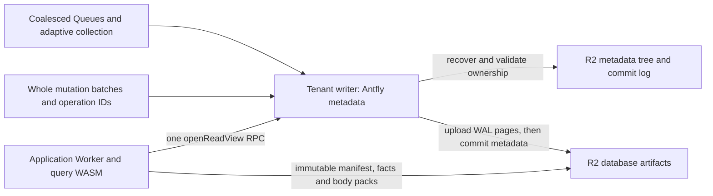

# Cloudflare object-native performance

This extends the [R2 backend design](antfly-object-storage-backend.md). It keeps
Antfly's immutable data and transactional coordination in R2 and uses Durable
Objects as warm writers. No application SQLite/KV path is added.

## Read path



`openReadView` reads the published HEAD, WAL HEAD and manifest GC floor from one
transactional metadata root. It observes or publishes a generation-shared pin
in that same transaction. The response supplies records in the existing object
ABI, so native session, visibility, checksum and lease validation still execute.

The Worker captures one view per query and uses its records for all metadata
reads in that operation. It does not reuse the view across HTTP requests.
A paginated query selects its pinned generation after native cursor validation;
the transport observes that generation's manifest request before opening the
view. The WAL cutoff remains subject to the native cursor/visibility contract.
A retired generation cannot acquire or extend protection.

Pins keep the existing ten-minute duration and five-minute reuse threshold.
Warm reads share the durable deadline instead of publishing another pin for
each query. The pin and floor test are atomic with respect to collection's
metadata changes. Native suspend-inclusive lease checks, request deadlines and
the collector's grace period still bound use of immutable objects.

## Warm state and parallel recovery

Each coordinator retains its owner/cursor, immutable byte cache and a decoded
KV cache of at most 256 entries and a 512 KiB encoding-based charge budget. Decoded values are associated with
the validated metadata revision. Known local commits update affected entries;
a recovered revision change invalidates them. Reads return owned copies and
failed callbacks cannot leak overlay changes into the cache.

A warm recovery step prefetches the checkpoint, epoch seal and next slot
concurrently. The checkpoint remains uncached. Prefetched negative results live
only for that single `begin` operation. A changed checkpoint can redirect
recovery to a different epoch. Append's before/after fencing checks use the
ordinary transport and never reuse the prefetch. Started reads are drained.
Recovery with takeover disabled rejects a different owner before returning a
bounded continuation. The adapter also retains whether its session has already
acquired ownership, so a long recovery cursor cannot turn a stale warm writer
into a new boot session. A 5,000-commit frozen-checkpoint regression exercises
both the native protocol and adapter.

The aggregate budget conservatively reserves two operations and 34 KiB for
prefetch work, including results which recovery does not consume.

The Worker additionally caches immutable, versioned manifests. Existing
content-addressed page/body caching stays bounded. Immutable model-profile
validation is reused for at most 64 namespace/storage/model identities.

## Whole mutations and group commits

The Worker submits a complete mutation operation to the tenant coordinator.
The coordinator runs the existing native mutation engine using a transaction-
local metadata transport. Native WAL pages and operation receipts are uploaded
before the enclosing Antfly metadata root is committed. HEAD conditions are
evaluated against the shared overlay; operation IDs preserve retry behavior.

Queued operations may share one durable metadata commit. Their callbacks run
in serial order and see preceding successful changes. Every accepted response
waits for the commit; a failed callback rolls back its overlay. The existing
native engine still constructs WAL updates per operation. This is not a claim
that all callers' WAL trees are rebuilt in one combined native update.

Worker HTTP admission is bounded to eight requests. Each coordinator admits at
most sixteen queued mutations and 4 MiB of serialized mutation input. Metadata
queues, byte/I/O budgets, native working memory and WASM recycling remain
bounded. Interactive callbacks are selected ahead of maintenance callbacks;
maintenance becomes equally eligible after five seconds. An executing callback
is not preempted, and a group stops admitting more callbacks after five seconds.

## Publication and collection scheduling

A mutation reserves publication admission in its own transaction. Other callers
reuse an active ticket. Queue send failure abandons that ticket conditionally;
a crash before admission is recovered through ticket expiry and cron.

Publication completion compares the published watermark with the current WAL
HEAD atomically. A concurrent write retains continuation work. Idle cron and
replayed, already-published receipts do not create redundant publication jobs.
Enrichment can explicitly request continuation without a new WAL watermark.

Metadata collection resumes active jobs. New scheduled passes require both
five minutes and 256 revisions of growth, or a one-hour maximum interval. A pass
with less than 1 MiB reclaimed and less than ten percent of scanned objects
deleted backs off to fifteen minutes and 1,024 revisions. Completion records
its revision to exclude its own progress writes from subsequent growth.
Explicit `collect_metadata` requests bypass the scheduling threshold.
Reclaimed-byte/object counters are persisted with normal collection progress.
The fresh R2 configuration enables bounded application collection every fifteen
minutes with `AUTO_GC`; qualification overrides this to measure stable workloads.

## Packed small document bodies

The R2 profile defaults `PACK_SMALL_BODIES` on. Up to eight small after-images
share an immutable `AFDBPAK1` object of at most 64 KiB. A pack holds typed
`AFDBODY1` envelopes. Facts retain each body's digest and add the containing
pack's digest, length and offset. Readers authenticate both the complete pack
and selected body. Reading the whole bounded pack lets nearby queries reuse
one cached object.

Legacy facts remain 80-byte records under `AFDFACT3` roots. Packed records are
120 bytes and upgrade the root to `AFDFACT4`/metadata version 4. A version-4
root can retain old standalone records. Metadata-only updates preserve body
and pack identities. Both native and hosted collectors mark the entire shared
pack, and removing one document cannot reclaim a pack used by another.

New readers accept versions 3 and 4. For an existing rolling deployment, first
deploy the new runtime with `PACK_SMALL_BODIES=false`, drain old query/build
executions, then enable packing. Disabling packing later stops new packs and
does not downgrade existing version-4 roots. Rollback must retain version-4
read/collection support. Older coordinator RPCs have explicit missing-method
fallbacks for snapshot reads, mutation execution and publication admission;
normal storage/fencing errors never select that fallback.

## Independent tenant domains

`ANTFLY_TENANTS` is an operator-configured JSON map:

```json
{"north":{"incarnation":"north-v1","storage_id":"north-store-v1"},"south":{"incarnation":"south-v1","storage_id":"south-store-v1"}}
```

Authenticated requests select a route with `X-Antfly-Tenant`. Each route has a
separate named Durable Object, metadata root, WAL namespace and visibility
scope. Both incarnation and storage-ID collisions are rejected. The coordinator
identifies its route by comparing its ID with the binding's `idFromName`
results; it does not rely on the transient ID `name` property. Queue messages
carry the route and incarnation, which are validated before dispatch. Cron
visits the default database and at most 32 configured routes.

`API_TOKEN` remains an operator credential. Tenant routing provides storage and
commit-domain separation; application end-user authorization must map an
identity to an allowed route before exposing this API. There are no atomic
transactions across domains. Configure tenant routes on a deployment running
the tenant-aware coordinator, using fresh tenant identities or explicit data
migration. Existing data is not repartitioned automatically.

## Measurement and validation

Logical WASM operations, actual R2 transport calls/payload bytes, aggregate R2
wait time, coordinator RPC wait, queue wait, begin/commit duration, decoded-cache
bytes and derived native CPU time are separate counters. `bucket_exists` is a binding
capability check and is excluded from physical R2 calls. Parallel wait times
are additive spans, not end-to-end latency. Admission bytes include conservative
prefetch reservations and are not network billing figures.

Reproduce live measurements with
`node qualification/performance.mjs RUN_JSON HTTPS_ORIGIN`, then replace the
coordinator namespace while preserving the logical incarnation/storage ID and
run it again with `--reopen`. The fixture validates 256 initial documents, 100
warm fenced point reads, eight concurrent writers and an exact final count of
264. It records whole-call latency including retries, attempts and Worker
versions. Cold recovery and maintenance interference must be measured separately.

The 100,000-record metadata fixture still passes a complete value scan after
three collection cycles and intermediate reopens. Native tests cover packed-
body integrity, mixed root formats, unchanged-body reuse and shared-pack GC.
Workerd covers erased platform storage, reindex, migration, tenant isolation
and concurrent whole-operation writes. The ANN routing recall limitation is
independent of these changes and remains documented in the native audit.


## Live fixture results (2026-10-24)

| Fixture | Samples | Median | p95 | p99 |
| --- | ---: | ---: | ---: | ---: |
| Warm, initial deployment | 100 | 124 ms | 386 ms | 499 ms |
| Warm after fresh coordinator namespace recovery | 100 | 132 ms | 350 ms | 593 ms |

Both runs had zero admission retries and checked every returned body, the
visibility fence, the original operation receipt and the final count of 264.
The eight-writer burst completed in 13.51 seconds including all acknowledgements.
Warm lookups used one coordinator snapshot RPC. The recovered measurement follows
32 warmup reads; it is not a measurement of cold-start latency.

The earlier three-sample fixture had a 7,524 ms median. The direction of the
improvement is clear, but different fixtures, deployment timing and the tiny
baseline prevent treating the ratio as a controlled production speedup. The
write path still serializes native WAL construction across callers, and
publication still performs multiple coordination exchanges. Those remain
measured latency limits; native CPU or a larger cache alone will not remove them.

The updated 100,000-record metadata run retained all 99,872 expected records
after three collections, with 1,232,862 native working bytes and 19,922,944 WASM
linear bytes at peak. Its largest reported aggregate request/group charge was
105 operations and 3,492,666 bytes, including conservative prefetch reservations.
Final collection sizes were 178,218,050, 173,316,778 and 172,971,760 bytes.
These are local fixture admission measurements, not total isolate memory or
live R2 throughput. The detailed deployment record is in
[Cloudflare qualification](cloudflare-qualification.md).


The disposable performance Worker, both Queues and bucket were removed after
both runs. Queue delivery was paused and its consumer explicitly removed before
storage drain and deletion. Tokens, full reports and telemetry remain under the
ignored qualification directory.
