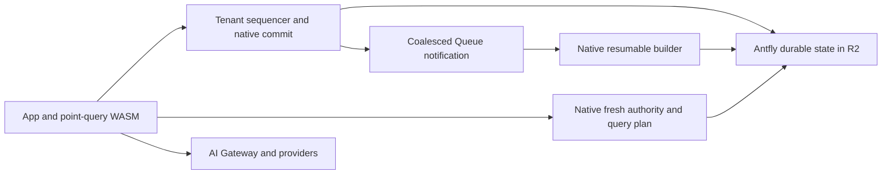

# Cloudflare runtime: next architecture steps

This is a proposed implementation order following the
[latency experiments](cloudflare-latency-experiments.md). The experiments remain
unqualified: full-size preparation stalls, the smaller corpus misses latency
targets, and transport/diagnostic completeness is unresolved. These proposals
are not claims that the fixes are already implemented.

## Keep one native engine and one durable truth

Use Antfly's shared native object-storage engine for WAL, metadata, document
artifacts, indexes, recovery and collection. R2 holds authoritative durable
state. The Cloudflare adapter supplies object I/O, execution, scheduling and
provider calls; it does not implement a separate database protocol in JavaScript.
See [deployment modes and storage engines](../architecture.mdx).

Keep the public app and ordinary point-query WASM together. Tenant Durable
Objects provide bounded warm sequencing and native commit execution. Heavy
query and builder execution can retain separate memory/admission lanes; logical
roles need not always require four physical Worker deployments. Consolidate a
role only after checking aggregate isolate memory and request-context ownership.
AI Gateway/model calls remain outside the serialized write-commit path.

The desired paths are:

Queues wake durable work. The native outbox/progress records determine what work
exists and whether it completed, including after lost, duplicated or delayed
notifications. Preserve visibility tokens separating accepted WAL progress from
published index progress; a durable write acknowledgement does not imply every
index or enrichment has caught up.

## 1. Bound the minimum publication unit

Fix this first. The observed budget-one cancellation means reducing the number
of records is insufficient in at least one slow-storage case. Identify the
minimum unit's actual phase/dependency cost before prescribing its split.

Introduce a durable native publication plan containing source identity, the WAL
prefix, policy/schema identity, stable output attempt identity, completed output
references, a bounded continuation and terminal status. Each invocation builds
or uploads a bounded unit, persists progress and yields with deadline headroom.
The plan must support input records whose internal work exceeds one slice.

Independent immutable pages can upload in bounded waves. Parent references are
computed from validated content identities; source protection and all unfinished
outputs remain reachable to GC through the plan. Each resumed slice reacquires
and validates native ownership and source protection. An expired or retired
source cannot be made valid by trusting a saved cursor or old pin expiry.

Only the terminal native transaction advances published HEAD/watermarks and
records completion. It rejects a changed source or replaced owner. Intermediate
objects never expose a partial published prefix. Crashes before and after each
checkpoint/finalization must recover to one outcome; abandoned plans eventually
release protected objects through bounded collection.

## 2. Fuse authority and immutable query planning natively

The current scheduling experiment starts a query after fresh admission while
obsolete I/O drains. It is not the full dependency reduction.

A native read plan can prepare immutable manifest/facts/body reads in parallel
with fresh authority observation. Speculative inputs carry their exact source
generation, WAL cutoff and checksums. Native validation accepts them only when
they match the freshly authenticated view, visibility fence and live source
protection. A changed source selects a bounded replan under the same original
deadline/admission and aggregate I/O budget. No speculative result is returned
before that validation succeeds.

Keep immutable byte caching shared and bounded. Mutable authority is observed
freshly. Avoid per-object coordinator RPCs once the operation has an authenticated
native view. Retain separate bounded heavy-query admission where required.

## 3. Minimize the native write transaction's dependent calls

Keep one client mutation call into the tenant sequencer. Progressively combine
native WAL preparation, operation-receipt handling and metadata transaction
planning so they share decoded state and immutable inputs. Preserve one
authoritative commit decision binding the WAL head, receipt and durable work
admission. Background index publication remains outside this acknowledgement.

Upload independent immutable output before the final fenced conditional commit.
If ownership, WAL identity or source dependencies change, fail or replan within
the original budget. Warm retained state supplies preparation hints, never an
acknowledgement by itself. Do not remove recovery/seal checks just to remove a GET.

Measure native commit phases to identify remaining calls before extending the
ABI. Existing optimistic preparation is a safe incremental experiment, not proof
that the combined native write plan has been implemented or that its cloud p95
meets the target.

## 4. Give small bodies a canonical native representation

The experimental inline format removes a GET but retains external body copies,
increasing measured fixture payload by 27–29%. Keep it opt-in for now.

A follow-up versioned body locator should support inline and external/packed
representations through shared native readers, builders, enrichment, reindex,
exact scans and collectors. Eligible small bodies can then have one canonical
representation in their authenticated facts leaf. Large or dependency-bearing
bodies retain external/packed storage. Audit/scheduling indexes stay compact.

Complete the reader/collector rollout and pin-aware retention transition before
removing any fallback copies. Measure both retained bytes and COW write
amplification: saving a GET must not make publication exceed its minimum slice.

## 5. Make operations and cost part of the design

Use stable operation identities and durable status/result receipts for
maintenance that can change HEAD. After an ambiguous acknowledgement, recover
the original result. Existing keyed compaction provides this contract; preserve
the failed unkeyed qualification populations and their no-transport-replay rule.

Collect bounded numeric phase metrics: storage calls/bytes, dependent waves,
native/queue/RPC time, stale preparation retries, publication progress, retained
bytes and physical HTTP attempts. Independent invocation accounting and complete
resource/error coverage remain separate requirements from latency measurement.

Track cost per useful acknowledged operation and published document. Parallel
uploads reduce elapsed time but do not reduce request counts by themselves.
Coalesced notifications, compact metadata commits, fewer immutable objects and
reduced rewrite amplification can improve both latency and cost. Suppress idle
background scans when durable state already proves there is no work.

For disposable testing, persist an exact resource inventory, ownership/scope,
expiry and cleanup state. Archive reports and sealed provenance locally before
cleanup. Teardown stops producers and consumers, removes execution namespaces,
drains/deletes object storage, removes queues and credentials, and verifies
resource absence. A failed gate must not require retaining cloud resources
indefinitely. Expiry is a cleanup trigger, not permission to delete resources
outside the approved scope. Production retention follows its own explicit policy.

## Validate changes locally, then use short cloud confirmation

Replace a uniform-delay-only model with locally replayable storage delay,
correlated slow periods, queue lag, source changes, lease expiry and interrupted
I/O. Start from measured per-phase data; aggregate operation averages cannot
establish per-GET/PUT latency distributions. Reproduce the stalled publication
case, not just a warm steady checkpoint. Test pauses and reconstruction at every
durable publication boundary and lost acknowledgements after a real commit.

Compare one change at a time against the immediately preceding implementation
on identical seeded data. Track latency, useful throughput, request counts,
rewrite/retained bytes and peak memory together. The older approved control
remains the fixed gate comparison; it cannot isolate each new optimization.

Once the full-size local fixture stays within the existing budgets under the
declared faults/delays, use disposable short cloud trials, then refresh native
module-bound scale/ANN evidence and diagnostic completeness before spending the
reserved hour/cold populations. Keep acceptance thresholds and freshness,
durability, lease and recovery semantics unchanged.

Placement is a subsequent measurement, not the primary fix. Neither tested
placement profile improved the observed default p95 pair, and Cloudflare's
[placement policy](https://developers.cloudflare.com/workers/configuration/placement/)
affects fetch handlers rather than Durable Object RPC execution.
