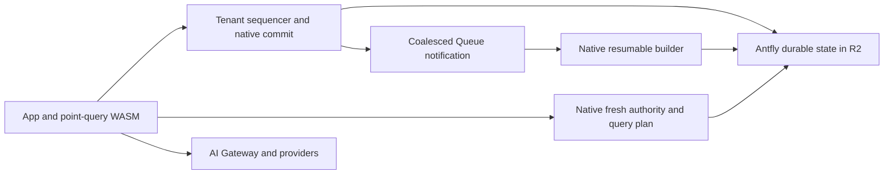

# Cloudflare runtime: next architecture steps

This is a proposed implementation order following the
[latency experiments](cloudflare-latency-experiments.md). The experiments remain
unqualified: full-size preparation stalls, the smaller corpus misses latency
targets, and transport/diagnostic completeness is unresolved. These proposals
are not claims that the fixes are already implemented.

## Keep one native engine and one durable truth

Use Antfly's shared native object-storage engine for WAL, metadata, document
artifacts, indexes, recovery and collection. R2 holds authoritative durable
state. The Cloudflare adapter supplies object I/O, execution, scheduling and
provider calls; it does not implement a separate database protocol in JavaScript.
See [deployment modes and storage engines](../architecture.mdx).

Keep the public app and ordinary point-query WASM together. Tenant Durable
Objects provide bounded warm sequencing and native commit execution. Heavy
query and builder execution can retain separate memory/admission lanes; logical
roles need not always require four physical Worker deployments. Consolidate a
role only after checking aggregate isolate memory and request-context ownership.
AI Gateway/model calls remain outside the serialized write-commit path.

The desired paths are:

Queues wake durable work. The native outbox/progress records determine what work
exists and whether it completed, including after lost, duplicated or delayed
notifications. Preserve visibility tokens separating accepted WAL progress from
published index progress; a durable write acknowledgement does not imply every
index or enrichment has caught up.

## 1. Bound the minimum publication unit

Fix this first. The observed budget-one cancellation means reducing the number
of records is insufficient in at least one slow-storage case. Identify the
minimum unit's actual phase/dependency cost before prescribing its split.

Extend existing prefix/job checkpointing with continuations inside a large input
record or artifact. Introduce a durable native publication plan containing source identity, the WAL
prefix, policy/schema identity, stable logical job identity, completed output
references, a bounded continuation and terminal status. Each invocation builds
or uploads a bounded unit, persists progress and yields with deadline headroom.
The plan must support input records whose internal work exceeds one slice.

Independent immutable pages can upload in bounded waves. Parent references are
computed from validated content identities; source protection and all unfinished
outputs remain reachable to GC through the plan. Each resumed slice reacquires
and validates native ownership and source protection. An expired or retired
source cannot be made valid by trusting a saved cursor or old pin expiry.

Only the terminal native transaction advances published HEAD/watermarks and
records completion. It rejects a changed source or replaced owner. Intermediate
objects never expose a partial published prefix. Crashes before and after each
checkpoint/finalization must recover to one outcome; abandoned plans eventually
release protected objects through bounded collection.

A continuation has a versioned native envelope with the base manifest identity,
accepted WAL prefix, policy fingerprint, phase, input ordinal/offset, completed
typed output references, and a collector-visible protection root. The phase
boundary must occur inside materialization and index construction, not only
between whole artifacts. Bounds apply to input bytes, allocations, output bytes
and host I/O; record count is an additional bound rather than the only bound.

The job identity survives owner replacement; upload authority does not. Never
resume writes in an expired owner's `UploadScope`. A resumed owner authenticates
completed immutable outputs and protects them through the job, creates a fresh
scope for missing outputs, and regenerates parent references where attempts
change. A lost final acknowledgement recovers the terminal job result. Neither
replaying the whole build behind a host-side cache nor publishing intermediate
HEADs implements this contract.

## 2. Fuse authority and immutable query planning natively

The current scheduling experiment starts a query after fresh admission while
obsolete I/O drains. It is not the full dependency reduction.

A native read plan can prepare immutable manifest/facts/body reads in parallel
with fresh authority observation. Speculative inputs carry their exact source
generation, WAL cutoff and checksums. Native validation accepts them only when
they match the freshly authenticated view, visibility fence and live source
protection. A changed source selects a bounded replan under the same original
deadline/admission and aggregate I/O budget. No speculative result is returned
before that validation succeeds.

Keep immutable byte caching shared and bounded. Mutable authority is observed
freshly. Avoid per-object coordinator RPCs once the operation has an authenticated
native view. Retain separate bounded heavy-query admission where required.

## 3. Minimize the native write transaction's dependent calls

The existing [object backend](antfly-object-storage-backend.md) already commits
through a conditionally created immutable journal slot. Its throttled checkpoint
is a recovery hint. Preserve that protocol, including takeover/seal checks; a
logical HEAD must not become a hot mutable R2 object rewritten for every step.

Keep one client mutation call into the tenant sequencer. Progressively combine
native WAL preparation, operation-receipt handling and metadata transaction
planning so they share decoded state and immutable inputs. Preserve one
authoritative commit decision binding the WAL head, receipt and durable work
admission. Background index publication remains outside this acknowledgement.

Upload independent immutable output before the final fenced conditional commit.
If ownership, WAL identity or source dependencies change, fail or replan within
the original budget. Warm retained state supplies preparation hints, never an
acknowledgement by itself. Do not remove recovery/seal checks just to remove a GET.

Measure native commit phases to identify remaining calls before extending the
ABI. Existing optimistic preparation is a safe incremental experiment, not proof
that the combined native write plan has been implemented or that its cloud p95
meets the target.

Do not hold the metadata transaction queue across WAL page construction simply
to combine host calls. That would serialize cold object I/O ahead of unrelated
read admission and could invert the separate kernel/memory reservations. The
combined implementation belongs in native library planning and finalization,
with one bounded caller context and explicit reservations. Prepared immutable
outputs remain outside the final authority transaction; its native dependency
checks and sealed-epoch commit remain mandatory. Measure queue latency as well
as write latency before adopting any combined path.

## 4. Give small bodies a canonical native representation

The experimental inline format removes a GET but retains external body copies,
increasing measured fixture payload by 27–29%. Keep it opt-in for now.

A follow-up versioned body locator should support inline and external/packed
representations through shared native readers, builders, enrichment, reindex,
exact scans and collectors. Eligible small bodies can then have one canonical
representation in their authenticated facts leaf. Large or dependency-bearing
bodies retain external/packed storage. Audit/scheduling indexes stay compact.

Complete the reader/collector rollout and pin-aware retention transition before
removing any fallback copies. Measure both retained bytes and COW write
amplification: saving a GET must not make publication exceed its minimum slice.

The first implementation is opt-in through `CANONICAL_POINT_BODIES`. Native
facts format 12 (`AFDFACTC`) stores eligible bodies of at most 1536 bytes in a
single authenticated primary leaf. It does not upload the external fallback
used by format 11. Existing formats remain readable. Disabling new canonical
writes preserves readers for already published generations; this is not a
binary downgrade path to readers that predate format 12.

Scheduling and audit trees store compact logical canonical references. Their
cursors resolve the body through the primary root of the same pinned generation.
They must not retain physical locators into an obsolete primary leaf: changing
one neighbor would otherwise retain the old leaf indefinitely. Native body
locators used outside those indexes include the full leaf digest, attempt,
record count and exact envelope offset. Readers authenticate the standalone leaf
and selected body. Dependency-bearing and larger bodies keep their existing
external/packed representation. Leaf bodies reuse the operation-local page cache.

Canonical leaves currently disable page packing and value-prefix expansion for
the facts build only, because offsets must identify contiguous authenticated
bytes. This can increase storage calls or COW amplification. Keep the switch off
by default until lifecycle measurements establish its overall tradeoff. Native
facts publication also buffers independent primary/scheduling tree uploads into
bounded batches and flushes them before returning a publishable root. This is
upload batching, not a durable continuation inside a large record.

## 5. Make operations and cost part of the design

Use stable operation identities and durable status/result receipts for
maintenance that can change HEAD. After an ambiguous acknowledgement, recover
the original result. Existing keyed compaction provides this contract; preserve
the failed unkeyed qualification populations and their no-transport-replay rule.

Collect bounded numeric phase metrics: storage calls/bytes, dependent waves,
native/queue/RPC time, stale preparation retries, publication progress, retained
bytes and physical HTTP attempts. Independent invocation accounting and complete
resource/error coverage remain separate requirements from latency measurement.

Physical transport instrumentation now records fixed, disjoint per-operation
latency bins (at most 10, 50, 200, 1000 ms, and over 1000 ms) and counts transport
errors, including failed attempts. These bounded numeric distributions avoid
retaining keys or individual samples. Sum bins across invocations; do not average
per-invocation percentiles or interpret overlapping wait time as serial latency.

Track cost per useful acknowledged operation and published document. Parallel
uploads reduce elapsed time but do not reduce request counts by themselves.
Coalesced notifications, compact metadata commits, fewer immutable objects and
reduced rewrite amplification can improve both latency and cost. Suppress idle
background scans when durable state already proves there is no work.

For disposable testing, persist an exact resource inventory, ownership/scope,
expiry and cleanup state. Archive reports and sealed provenance locally before
cleanup. Teardown stops producers and consumers, removes execution namespaces,
drains/deletes object storage, removes queues and credentials, and verifies
resource absence. A failed gate must not require retaining cloud resources
indefinitely. Expiry is a cleanup trigger, not permission to delete resources
outside the approved scope. Production retention follows its own explicit policy.

## Validate changes locally, then use short cloud confirmation

The earlier latency matrices enable injected delay after seeding. They do not
establish bulk-preparation headroom. Apply the declared storage model to seeding
and publication as well as steady reads/writes in the next fixture.

The separate `examples/cloudflare-serverless/qualification/local-lifecycle-latency.mjs`
fixture now applies uniform injected delay before seeding, bounds publication
convergence, records preparation/publication latency and retained object bytes,
and preserves a failure report. Its reports live under
`dist/qualification/runtime-plan-lab`; earlier sealed evidence remains unchanged.
Compare `before,current,canonical,canonical-combined` with `--only` and use
`--documents=512 --delay=20` for the full local population. These local delays
are an experimental model, not measured Cloudflare storage percentiles. The
`--model=bursty` option adds deterministic jitter and correlated slow windows,
so the same declared load can be replayed. All candidate native modules are
captured once at startup; reports bind every module and generated service bundle
by checksum. A failed case is retained and subsequent selected cases still run.

Extend this uniform-delay model with locally replayable storage delay,
correlated slow periods, queue lag, source changes, lease expiry and interrupted
I/O. Start from measured per-phase data; aggregate operation averages cannot
establish per-GET/PUT latency distributions. Reproduce the stalled publication
case, not just a warm steady checkpoint. Test pauses and reconstruction at every
durable publication boundary and lost acknowledgements after a real commit.

Compare one change at a time against the immediately preceding implementation
on identical seeded data. Track latency, useful throughput, request counts,
rewrite/retained bytes and peak memory together. The older approved control
remains the fixed gate comparison; it cannot isolate each new optimization.

Once the full-size local fixture stays within the existing budgets under the
declared faults/delays, use disposable short cloud trials, then refresh native
module-bound scale/ANN evidence and diagnostic completeness before spending the
reserved hour/cold populations. Keep acceptance thresholds and freshness,
durability, lease and recovery semantics unchanged.

Placement is a subsequent measurement, not the primary fix. Neither tested
placement profile improved the observed default p95 pair, and Cloudflare's
[placement policy](https://developers.cloudflare.com/workers/configuration/placement/)
affects fetch handlers rather than Durable Object RPC execution.

## Local implementation status

The initial full-size lifecycle comparison used four tenants with 512 documents
each and uniform 20 ms delay from the first storage call. Every case completed
preparation and data checks. These are one-pass local workerd measurements under
concurrent local build load, not Cloudflare results or gate qualification.

| Case | Preparation, all tenants | Publication p95 | Read p95 | Builder PUTs | Retained bytes |
| --- | ---: | ---: | ---: | ---: | ---: |
| Previous native build | 48.1 s | 1322 ms | 128 ms | 704 | 14,277,228 |
| Batched facts uploads | 43.4 s | 1115 ms | 132 ms | 704 | 14,279,149 |
| Canonical bodies | 39.5 s | 1068 ms | 142 ms | 556 | 14,893,655 |
| Canonical plus existing scheduling experiments | 38.1 s | 981 ms | 145 ms | 556 | 14,907,786 |

The report is `runtime-plan-lab/lifecycle-latency-1793151405274.json` and binds
all three native modules and all four generated service bundles. Candidate native
SHA-256 was `29b0faea06cf6bfc357333f89c0a3703c6b2f5c4627772d4a356b3844cdafc50`;
previous native SHA-256 was
`c0f96a553ebdeb2be64c94d1cdbb3aa6bd753c8666282a029aa56af68550e8ce`.
The subsequent scan change consumes canonical bodies directly from the verified
cursor leaf rather than decoding a second copy of that leaf for every row.

Batching improves dependent upload waves without reducing request counts.
Canonical bodies save builder requests but have a retained-byte tradeoff in this
fixture, and neither option establishes a read p95 improvement. Keep the body
format opt-in and measure page packing/COW amplification before enabling it.

Durable continuations inside large records, the native overlapping read plan,
and shared native WAL/metadata transaction planning remain implementation work.
The changes above do not satisfy those three contracts. The bursty local model,
original gate comparison, module-bound scale/ANN evidence, diagnostic completeness
and reserved cloud qualification populations remain separate checks. No new
Cloudflare resources are required for this local work.

The subsequent native scan build also passed the 16,384-row metadata workload
with both full and compact modules: recovery, immutable committed-prefix
observation, hot WAL/outbox rows, branches with 193 children, and three collection
cycles. Peak calls per native operation were 101/100, transfer was below 2.11 MB,
and native working bytes were below 0.98 MB. This checks metadata scale under
existing caps; it does not substitute for full ANN corpus evidence or cloud
qualification.

The final scan build's deterministic bursty comparison also completed at four
by 512 documents (`lifecycle-latency-1793151765883.json`). Preparation was
102.8/97.4/82.3 seconds and publication p95 was 3477/3093/2662 ms for previous,
batched, and canonical-plus-existing-options respectively. Read p95 was
359/360/251 ms; write p95 was 879/990/812 ms. The write regression in the
batching-only case and differing read results across delay models require
repeated measurements; these samples do not establish a stable SLO win.
Canonical retained bytes remained about 4% higher. The final full native hash is
`afcd379963d3488befe1701f902d08a083e1baa52c2f69313e1261394b821eb9`.

Final verification passed 276 Node tests, 25 actual-workerd integration tests,
663 native serverless tests (six skipped), and the focused native facts tests,
including canonical source locators serialized through enrichment descriptors.
The original 117 latency, 108 gate and 35 cleanup artifacts remained hash-valid.
The code and design are incremental progress; the three native protocol changes
listed above and cloud gate qualification are still outstanding.
