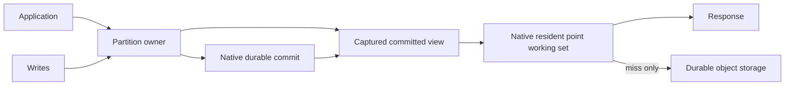

# Resident Antfly serving shards

Issue #1278 / draft PR #1320. The objective is a warm point-read path of one
application-to-owner RPC and zero physical object-store calls. A roughly 40–90 ms
service p95 would be an order of magnitude below the recent 400–900 ms local
results. This is a target, not an achieved provider SLO. WAN latency and cold
object reads remain separate constraints.

## Serving and durability

The app routes point reads directly to the same partition owner that orders
commits. R2/S3/GCS remain durable storage. Antfly native code owns query execution,
visibility, WAL overlays and the bounded point working set; the host supplies
routing and exclusive sequencing. Application SQL/KV is unnecessary.

The initial implementation is deliberately point-oriented. Immutable page and
manifest caches plus native read-state retention support the miss path. The
new native `query/serving_shard.zig` retains owned bodies, absence and visibility
LSNs by namespace, exact committed cut and document identity. It has at most
128 entries and 256 KiB per kernel, including entry/ID/body charges, inside the
unchanged writer kernel memory limits. Returned buffers are independent copies.
Allocation failures propagate; oversized results use the ordinary query path.
The current exact-cut scheme conservatively misses after a relevant commit;
it does not infer that untouched documents stayed unchanged. Query indexes and
arbitrary working sets are not promised to fit in this point cache.

A cut hashes the provider-bound owner/namespace, owner epoch and captured
HEAD/WAL/floor records. It conveys no authority. Cache hits still validate any
required visibility token against the cached native LSN and namespace. Mutable
metadata calls made by native initialization are answered from the captured view;
zero *physical* storage calls does not mean zero host bridge operations.

## Exclusive-owner contract

Existing journal certificates authenticate accepted roots and collection bounds;
they do not prohibit a second actor from taking ownership. They cannot justify
serving latest reads from a retained root without a fresh end probe.

`RESIDENT_SERVING=true` therefore selects a persisted authority descriptor format
2 with `serving.protocol=serialized-owner-v1` and the exact provider actor ID.
It requires the bounded-journal backend, inline metadata roots and an R2
coordinator. Creation uses the existing create-only publication. Existing format-1
namespaces reject activation; old adapters reject format 2. Every compatible
write adapter must validate this descriptor before mutating the namespace.

Cloudflare's adapter derives the owner ID from the COMMITS namespace and logical
partition name, then checks the actual actor ID at owner admission. A different
actor or runtime generation is rejected before native acquisition. Code versions
and eviction/reconstruction can retain the same provider actor ID. Resident
instances nevertheless use a fresh random native owner term on every physical
construction. Native recovery seals the predecessor epoch before serving. This
is mandatory: provider instance uniqueness alone does not prevent an old
in-flight object PUT from arriving after a crash. A racing old PUT either wins
before takeover and is recovered, or loses to the native seal; it cannot appear
behind an admitted new owner cut. The stable actor/version native identity used
by ordinary fresh-probing adapters is not used for resident serving. This relies on the
provider's unique serialized actor guarantee, not a self-declared cache TTL.
Direct low-level writers that bypass deployment authority are unsupported in
this mode, as are mixed old/new adapters. Credentials must limit access to
compatible services.

Read-only observers can validate format 2 and observe committed storage; they
cannot enqueue transactions or acquire ownership. Maintenance, publication and
collection mutations route through the owner. A generic native/S3/GCS host must
supply an equivalent exclusive-sequencer contract before using the resident
cache for latest reads. Native serverless `--resident-points` / `ANTFLY_SERVERLESS_RESIDENT_POINTS`
(and `BootstrapConfig.resident_points`) enables the same synchronized working-set
primitive after ordinary fresh live-session admission. Its key includes namespace,
manifest generation, facts checksum and admitted WAL LSN. It is owned by the
runtime and freed before transport teardown. This path helps S3/GCS/native hosts
reuse validated bodies while preserving their existing authority work.
The current Cloudflare host capability is not automatically an AWS/GCS leader
lease implementation.

Changing owner actor identity, changing storage or rolling back to format-1-only
code requires a frozen, explicit migration to a compatible namespace. Disabling
the flag is not an online format downgrade. Automatic owner rebind is forbidden.

## Commit ordering, capture and lifetime

Owner reads enter the same bounded queue as metadata/WAL commits. They have their
original request deadline, execute as individual read-only callbacks and capture
only committed state. The warm path skips journal rediscovery only when the
owner contract is active, state is acquired and not recovering, and the existing
25-second refresh guard is satisfied. Cold/recovering/expired paths run normal
native recovery. At most four pre-callback recovery continuations share the
original request deadline and the existing 254-operation / 8 MiB read-admission
allowance. Draining I/O, resource errors and callback failures are not retried.
Clocks and certificates are never extended in JavaScript.

Native durable commit completion installs the accepted metadata root/WAL HEAD
in the owner before the ACK promise resolves. Thus a later captured cut includes
the acknowledged update or tombstone. The native live overlay resolves a cache
miss, and an exact-cut cache entry from the previous commit cannot match it.
A read overlapping a write can linearize at its captured committed cut. No
uncommitted preparation is installed as a visible result. Ambiguous failures
must recover before another owner cut is admitted.

Each fresh owner read keeps the submitting request's original wall/monotonic
30-second bound, including an empty namespace or a WAL header too large for the
small reusable JS lease envelope. Current-head native pin/collector protection
still applies; the owner does not reuse these views across requests. When a
compact reusable read lease is present, it is additionally bound to that original
monotonic anchor.
The original wall/monotonic and GC bounds are checked before kernel admission,
before execution and before returning, including native cache hits that perform
no storage I/O. No request context, live session, native pointer or I/O promise
is retained in the point cache. Physical I/O timeout settlement remains owned
by the existing RequestPool and caller background lifetime.

Foreground execution partitions the existing writer allowance: 32 MiB for
commit/preparation and 16 MiB for two point lanes, with ordinary bounded promotion
to a single 16 MiB read when necessary. The separate 16 MiB observation allowance
and total 64 MiB role ceiling remain unchanged. Native cache bytes remain inside
those linear-memory reservations. Point capacity promotion retains one aggregate
I/O budget and the original read view. Publication/building remains in the builder
role. Resident reads do not add an unbounded execution pool. Contention with commits is measured rather than hidden
by increasing memory or queue ceilings.

## Partitioning and replicas

The current partition is the native namespace/incarnation. Existing tenant routes
supply independent owner identities, native WALs and bounded working sets. More
partitions cost additional actors and require explicit routing. A partition whose
working set exceeds memory may miss frequently; the cache is not a substitute
for a split protocol.

Future online splits require a durable routing epoch, a fenced handoff cut,
receipt-preserving movement, forwarding of stale routes and query merge semantics.
They must not be approximated by hashing document IDs into new namespaces, which
would break visibility and retry identities. Until that protocol exists, use
explicit namespace partitioning and existing backpressure.

Strong latest point reads initially stay on the owner. Existing snapshot and
receipt-fenced reader paths remain available for their existing semantics.
A replica needs an applied committed LSN at least as high as the requested fence;
that alone does not make an arbitrary replica read globally latest. Strong
replica reads require a leader read barrier or a real write-coordinated serving
lease. Replica fan-out, quorum leases and automatic online splits remain separate
protocol work, not capabilities implied by this opt-in.

## Measurement and qualification

Use `--strong-latest` to require fresh/latest admission in both variants. Without
that option the existing harness requests only a minimum visibility fence, which
can legitimately use an older certified snapshot. Keep these consistency profiles
separate; a latest-read improvement is not evidence that minimum-fence reads
were previously slow.

Compare flags-off and resident profiles using the same modules, offered requests,
corpus, capacities, durability and visibility checks, in both orders. Preserve
cold/mixed results. `--resident-warmup` separately primes exactly the offered point
identities with bounded concurrent reads; record warmup time and preserve all
resource failures. It is not cold qualification and does not erase failures.

Record physical calls for the entire owner path, native bridge operations, native
cache hits/bytes, owner-admission/kernel queues, response latency, throughput,
write ACK latency and recovered resource failures. A local zero-I/O regression
must instrument the bucket across admission and query execution, not infer zero
I/O from cache-hit counters alone. Measure offered-load p50/p95/p99, missed
deadlines and saturation separately from closed-loop bursts. Warm hit coverage
must comfortably exceed 95% to move total p95; target over 99% for a claimed warm
service SLO. Random/cold object reads and WAN geography have different bounds.

Required faults include concurrent commits/deletes, wrong/future visibility,
wrong owner, activation on existing namespaces, old adapters, real-time expiry,
eviction/restart and publication/collection races. Keep the original hosted gate
and complete independent diagnostics unchanged. No injected memory error test
establishes the cause or resolution of historical live SQLITE_NOMEM.
