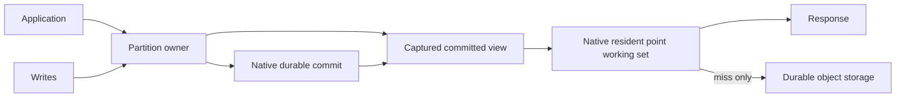

# Resident Antfly serving shards

Issue #1278 / draft PR #1320. The objective is a warm point-read path of one
application-to-owner RPC and zero physical object-store calls. A roughly 40–90 ms
service p95 would be an order of magnitude below the recent 400–900 ms local
results. This is a target, not an achieved provider SLO. WAN latency and cold
object reads remain separate constraints.

## Serving and durability

The app routes point reads directly to the same partition owner that orders
commits. R2/S3/GCS remain durable storage. Antfly native code owns query execution,
visibility, WAL overlays and the bounded point working set; the host supplies
routing and exclusive sequencing. Application SQL/KV is unnecessary.

The initial implementation is deliberately point-oriented. Immutable page and
manifest caches plus native read-state retention support the miss path. The
new native `query/serving_shard.zig` retains owned bodies, absence and visibility
LSNs by namespace, exact committed cut and document identity. It has at most
128 entries and 256 KiB per kernel, including entry/ID/body charges, inside the
unchanged writer kernel memory limits. Returned buffers are independent copies.
Allocation failures propagate; oversized results use the ordinary query path.
The current exact-cut scheme conservatively misses after a relevant commit;
it does not infer that untouched documents stayed unchanged. Query indexes and
arbitrary working sets are not promised to fit in this point cache.

A cut hashes the provider-bound owner/namespace, owner epoch and captured
HEAD/WAL/floor records. It conveys no authority. Cache hits still validate any
required visibility token against the cached native LSN and namespace. Mutable
metadata calls made by native initialization are answered from the captured view;
zero *physical* storage calls does not mean zero host bridge operations.

## Exclusive-owner contract

Existing journal certificates authenticate accepted roots and collection bounds;
they do not prohibit a second actor from taking ownership. They cannot justify
serving latest reads from a retained root without a fresh end probe.

`RESIDENT_SERVING=true` therefore selects a persisted authority descriptor format
2 with `serving.protocol=serialized-owner-v1` and the exact provider actor ID.
It requires the bounded-journal backend, inline metadata roots and an R2
coordinator. Creation uses the existing create-only publication. Existing format-1
namespaces reject activation; old adapters reject format 2. Every compatible
write adapter must validate this descriptor before mutating the namespace. The
resident HTTP adapter rejects native coordinator/publication/collector protocol
operations; application requests cannot bypass the owner through those internal
entrypoints, including when a runtime binding is misconfigured.

Cloudflare's adapter derives the owner ID from the COMMITS namespace and logical
partition name, then checks the actual actor ID at owner admission. A different
actor or runtime generation is rejected before native acquisition. Code versions
and eviction/reconstruction can retain the same provider actor ID. Resident
instances nevertheless use a fresh random native owner term on every physical
construction. Native recovery seals the predecessor epoch before serving. This
is mandatory: provider instance uniqueness alone does not prevent an old
in-flight object PUT from arriving after a crash. A racing old PUT either wins
before takeover and is recovered, or loses to the native seal; it cannot appear
behind an admitted new owner cut. The stable actor/version native identity used
by ordinary fresh-probing adapters is not used for resident serving. This relies on the
provider's unique serialized actor guarantee, not a self-declared cache TTL.
Direct low-level writers that bypass deployment authority are unsupported in
this mode, as are mixed old/new adapters. Credentials must limit access to
compatible services.

Read-only observers can validate format 2 and observe committed storage; they
cannot enqueue transactions or acquire ownership. Maintenance, publication and
collection mutations route through the owner. A generic native/S3/GCS host must
supply an equivalent exclusive-sequencer contract before using the resident
cache for latest reads. Native serverless `--resident-points` / `ANTFLY_SERVERLESS_RESIDENT_POINTS`
(and `BootstrapConfig.resident_points`) enables the same synchronized working-set
primitive after ordinary fresh live-session admission. Its key includes namespace,
manifest generation, facts checksum and admitted WAL LSN. It is owned by the
runtime and freed before transport teardown. This path helps S3/GCS/native hosts
reuse validated bodies while preserving their existing authority work.
The current Cloudflare host capability is not automatically an AWS/GCS leader
lease implementation.

Changing owner actor identity, changing storage or rolling back to format-1-only
code requires a frozen, explicit migration to a compatible namespace. Disabling
the flag is not an online format downgrade. Automatic owner rebind is forbidden.

## Commit ordering, capture and lifetime

Owner reads enter the same bounded queue as metadata/WAL commits. They have their
original request deadline, execute as individual read-only callbacks and capture
only committed state. The warm path skips journal rediscovery only when the
owner contract is active, state is acquired and not recovering or uncertain.
The currently live provider instance plus its confirmed native state supplies
read authority. A native append certificate is not a serving lease: its expiry
must not force repeated storage discovery on reads, especially when a queued
Cloudflare request has a frozen clock older than a recent proof anchor. Readers
neither renew that certificate nor use it to authorize writes. The existing
25-second write refresh guard and native append proof checks remain unchanged.
Cold/recovering/uncertain paths run normal native recovery. At most four pre-callback recovery continuations share the
original request deadline and the existing 254-operation / 8 MiB read-admission
allowance. Draining I/O, resource errors and callback failures are not retried.
Clocks and certificates are never extended in JavaScript.

Native durable commit completion installs the accepted metadata root/WAL HEAD
in the owner before the ACK promise resolves. Thus a later captured cut includes
the acknowledged update or tombstone. The native live overlay resolves a cache
miss, and an exact-cut cache entry from the previous commit cannot match it.
A read overlapping a write can linearize at its captured committed cut. No
uncommitted preparation is installed as a visible result. Ambiguous failures
must recover before another owner cut is admitted.

Each fresh owner read keeps the submitting request's original wall/monotonic
30-second bound, including an empty namespace or a WAL header too large for the
small reusable JS lease envelope. Current-head native pin/collector protection
still applies; the owner does not reuse these views across requests. When a
compact reusable read lease is present, it is additionally bound to that original
monotonic anchor.
The original wall/monotonic and GC bounds are checked before kernel admission,
before execution and before returning, including native cache hits that perform
no storage I/O. No request context, live session, native pointer or I/O promise
is retained in the point cache. Physical I/O timeout settlement remains owned
by the existing RequestPool and caller background lifetime.

Foreground execution partitions the existing writer allowance: 32 MiB for
commit/preparation and 16 MiB for two point lanes, with ordinary bounded promotion
to a single 16 MiB read when necessary. The separate 16 MiB observation allowance
and total 64 MiB role ceiling remain unchanged. Native cache bytes remain inside
those linear-memory reservations. Point capacity promotion retains one aggregate
I/O budget and the original read view. Publication/building remains in the builder
role. Resident reads do not add an unbounded execution pool. Contention with commits is measured rather than hidden
by increasing memory or queue ceilings.

## Publication read readiness

Before publishing HEAD, the resident owner can opportunistically prepare the
new immutable manifest and document-facts routing headers in a free point lane.
A dedicated native ABI constructs no live session, visibility result or pin.
The transport permits only that exact immutable manifest and immutable artifact
names; mutable metadata, writes and admission barriers are forbidden. Native
validation checks the manifest version, namespace domain, checksums and routing
pages. A namespace without document facts reports that nothing was prepared.

Preparation runs outside the metadata sequencing queue, with no authority and
no reusable request context. It leaves a lane for interactive readers and skips
when the pool is busy or the original small read capacity is insufficient. Host
responses are bounded before copying into WASM. Unexpected transport, integrity,
resource and memory errors propagate; they are not treated as cache misses.
The prepared bytes use the existing bounded immutable cache, preserving protected
foreground blocks. This warms headers, not every body or every routing leaf.
The guarded publication still validates the native lease and applies the normal
atomic HEAD/offset/receipt commit. Preparation I/O is charged against the same
parent finalization budget and deadline, rather than creating another allowance.

Keyed compaction checks its receipt before preparation: an already completed
receipt can survive collection of its old manifest. The final transaction checks
the receipt again. The preliminary read conservatively reserves the entire
254-operation / 8 MiB admission allowance inside the old parent budget, so replay
safety does not increase resource ceilings.

## Detached immutable misses

With the existing `NATIVE_POINT_CONTINUATIONS=true` option, resident lookups use
the common WASM host's `withPointReadDependencies` scheduler. Cache lookup stays
outside the dependency wrapper: completed immutable hits execute immediately.
The load transport rechecks and populates the completed-byte cache before native
replay, so a queued miss can reuse bytes another caller already fetched. It never
shares an in-flight promise across request contexts. A physical immutable miss
unwinds the native call before starting external I/O,
then resumes against the same captured cut and original lifetime. It creates no
fresh authority, extends no pin and retains no native pointers.

Only misses acquire a transcript permit. Warm reads therefore do not queue behind
cold I/O holding all transcript permits. The owner pool has two native lanes and
at most two 100 KiB transcript reservations; pending misses share the existing
bounded native queue admission. Large dependencies fall back to the ordinary
bounded native path rather than increasing retained space. Every replay and
detached read shares the original 1,024-operation / 32 MiB query allowance.
Native and detached I/O remain separately attributable in trace/physical metrics.

The scheduler uses the shorter remaining wall/monotonic/read-lease lifetime at
each phase. A timed-out I/O retains its permit, response space and submitting
request's background lifetime until physical settlement. Late resource errors
remain observable. Resource/integrity failures are not replayed. Tests cover warm
progress with both cold permits occupied, timeout plus late `SQLITE_NOMEM`, queued
expiry, oversized responses and older-module fallback. These tests do not resolve
historical hosted allocator failures. Moving I/O outside native execution improves
liveness; it does not increase cold-read throughput or guarantee better p95.

## Partitioning and replicas

The current partition is the native namespace/incarnation. Existing tenant routes
supply independent owner identities, native WALs and bounded working sets. More
partitions cost additional actors and require explicit routing. A partition whose
working set exceeds memory may miss frequently; the cache is not a substitute
for a split protocol.

Future online splits require a durable routing epoch, a fenced handoff cut,
receipt-preserving movement, forwarding of stale routes and query merge semantics.
They must not be approximated by hashing document IDs into new namespaces, which
would break visibility and retry identities. Until that protocol exists, use
explicit namespace partitioning and existing backpressure.

Strong latest point reads initially stay on the owner. Existing snapshot and
receipt-fenced reader paths remain available for their existing semantics.
A replica needs an applied committed LSN at least as high as the requested fence;
that alone does not make an arbitrary replica read globally latest. Strong
replica reads require a leader read barrier or a real write-coordinated serving
lease. Replica fan-out, quorum leases and automatic online splits remain separate
protocol work, not capabilities implied by this opt-in.

## Measurement and qualification

Use `--strong-latest` to require fresh/latest admission in both variants. Without
that option the existing harness requests only a minimum visibility fence, which
can legitimately use an older certified snapshot. Keep these consistency profiles
separate; a latest-read improvement is not evidence that minimum-fence reads
were previously slow.

Compare flags-off and resident profiles using the same modules, offered requests,
corpus, capacities, durability and visibility checks, in both orders. Preserve
cold/mixed results. `--resident-warmup` separately primes exactly the offered point
identities with bounded concurrent reads; record warmup time and preserve all
resource failures. It is not cold qualification and does not erase failures.

Record physical calls for the entire owner path, native bridge operations, native
cache hits/bytes, owner-admission/kernel queues, response latency, throughput,
write ACK latency and recovered resource failures. A local zero-I/O regression
must instrument the bucket across admission and query execution, not infer zero
I/O from cache-hit counters alone. Measure offered-load p50/p95/p99, missed
deadlines and saturation separately from closed-loop bursts. Warm hit coverage
must comfortably exceed 95% to move total p95; target over 99% for a claimed warm
service SLO. Random/cold object reads and WAN geography have different bounds.

Required faults include concurrent commits/deletes, wrong/future visibility,
wrong owner, activation on existing namespaces, old adapters, real-time expiry,
eviction/restart and publication/collection races. Keep the original hosted gate
and complete independent diagnostics unchanged. No injected memory error test
establishes the cause or resolution of historical live SQLITE_NOMEM.

## Verified local outcome (2026-10-31)

The implementation and trials establish a targeted warm point-read improvement,
not a general order-of-magnitude application improvement. All new modes remain
opt-in. No hosted profile is selected from these results.

Both main matrices pass: 28 owner-only cases at `afc00ad655` and 28 detached-owner
cases at `faf13a6428`. Twelve WAL-projection comparisons and six separate
completed-metadata-cache prototype comparisons also pass correctness. In total,
**74 final cases verify 7,872 measured reads and 1,792 durable writes**, including
exact bodies, counts, required visibility, publication and final background drain.
An independent audit verifies source/experiment, module/bundle hashes, unchanged
native memory ceilings, empty recovered resource-failure histories and settled
transcript reservations. Prototype bundle transforms are retained in their exact
experiment snapshots; they are not production source changes.

The following ranges contain both execution orders. Each cell is read/write p95
in milliseconds. Each within-matrix pair uses the same modules, offered requests,
corpus and capacities. Offered runs include eight concurrent writes per 128 reads;
closed-loop bursts include 32 writes per 96 reads. The four-tenant, explicitly
warmed 64-document offered profiles inject 50 ms per physical storage operation.
The 512-document burst profiles inject 100 ms. All use the separate warm-setup,
drained profile (`--setup-delay=0`); these are not physical-cold or cloud SLOs.

| Profile | Flags-off comparator, owner-only matrix | Resident owner |
| --- | --- | --- |
| Warm offered latest, 8 reads/s | 121–122 / 126–127 | 11–12 / 125 |
| Warm offered latest, 32 reads/s | 125–126 / 126–127 | 43–45 / 125–126 |
| Warm offered minimum fence, 8 reads/s | 126 / 126–127 | 11 / 126–127 |
| Warm latest bursts, 64 documents/tenant | 408–413 / 199–202 | 482–484 / 298–300 |
| Warm latest bursts, 512 documents/tenant | 753–770 / 350–392 | 868–974 / 451–548 |
| Unprimed mixed, 64 documents/tenant | 421–422 / 208–223 | 471–511 / 251–308 |
| Unprimed mixed, 512 documents/tenant | 867–875 / 356–358 | 1,265–1,276 / 486–543 |

| Profile | Flags-off comparator, detached matrix | Resident + detached misses |
| --- | --- | --- |
| Warm offered latest, 8 reads/s | 121–122 / 126–128 | 11–12 / 128–129 |
| Warm offered latest, 32 reads/s | 124–125 / 128–129 | 44 / 122–126 |
| Warm offered minimum fence, 8 reads/s | 125 / 123–124 | 11 / 126 |
| Warm latest bursts, 64 documents/tenant | 418–458 / 199–201 | 499–518 / 296 |
| Warm latest bursts, 512 documents/tenant | 758–766 / 348–355 | 908–974 / 448–547 |
| Unprimed mixed, 64 documents/tenant | 412–416 / 199–204 | 417–418 / 298–301 |
| Unprimed mixed, 512 documents/tenant | 865 / 368–371 | 1,279–1,291 / 468–542 |

At 8 reads/s, owner-only read p95 improves **10.4–10.9×**, and the detached
configuration improves **10.1–11.5×**. At 32 reads/s both improve about **2.8×**.
These are offered-to-completion latencies, including client dispatch lag and
queues. Completing a fixed 8/32 reads/s workload does not establish a maximum
throughput or a corresponding throughput multiplier. Write p95 is essentially
unchanged in these offered profiles; burst write p95 regresses.

For each resident offered run, 124/128 measured reads at 8 reads/s and 122/128 at
32 reads/s perform zero physical object-store calls across admission and query.
These counts exclude the four postmeasurement validation reads. Native body
cache hits cover only a minority of reads as cuts change; completed immutable
page reuse also contributes to zero-I/O serving. The 95–97% zero-I/O coverage moves
p95 but leaves cold misses in p99. Do not describe every warmed request as a
native body-cache hit or generalize the result to 99% coverage.

The exact-cut working set misses after relevant commits. Bursts expose cold
immutable dependencies and queues; the fixed 32/16 MiB execution split also has
a measured write-contention cost. Detached misses establish warm progress while
cold I/O holds both transcript permits, not higher cold-I/O throughput. They do
not consistently improve burst p95 and remain optional.

The additional native WAL-document projection is not selected. At 512 documents,
flags-off read/write p95 is 776–777 / 353–367 ms; projection alone is 769–771 /
580 ms; resident plus projection is 742–896 / 757–761 ms. Small-corpus read results
also reverse/regress across orders. The separate prototype consulting completed
immutable coordinator-cache bytes produces 467–512 ms read p95 versus 472–511 ms
for the ordinary owner and 414–424 ms for flags-off, without removing the misses.
That two-file prototype is preserved only as experiment source/bundles.

Native production remains `afc00ad655`; no native rebuild was needed for the
shared JavaScript scheduler. Full WASM is 7,733,405 bytes, SHA-256
`5f830322da602c799bf10a3518936786c557ef85436abe6fb612558c8e2963d9`.
Final verification passes **552 Node tests, 54 actual-workerd checks, one mail
workerd integration and 48 focused native tests**; three live-provider checks
skip. The resident fixture forbids application SQL/KV, verifies zero physical
I/O after real append-certificate expiry, runs both collectors, checks large-body
promotion, concurrent writes/deletes and restart with a different native term.
A separate delayed-PUT test proves that reconstruction fences the old writer.

Activation currently requires a fresh compatible namespace. This increment does
not implement an in-place format-1-to-format-2 migration tool. Existing namespace
activation fails closed; disabling the flag is not rollback. Online partition
splits, strongly latest replicas and a portable AWS/GCS exclusive-owner adapter
remain separate protocol work. The generic native point cache preserves ordinary
fresh admission on those providers.

No new cloud resources or credentials were created. The unchanged hosted gate,
complete live whole-window diagnostics, historical `SQLITE_NOMEM`, three paired
hour-long trials, physical-cold samples and live provider latency qualification
remain open. Local successes and injected late errors do not satisfy those gates.

### Sealed resident evidence

Local evidence is `examples/cloudflare-serverless/dist/qualification/resident-sealed-1793435256615/evidence.json`:
**1,166 independently verified artifacts / 3,667,630,615 bytes**, SHA-256
`b227200623841be6424ab347cb3ab1f50dc2348082cee802409ab98a21dbbace`.
It preserves exact final/measured/native source archives, frozen modules and
native test binaries, all 74 correct final cases, integration logs, failed
prechecks, interrupted earlier matrices and negative prototype bundles.
The independent matrix audit verifies 7,872 measured reads / 1,792 writes.

All six preceding corrected closures reverify unchanged, including 1,344, 224
and 27 recorded window references in the earlier local/hosted/memory closures.
The earlier invalid self-summary and historical availability gap remain explicit.
Initial prototype/intermediate precheck sources or raw modules overwritten before
archiving are not promoted to exact final evidence. Credentials and post-write
summaries were excluded before reading/hashing. Production, measurement and
rollout/qualification limitations above remain unchanged.

## Burst and reconstruction serving state (v3 implementation)

This increment keeps the existing object-store authority and publication formats.
It introduces opt-in `RESIDENT_READ_STATE`, `RESIDENT_MVCC`,
`RESIDENT_SHARED_KERNELS`, `RESIDENT_BOOTSTRAP`, `RESIDENT_READ_COHORTS` and
`RESIDENT_FETCH_COALESCE`. These are experimental until the same correctness,
resource and paired hosted gates pass. None changes a gate threshold.

### Committed native state and visibility

Native `live_session` now caches published bodies by namespace, generation and
facts checksum. A later WAL append does not invalidate unchanged published
bodies. Every lookup still applies its captured WAL overlay first, including
updates and tombstones. This cache benefits native S3/GCS sessions without
changing their admission protocol.

An exclusive owner can additionally retain a contiguous interval of canonical
mutations emitted by the native append result. Installation happens only after
the durable metadata finalizer succeeds, before acknowledging the write. Raw
application bodies are never installed: native normalization must happen first.
The owner retains at most 128 records / 64 KiB charged bytes, deducted from its
existing 512 KiB decoded-row budget. The physical native owner term binds the
interval; ordinary metadata epoch rotation does not discard valid history.
Reconstruction, uncertainty, eviction and gaps safely lose the optimization.

The private `resident_tail` input is trusted owner-admitted data, not a portable
proof. The native view independently validates namespace scope, interval shape,
its current captured WAL latest, published boundary and each caller's required
visibility. It clips an admitted newer interval to the captured cutoff. A gap
falls back to the ordinary bounded WAL path; it never proves absence. Public
requests cannot supply these private runtime fields.

### MVCC admission and bounded execution

Fresh namespaces can select authority protocol `serialized-owner-v2`. Reads
capture the last confirmed immutable metadata root without waiting for a
concurrent write's storage acknowledgement. Unacknowledged durable prefixes are
not visible through an independent latest-read observer: reader admission goes
through the owner. A cold read uses fresh native authenticated observation without taking write ownership. Any concurrent write admission invalidates its result and forces owner re-admission, even if that write fails. Native fencing and recovery remain mandatory before write takeover.
A v1 adapter rejects the v2 descriptor. No in-place migration is implemented.

Decoded metadata is reusable only at the exact captured revision, epoch and
owner. A snapshot read can populate the existing bounded decoded-row cache only
if that root remains current after its native read completes. A read paused
across a commit cannot seed the newer root with stale data.

Shared execution retains the existing 64 MiB writer-isolate total in one
memory-admitted pool. Metadata observation and small points reserve 8 MiB;
compact write/point jobs reserve 16 MiB and full modules reserve 32 MiB. Up to
eight slots share that total, including retained idle hosts. The scheduler
reclaims idle variants before admission, retains commit priority and aging,
and counts the aliased pool exactly once in aggregate metrics. Observation
adapters select the actual 8 MiB module, never an undercharged compact module.
Transcript permits stay at two. Earlier fixed 48/16 and 32/16/16 partitions are
retained in failed exploratory reports. Sharing is not evidence of 10x gains.

Cohorts have at most 16 pending members / 64 KiB inputs and two active groups.
One native session serves up to 16 points, with independent visibility errors.
Bodies larger than 16 KiB per member use the existing individual bounded path;
resource, integrity and transport failures do not trigger arbitrary replay.
Cohort metrics describe a physical native group once, with its member count.
They must not be multiplied into fictitious per-member physical I/O.

### Reconstruction headers and immutable misses

Publication atomically stores a bounded serving bootstrap beside HEAD in native
metadata. It contains owned copies of the exact immutable manifest and eligible
native facts-root header (two records, at most 8 KiB each / 17 KiB encoded).
Generation mismatch ignores it. Native checksum/domain validation, captured
leases, ranges, conditions and response budgets still apply. Existing covering
point leaves supply small document bodies; there is no second mutable database
or parallel document format. A published point can avoid manifest/root round
trips after owner admission, while truly cold write ownership still requires recovery.

Immutable miss coalescing matches exact namespace/bucket/key/range/condition/
version/response-budget identities. Its registry holds at most four flights and
16 followers per flight, charged to the existing input reservation budget.
Only the selected submitting request performs physical I/O. Followers re-enter
their own completed-cache transport after settlement; response handles and
physical I/O promises never cross request contexts. Failures remain failures.
Each follower retains its own deadline and request-owned timer.

An actual-workerd negative test reproduced cancellation when even CPU-only
shared wake promises were used between independent requests. The implementation
therefore uses bounded plain-data tickets inspected by timers belonging to each
submitting request, for both flights and cohort handoff. The corrected test
checks concurrent R2 reads, owned response bytes and propagated resource errors.

### Qualification boundaries

Earlier evidence closures remain unchanged. New exploratory reports and all
failed attempts are under `dist/burst-v3` and
`dist/qualification/burst-v3-*`; they are not hosted qualification. Initial
50 ms injected-delay warm burst probes improved read p95 from about 413 ms to
144 ms with a shared writer pool, but retained write contention. Sharing the
observation pool measured about 409 to 199 ms. These are distinct experimental
configurations, not repeatable 10x proof. Later concurrent-suite probes are
confounded by other local builds and must not replace isolated paired trials.

The remaining targets include larger-corpus, burst, offered-load, worker-cold
and physically cold trials in both orders; live provider measurements; and the
unchanged hosted availability/memory gate, including historical SQLITE_NOMEM.
At a fixed 100 ms mandatory object GET latency, an 86 ms truly cold target is
impossible. Reducing serial dependencies helps; claims must separate warm cache,
worker reconstruction, ownership recovery and physically cold object reads.

Cold reconstruction originally acquired ownership for reads and regressed to 1,416 ms p95 versus 336 ms for control. That failed report is retained. The subsequent read-only reconstruction path avoids write takeover until a write arrives; a monotonic admission counter and root checks prevent a concurrent write from exposing an unconfirmed prefix through that path.

### Final v3 local results and evidence

Production JavaScript is `d823b5a75b`; native source is unchanged after
`6b5ef4547c`. Measurement `a951cf64f1` corrects admission I/O accumulation when a
cold snapshot is discarded and re-admitted. Original reports are retained.
All comparisons below use the same current native modules on both sides and
50 ms injected binding latency. The baseline is the current-module flags-off
profile, not the approved fixed hosted control. The two protocols use fresh,
compatible isolated namespaces and identical logical keys.

| Profile | Baseline read/write p95 | V3 read/write p95 |
| --- | ---: | ---: |
| Warm burst, 64 documents/tenant | 466 / 215 ms | 110 / 218 ms |
| Warm burst, 512 documents/tenant | 458 / 220 ms | 176 / 262 ms |
| Warm offered, 8 reads/s | 124 / 130 ms | 22 / 136 ms |
| Warm offered, 32 reads/s | 133 / 135 ms | 18 / 136 ms |
| Mixed after reconstruction, 64 documents/tenant | 475 / 581 ms | 704 / 845 ms |
| Mixed after reconstruction, 512 documents/tenant | 493 / 598 ms | 697 / 847 ms |

Separate first-read reconstruction p95 is **344 vs 469 ms** at 64 documents,
and **500 vs 862 ms** at 512 documents (baseline vs v3). This includes fresh
metadata admission; a one-GET covering data path does not eliminate metadata
or ownership costs. V3 improves warmed bursts about **4.2x / 2.6x** and the
32 reads/s profile about **7.4x**, with a large-burst write regression and cold
regressions. There is no universal 10x result, qualified rollout profile, or
hosted gate pass. Competing local builds were present, each final profile has
one paired order, and different profiles are not interchangeable repetitions.

Independent primary audit: **12 correct cases / 1,152 measured reads / 280
writes / 48 separate reconstruction reads**. Including the earlier cold
attribution runs: **16 cases / 1,536 reads / 408 writes / 96 reconstruction
reads**. It verifies source/experiment/native/bundle hashes, individual sample
p95/counts, physical group member coverage, terminal I/O/reservations and role
memory ceilings. Cohorts count physical native frames once; logical reads are
counted independently.

Final verification passes **562 Node checks, 49 focused native checks** (three
live-provider checks skip), the real-workerd v1/v2 owner lifecycle checks,
request-owned flight/cohort integration and one mail integration. The full
workerd first stage passed 48/49 with an export burst failure; all four export
tests passed on isolated rerun. The subsequent seven serving/RPC/continuation
checks passed, and the corrected cold and final unified-pool v2 fixtures each
passed separately. The original export failure remains in evidence. These
reruns are reported explicitly rather than claiming an uninterrupted green suite.

Full WASM SHA-256:
`06d8fcf8ce316d768bf211552323423c2985595a69cff39bb41bfe4186558966`.
Sealed evidence is
`dist/qualification/burst-v3-sealed-1793467455651/evidence.json`:
**2,113 artifacts / 3,517,717,933 bytes**, manifest SHA-256
`84c3255e0d5f48c3d06774ec08f3ccd92523727f71ef85139170eb0e9ccf8756`.
The source archives, native test executables, frozen modules, all attempts and
independent audits are local. All seven corrected predecessor closures reverify
unchanged. Their historical availability gaps and invalid nested self-summary
remain explicit; the recursive audit's initial rejection of that invalid older
summary is preserved. Credentials were excluded before reading/hashing.

Cold metadata admission, first-write ownership takeover, incremental native
overlay installation cost, stronger repetitions without competing builds and
live whole-window qualification remain work. Historical `SQLITE_NOMEM` is not
resolved by these local results. All new flags remain opt-in; the original
hosted resource, error, duration and latency thresholds are unchanged.

The subsequent opt-in cold pipeline and provider-local durability protocol are specified in [Cold serving plans and durable native bootstrap](cold-serving-bootstrap.md). Its clean/dirty recovery and authority contract differs from the R2-only v2 baseline above; results must remain separately qualified.
