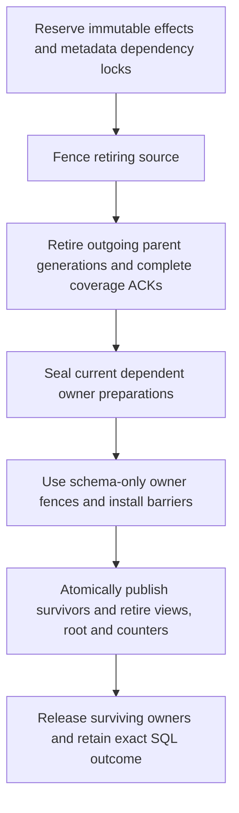

# Whole-table SQL retirement

Ordinary `DROP TABLE` must remove a constrained table without first publishing a
weaker schema or deleting each row through the mutation API. PostgreSQL is the
semantic oracle. `scripts/check_sql_drop_postgres.py` independently exercises
RESTRICT, child-only ownership, self/external references, active RLS, name reuse,
and the original `sql-0157`/`sql-0159` statements against an isolated PostgreSQL
18+ server. This work strengthens those ordinary DROP contracts; it does not
close or relabel `DROP TABLE ... CASCADE` (`sql-0158`).

## One existing publication protocol

The SQL dispatcher pins the exact namespace relation, immutable table ID,
schema digest and catalog incarnation before ordinary DROP admission. Only a
definite, unproposed `ConstraintRetirementRequired` result may enter coordinated
retirement. The subsequent schema/snapshot capture must match that pinned owner;
a same-name replacement cannot become the deletion target.

The existing FK generation publication record carries a private `sql_drop`
intent. Its prospective schema removes outgoing FKs only and is never published.
It retains all other declarations, indexes and read layouts. A source with no
outgoing FK still receives a private successor epoch for its native fence;
ordinary idempotent schema updates do not change epochs.

| Phase | Durable requirement |
| --- | --- |
| Admit | Exact catalog owner, source/parent descriptors and complete memberships; no incoming FK, dependent view, extension ownership, backup/restore conflict or policy publication in progress |
| Fence source | Every native source owner freezes and drains admitted transactions under the exact plan fence |
| Stage parents | Every outgoing FK has a retire-only parent generation transition |
| Activate parents | Every parent installs its generation tombstones; cancellation can no longer reopen the old contract |
| Acknowledge parents | Every parent returns its replicated activation receipt |
| Complete coverage | Every surviving parent independently acknowledges reference-coverage completion |
| Publish deletion | One metadata transaction deletes the exact table, catalog binding, range membership, column/sequence ownership and policies, releases lifecycle locks, and records the terminal publication |

A self-parent shares the source's dual-role fence. Its own coverage barrier
remains frozen and disappears with that physical namespace; it is not reopened
just to delete the namespace. Every external parent still requires the second
coverage ACK. Mixed self/external plans distinguish these owner sets explicitly.
Ordinary FK ALTER retains its existing successor installation and subsequent
parent coverage protocol.

The coordinator advances from durable receipts. Cold recovery does not replay
SQL, recapture names or infer completion from an empty lookup. Before any parent
activation, cancellation uses the existing durable source/parent cancel path.
After activation, interruption leaves an admitted job that must finish.

## Authorization and row policies

DROP requires current administration of the pinned child table. Retiring that
child's outgoing references does not require parent administration; native plan
validation proves that all transitions belong to the exact child preimage and
carry no successor generation. Ordinary FK ALTER retains parent authorization.

A stable source or parent policy does not require disabling RLS. The private
`sql_drop_control` language allows only source fencing/cancellation and
retire-only parent controls. Native admission rejects schema installation,
transfers, successor grants and every mixed batch effect. Only sync level and
the materialized ordered timestamp may accompany the control. Application still
uses the normal native transaction, source-pin and topology checks; user writes
and unrelated topology changes retain policy enforcement.

Surviving-parent mutations carry signed integrity-read authority through both
primary reads and batched observations. Tokens and database scope remain in
headers. The receiver requires an explicit service credential even in legacy
internal mode, and native readers verify the signed owner and purpose.

Metadata topology capability 72 and data-Raft protocol 27 fence the new control
and lifecycle-lock kind. Private storage engine descriptor/method symbols
advance together to version 37. Public storage-owner ABI and OpenAPI contracts
are unchanged. The marker is omitted from ordinary legacy control bytes.

Integration with main through `a69c0b582e` raises the metadata topology decoder
to 73. Main's durable job-state command retains tag 79; the unreleased SQL index
publication ACK moves to 89, and the complete index publication cohort requires
decoder 73. Compiled boundaries require runtime callback ABI 11, storage owner
ABI 108 and failure ABI 74. Job-state lookup, paged scanning and owner counts use
the existing owned metadata projections, including exact checkpoint errors and
the distinction between an absent cursor and an invalid empty cursor.

## Publication and operational behavior

SQL returns `DROP TABLE` only for terminal completion. A bounded request may
return `DDL PENDING` with the existing FK publication token and immutable table
ID. An ambiguous begin retains an `admission_unknown` receipt. Neither response
authorizes replaying the DDL. Parent completion precedes logical deletion, so a
completed ordinary DROP leaves surviving parents usable.

While the durable deletion intent owns the table, native catalog admission
rejects table and ancestor namespace/database renames and new view or extension
dependencies. Ancestor checks stream active lifecycle locks and compact catalog
bindings, rather than decoding complete publication plans. Schema, policy and
other lifecycle changes use the shared table lock. The final native transaction
rechecks dependencies and owner identity before deleting anything.

Late publication commands which lose their plan/revision CAS are native
metadata no-ops before any writes. Later validation and storage failures still
abort apply. A successful response requires the exact durable owner receipt;
a competing command advancing the same revision is insufficient. The native
campaign deliberately repeats intermediate commands and verifies that both
fault profiles still have seven publication revisions.

A bound table whose advertised native snapshot is temporarily absent returns
statement-read unavailability instead of falling back to stateless pages or
claiming unsupported SQL. Cold-owner tests independently wait for serving
schema installation. Named scopes share the existing bounded nonadmission
retry client; unknown and committed outcomes are never replayed.

Work depends on source owners and FK parent edges, not the number of user rows.
The native campaign checks the same seven durable revisions for one and 128
child rows with one source owner and one external parent: begin, source fence,
parent stage, activation, first ACK, coverage ACK and final deletion. This is a
coordinator work-count assertion, not a throughput or latency benchmark.

Incoming-FK admission uses the transactional dependency directory after its
complete-coverage adoption (described below). Before adoption, the existing
bounded-memory source-schema scan remains authoritative. Terminal publication
records retain their full plan for exact receipt recovery; bounded terminal
receipt retention/compaction is not claimed here.

## Qualification

The strict Debug gate is `antfly-api-sql-drop-retirement-test`. Its mounted
campaign uses real metadata, session and data owners and independent cold
recovery. It checks external, self and mixed references, zero-parent constraints,
read-only denial, child-only authority, RLS source cleanup, an RLS-protected
surviving parent, dependency/name races, safe name reuse, lost early parent ACK
replies, and lost final catalog publication replies. It requires zero skips.

Neighboring gates are `antfly-api-hosted-fk-drop-test`,
`antfly-api-sql-fk-schema-lifecycle-test` and
`antfly-api-sql-tablespace-lifecycle-test`. Passing results must be recorded from
the completed build graph; compilation, an admitted receipt or one successful
subcase is not end-to-end qualification. The authoritative parity ledger stays
unchanged until an original contract has sufficient executable evidence.

Local qualification on 2026-10-26 used pinned Zig 0.17 Debug on macOS arm64.
Before the latest main merge, the combined retirement, hosted FK, FK schema, names/tablespace and runtime-error
gates passed all 108 build steps and 23 tests with zero skips or leaks. The
11-test retirement gate then passed two additional consecutive cached runs,
including deliberate duplicate metadata commands and both cold-recovery faults.
The merged-tree SQL suite passed 1,670 tests with four existing opt-in benchmark
skips and no failures or leaks. The PostgreSQL oracle passed all 50 assertions;
the Go SDK suite, inventory checker tests, license and embedded-boundary checks
also passed. The original parity disposition counts are unchanged.

After merging main through `a69c0b582e`, the combined Debug build passed all
164 steps: 1,670 SQL tests, 50 runtime identity tests, 32 coordinator tests,
12 retirement/native-owner tests, six tablespace tests, four hosted FK tests,
one FK schema test, one column/index lifecycle test and three durable metadata
tests. Only the four existing opt-in SQL benchmarks were skipped; no tests
failed or leaked. The added compiled-owner test verifies stale-create CAS,
owner quota isolation, exact cursor errors and cold reopen of durable job state.

## Sequence defaults and coordinated counter retirement

A column's default reference is independent of a counter's `OWNED BY` edge.
The native table transaction maintains a forward reference frame, reverse
attribute edges, and a monotonic per-counter count/revision. First-reference
publication persists the attribute registry in that same transaction. Reads
remain read-only; restore rejects references without their durable registry.
Unchanged table metadata does not reparse or rewrite this directory.

Dependent `DROP SEQUENCE ... CASCADE` uses the existing all-owner schema
publication machinery. An immutable version-four plan binds the original SQL
nonce/digest, exact counter definition and reference stamp, every dependent
table's before/after schema, and signed physical owner preparations. The native
writer rejoins the indexed directory and sums the actual references across the
proposed participants, rejecting an omitted table even when all included
preparations are valid. Metadata decoder 125 fences admission and publication.
The operation reserves the counter, participating tables and its containing
namespace/database until all releases or cancellation ACKs are durable.

Owner work removes default declarations while preserving physical rows and
indexes. Schema-only proofs require zero scanned rows; this operation does not
need a data rewrite. One native transaction publishes all table postimages,
retires the counter/ownership/directory state, and records the catalog revision.
A compact acceptance attached to retained job history keeps exact SQL outcome
recovery valid after the ordinary sequence receipt ring has churned. It remains
pending until every physical fence is released. Cancellation preserves all
preimages and releases the same reservations atomically. This reuses retained
publication history; terminal-history compaction is not introduced here.

The host checks both administrator and schema-validation authority. Authenticated
metadata HTTP carries a body-bound administrative grant and identifies only
retirement-preparation snapshots as schema-validation reads. The compiled kernel
receives a distinct private retirement projection selected after those checks;
an ordinary snapshot cannot acquire retirement authority through a payload flag.
Active schema migrations, restore/retirement work and unsupported policy or owner
cohorts keep their existing admission guards.

On 2026-10-31 the pinned Debug publication gates passed both 59-test server roots
and their two-test local roots, including every before/after admission,
publication, final-release and cancellation write fault. Cold recovery retains
pending and terminal outcomes after 65 unrelated ordinary sequence admissions.
The combined creation-source/submission/mounted gate passed 27 executions with
zero skips, failures or leaks. The mounted campaign rejects a signed incomplete
cohort without creating a receipt, pauses a real readiness ACK, cold-reopens
metadata/data/session owners, and completes the original public CASCADE receipt.
It verifies surviving rows, NOT NULL/UNIQUE behavior, indexed reads and stable
terminal observation. Independent PostgreSQL 18.6 checks confirm those logical
postimages. These are correctness/work-count checks, not latency benchmarks.

This qualifies dependent sequence retirement. SQL shared-default creation and
allocation, independent borrowed-default rebindings during table replacement,
identity-counter provenance, and copied index/constraint comments were still
unqualified at this checkpoint. Later cohorts below implement and qualify those
contracts. The original LIKE lifecycle requires ordinary RESTRICT until borrowed
defaults are removed, followed by source deletion; it does not require CASCADE.

The adjacent Debug regression then passed 76 executions across native counters,
attribute/view catalogs, creation sources, original sequence and serial/identity
lifecycles, and dependent retirement. Attribute preparation explicitly separates
first initialization from replacement: only a validated predecessor registry
owns attribute retirement, while first initialization rejects existing orphan
ownership edges. This preserves validated CONTINUE/RESTART restore handoffs.
A further creation-source run passed all 11 local/native tests with an injected
invalid default after registry preparation, checking exact nonadmission,
unchanged durable bytes and testing-allocator cleanup on optional-null returns.

### Native sequence kind and default-copy admission

Identity provenance belongs to the native counter definition. An ordinary
`CREATE SEQUENCE` or `OWNED BY` operation cannot create it, and a schema payload
cannot turn ordinary sequence privileges into implicit identity-column authority.
Identity defaults require NOT NULL and their exact native owning attribute;
removing an identity default while keeping that attribute is rejected. Ordinary
SERIAL defaults may reference a counter owned elsewhere or no longer owned by
any column. A stored native default supplies an early-bound identity, avoiding
namespace name resolution while retaining ordinary counter privilege checks.
PostgreSQL 18.6 confirms this distinction from an unbound `nextval` lookup.

The provenance/counter and creation-source Debug gates passed 46 executions;
the subsequent native creation plus mounted serial/identity and retirement
regression passed 15 more, with no skips, failures or leaks. This does not yet
qualify the full LIKE lifecycle.

Source-copy intent contains only the guarded source table and stable attribute,
plus destination type intent. The accepting native transaction reads source
bindings and current counter configuration. SERIAL copies retain the existing
counter and allocate neither a resource ID nor an ownership edge. Identity
copies receive a new native identity counter and copy configuration rather than
running state; their counter type follows the destination column, as PostgreSQL
requires even after independently altering the source sequence's type. Source
defaults and distinct counters are cached once per admission. The mounted
qualification now also exercises borrowed-default rebinding through replacement,
owner versus borrower RESTART, detached ownership and cold writes. That expanded
Debug gate passed all 15 native and mounted executions with no skips, failures
or leaks. It also covers a copied identity after independently narrowing the
source sequence type. The final native source-intent forgery, public permission and renamed-counter
gate passed 12 executions without skips, failures or leaks. It rejects four
forged source intents without changing allocation or dependency state and
requires ordinary counter permission for copied SERIAL defaults, while explicit
values remain writable.

### Explicit attribute handoffs in generation replacement

Metadata decoder 126 adds a skip-empty `attribute_renames` intent to the existing
staged target. Row expression assignment alone cannot rename a catalog attribute
or adopt its ownership or annotations. The immutable plan verifies a bounded,
bijective source/destination mapping against both native schemas, unchanged
logical type signatures, and the exact direct-column row transform. The producer
and native accepting transaction both require the capability. Counter/default
features retain their independent decoder-125 floor.

The native writer rejoins every old ownership edge with the persisted old
attribute registry and the actual new layout, including manually owned counters
whose defaults were removed. A move to a different attribute is rejected even
when no default could reveal that substitution. Borrowed defaults still do not
move or restart counters. Any native default-reference change causes rewrite
programs to be recompiled and sealed against the exact bound target schema,
including replacements with zero owned-counter moves.

Generation publication inherits column annotations from the actual predecessor
registry in its accepting transaction. Retained names keep annotations through
type changes; a renamed column needs the explicit verified identity mapping;
derived additions receive no implicit annotation. The prepared registry owns its
encoded bytes and publishes with rows, defaults, catalog and owner handoffs. This
covers TRUNCATE and schema-generation rewrites without read-time bootstrap or
post-publication COMMENT requests.

The combined Debug native and mounted gate passed 16 executions with zero skips,
failures or leaks. It exercises borrowed, owned SERIAL and internal identity
renames, continuing shared allocation, repeated TRUNCATE, detached ownership,
column comments, and independently cold metadata/data/session owners. Native
negative tests reject redirected ownership after DROP DEFAULT and a missing old
attribute registry. PostgreSQL 18.6 independently confirms the logical allocation
and annotation results. The later [object annotation cohort](catalog-object-annotations.md) now qualifies
index/constraint point notes, naming-only publication and accepting-cut LIKE
comment copying. Owning-table CASCADE with externally borrowed defaults remains
separate unfinished work. It is not a prerequisite of original `sql-0369`: the
unchanged PostgreSQL lifetime oracle drops the borrower before its source.

The final [LIKE lifetime gate](like-table-lifecycle.md) now qualifies that
original: two authenticated mounted Debug campaigns pass, including independently
cold owners, exact shared-counter state, borrower/source retirement and final
native checkpoint validation. PostgreSQL 18.6 matches the unchanged nine-original
persistence oracle. The subsequent [initial FK/counter publication cohort](initial-fk-counter-publication.md)
also qualifies a single combined source CREATE. The native accepting transaction
reserves immutable counter postimages; final publication exposes the table and
counters together. Ordinary LIKE still requires no owning-table CASCADE.

## Dependency withdrawal owner proof (not yet activated)

The shared `system_catalog/dependency_retirement.zig` selector derives one
successor schema that withdraws FKs to specified physical parent identities and
ordinary defaults to specified counter identities. It preserves all other
properties, declaration order and JSON number lexemes. Membership is bounded
and canonical; derivation parses the schema once, indexes parent names and uses
binary lookup for counters. It advances the schema epoch once, including when a
table has both kinds of dependency.

The native schema owner has a private `dependent_object_retirement` purpose.
It independently derives the complete schema postimage and re-derives the
catalog against the actual predecessor. Allocation identity, retained
constraint definitions, CHECK identity and retired history remain exact; only
selected FK bindings may become tombstones. A schema-only owner proof scans
zero rows. Installation retains the existing generated-value and physical-index
invariants and preserves historical row bytes. Native engine descriptor 40
fences the new private purpose semantics at the typed engine boundary.

This is not permission to publish independently. Ordinary schema-validation
plans explicitly reject this purpose. Owning-table CASCADE remains inactive
until its complete metadata coordinator and capability/recovery cut are wired.
Document schemas currently reject these relational dependency declarations, so
there is no valid document borrower schema to install through this purpose.
This does not change ordinary document table or restore semantics.

Native qualification passes six Debug owner tests, including real LSM cold
ready/install/release/cancellation, unchanged primary bytes, retained generation
identity, allocation failures and exact NUMERIC preservation. The isolated
binding/selector gate also covers sparse multi-counter membership and rejects
nearby decimal changes that floating-point parsing would collapse. No original
parity case is closed by these owner preparations alone.

The complete coordinator must retain the following ordering and scope:

An affected survivor may also be an outgoing parent. Its dependent schema fence
must not deadlock the earlier parent-generation controls. Metadata locks keep
its declarations stable throughout; fresh owner preparations after parent
completion bind its then-current physical root. Mutable preparation seals and
owner progress must remain separate from the immutable FK plan digest already
attested by source/parent receipts. Source effects, creator, scope, counter
configuration and view closure cannot change during sealing.

Immutable per-table inputs and their directory should be persisted once, with
compact references and owner progress records. Rewriting all survivor schemas
on every owner acknowledgement would multiply metadata/LSM write volume by the
owner count. The existing deduplicated schema-publication inputs and compact
owner barriers provide the machinery to reuse. Counter reference stamps and the
complete FK/view dependency closure still need independent validation at both
admission and final publication. Receipt observation must keep addressing the
old table/job identity after catalog deletion, including during name reuse.

## Restore-plan ownership correction

Restore validation previously invoked an owner-reference rewrite that returned
borrowed bytes when unchanged and allocated bytes when changed, while leaving
its parsed JSON in caller-owned scratch storage. A caller using a general
allocator leaked that scratch on repeated validation. `rewriteSchemaAlloc` now
always returns owned output, and `requireOwnerReferences` compares the expected
postimage using a local arena without copying unchanged schema bytes. Binding
validation also owns its scratch. Allocation failures remain allocation failures
rather than being reclassified as invalid input.

The strict parent-reservation regression now passes with zero errors or leaks.
The full schema-publication gate passes both 60-test metadata contexts and their
two-test native contract contexts. The four-test public identity/handoff gate
also passes, including raw-allocator and exhaustive allocation-failure checks
for unchanged and rewritten owner references. The previous 315 leaked
allocations per restore campaign are eliminated.

## Transactional incoming-FK directory

`system_catalog/foreign_key_dependencies.zig` maintains one edge per physical
parent name and child table ID. Multiple constraints to the same parent share
that edge. Independent active/read-layout flags preserve both lifetimes:
ordinary SQL DROP excludes historical-only references, while generic topology
admission retains its existing protection for both layouts. Reverse keys split
active/both edges from retained-only edges, without duplicating a parent/child
edge. Active lookup seeks only the active lane; schema churn cannot make an
active lookup traverse all historical-only dependents. Per-parent revision,
total count and active count commit the edge set, not the mutable child schema
or its privileges. A retirement manifest still pins each exact child schema and
independently proves the complete dependency union.

The common native prepared-table writer updates the forward frame, reverse
edges and parent summaries in the same transaction as the primary definition.
Deletion and restore replacement remove the old child's edges in their existing
transaction. Unchanged parent/flag sets write nothing; allocator-owned prepared
frames survive source snapshot release. Stored corruption remains an apply
failure, while invalid proposed definitions retain ordinary read-only rejection.

A populated index is not complete-coverage authority. Metadata decoder cohort
130 gates bounded adoption through the existing relation-maintenance worker and
Raft intent. Each page visits at most 16 physical tables and budgets 8 MiB of
source fields, always admitting one legal oversized table so migration cannot
stall on a single definition. New tables inserted behind the cursor receive
edges from their normal writer. The cursor and page effects commit together;
restart resumes the exact durable cut. The replicated coordinator establishes
its original live SQL catalog before attempting this additional capability
barrier, preserving that catalog during rolling upgrades.

Normal page preparation decodes schemas outside the apply mutex. Application
rejoins the exact ordered source prefix and its endpoint, including the boundary
row: point checks of the captured rows alone would miss inserted tables. The
source digest and byte budget exclude unrelated descriptions, reports and index
statistics. Replicas can group preceding source changes and several already
observed cursor intents into different Raft batches. If their local preparation
is stale or absent, apply re-derives the same bounded page at that ordered cut.
A local cache/preparation miss cannot become a committed no-op. Only a stale
durable cursor is a read-only no-op. The regression compares every durable
catalog row between individual commits and a combined four-entry batch, then
checks a cold reopen.

Native checkpoints and Raft snapshot validation independently verify source
prefix coverage, exact canonical forward frames, reverse-edge bijection and
per-parent total and active counts. A complete marker requires coverage of every primary table;
removing a child from both directory directions and adjusting its count cannot
hide the missing source edge. Validation streams rows with per-table scratch,
checks cancellation and rejects incomplete or orphaned restored projections.

After adoption, incoming DROP checks seek only the selected parent prefix.
Parent schema compatibility checks stream the same indexed dependents without
an accumulated result array or the 128-participant mutation limit. Existing
parent locks, authorization, RLS, backup/restore exclusions and target validation
remain in their common admission paths. The strict Debug
`antfly-incoming-fk-directory-test` gate covers canonical frames and allocation
failure, atomic rollback, retained layouts, cold adoption, stale preparation,
source insertion behind the cursor, torn restore and replica batch equivalence.
The existing metadata service campaign additionally drives capability activation
and directory completion through real Raft control rounds.

This completes the incoming-directory component. It does not activate owning-
table CASCADE or close `sql-0158`; the complete coordinator described above is
still required. No inventory disposition is changed by directory qualification.

## Immutable effects capture

`metadata/table_retirement_manifest.zig` now defines a bounded logical effects
manifest and compact digest reference. Native preparation uses one pinned read
transaction and indexed dependency discovery. The union includes active FK
survivors and borrowers of the root's owned counters; a self-reference consumes
no survivor slot. Counter configuration is pinned, while running counter values
are deliberately absent. The shared subtraction selector derives each exact
survivor postimage in a single schema epoch, preserving unrelated FKs and
arbitrary JSON number lexemes.

Transitive view discovery visits the root and selected views through their
reverse dependency prefixes. It rejoins every forward edge and source attribute
signature, rejects forged reverse edges, and captures physical materialization
backings and their ranges. An unrelated view cannot enter the effects closure.
Outgoing FK parents are captured through indexed physical-name lookup; self
parents and survivors reuse their existing preimages. The immutable manifest
therefore needs no whole-catalog administrative snapshot for this discovery.

Preparation budgets 16 MiB, 128 survivors, 256 owned counters, 256 views, 16,384
view edges, 128 outgoing parents and 4,096 ranges. Scratch is reclaimed per
schema/view/source. The private read remains body-bound administrative work;
its response travels as bounded raw JSON rather than a JSON-encoded string.
It provides no owner ACK, lock, mutation or CASCADE authority. Durable root
admission, its subordinate owner barriers and atomic final publication still
have to consume and independently rejoin this immutable manifest. Qualification
of preparation does not close `sql-0158` or change the parity inventory.

The transaction-local cut checker now independently rejoins the captured source
and survivor definitions/ranges, complete incoming-FK stamp, each counter's
configuration/reference stamp, the root's complete ownership prefix, and the
forward/reverse view closure. A newly added borrower or transitive view edge
invalidates the preparation even when every previously listed object remains
unchanged. This checker grants no accepted-root or owner authority. Its normal
resource path compares the canonical preimage without parsing the stored JSON;
a changed resource is decoded only to permit presentation-only COMMENT edits.
Running counter allocations likewise preserve the captured logical effects.

The targeted Debug gates pass 45 tests: four manifest/transport/permission
campaigns, nine directory campaigns and 32 existing coordinator regressions.
The manifest campaign includes self references, an incoming survivor that is
also an outgoing parent, a separate external parent, transitive views,
unrelated surviving views, missing effects, late dependencies, running counter
allocations and concurrent counter/view comments. A cold reopen calls the real
native C ABI projection entry point, parses its raw JSON and verifies the exact
manifest reference. The implementation fixture does not claim to be a linked
consumer-facade test. No positive owner acknowledgement is fabricated, and no
original parity case is marked complete by these preparation tests.

## Durable root reservation

`metadata/table_retirement_ledger.zig` now persists the immutable effects body
once, separately from a compact checksummed head. Its lookup contains the
metadata group, immutable root table ID and job ID. The head binds the effects
reference, creator principal, database/namespace scope and participant/range
counts. Native admission independently rejoins the prepared catalog cut and
checks every lifecycle, policy and shared FK-parent exclusion before staging.
The metadata decoder floor is 131; the private ordered command has tag 93.
Standalone and replicated paths parse and validate immutable inputs outside the
apply mutex, then recheck admission at their actual ordered transaction cut.
A direct internal adapter without preparation re-derives the immutable input;
local cache misses cannot change committed effects.

One transaction reserves all selected physical tables, counter definitions and
view definitions. Per-table, range and view aliases support point discovery and
streaming reverse validation. View leases block replacement, rename, drop and
new transitive dependents while preserving queries and COMMENT. The existing
counter lease mechanism preserves running values before admission and blocks
lifetime/configuration changes during the reservation. New FK/default borrowers,
source dependencies, conflicting restore/backup work and ancestor renames use
the common native exclusions. Shared schema-validation parent leases conflict
before the first reservation write, rather than poisoning apply after partial
staging.

The reservation-only phases are `reserved` and `canceled`. No physical owner work
may start in `reserved`. Cancellation first validates the full lease/alias set,
then releases it atomically. It also tombstones the large effects body in that
same transaction. A compact terminal head retains the immutable fingerprint and
scope needed for exact retry observation, without accumulating large historical
manifests or decoding them on every restart. A repeated begin cannot reacquire
a canceled reservation or substitute a different scope/effect set.

Native checkpoints and Raft snapshot validation join each active body once,
verify all expected aliases/locks/leases, and compare their reverse counts. A
streaming primary-range pass independently proves complete membership, including
a range omitted from both a forged manifest and its alias. Indexed view aliases
and ownership edges similarly detect hidden transitive dependents or owned
counters. Terminal heads keep their metadata identity/decoder proof while
allowing the original objects to change later. Orphan aliases, view leases,
root locks and competing FK-parent leases fail recovery.

The three focused Debug gates pass 46 tests: five manifest/transport/permission
campaigns, nine directory campaigns and 32 coordinator regressions. The native
campaign applies duplicate begin commands in one actual committed Raft batch,
reopens the reservation cold, and applies/replays cancellation through the
standalone opaque command. Fault injection fails every reservation put in the
four-table fixture; each aborted transaction leaves the original catalog intact.
A coherently altered manifest/range count/digest/lease set still cannot hide a
live primary range. The copied-counter campaign exercises a real owned-counter
reservation and release. Exhaustive allocation-failure coverage includes arena
growth during final encoding; the arena descriptor is moved only after that
encoding completes.

This qualifies durable reservation and pre-physical-work cancellation. Later
sections describe the physical and survivor-publication implementation. Public
SQL CASCADE activation remains separate from these internal qualification gates;
`sql-0158` remains unresolved until the unchanged public command is qualified.

## Physical retirement and survivor publication

The root now moves through `reserved`, `retiring`, `physical_ready`,
`validating_survivors` and `published`. `canceled` is terminal only before
physical retirement starts. A sealed root binds the complete source/parent
owner set and immutable manifest. Native source fences and parent generation
retirement use the existing FK owner controls, with root-bound decisions that
cannot be independently admitted as an ordinary FK publication. Sparse work
reads return one outstanding owner; fixed-size accepted counters and
commitments avoid rescanning all receipts on each acknowledgement.

Physical readiness does not delete anything. A surviving table receives one
union after-image for the root's FK and sequence-default withdrawals. The
existing all-owner schema publication ledger installs those successors, using
borrowed root locks until logical publication. The root reference, exact plan,
complete participant/range cover, current signed owner preparations and
source-policy cuts are independently joined by native metadata admission.
Metadata decoder 133 fences this protocol. The private schema plan is version
five; ordinary plans omit its root reference.

Once all survivor installations are durable, one metadata transaction publishes
the survivor definitions, removes the root, dependent nonmaterialized views
and owned counters, and transfers survivor locks to the common release phase.
No intermediate weaker schema is published. Failed or canceled survivor
preparation cannot release the physical root's reservations; recovery can retry
the exact admitted effects. Published roots retain their common cohort identity
for checkpoint validation after their catalog preimages have disappeared.

Subtractive schema installation preserves enforced constraint coverage only
when the predecessor catalog and physical owner match exactly and the successor
retires FKs without changing UNIQUE generations, CHECKs or unrelated bindings.
This rebind joins the schema/catalog/installed-receipt/outbox transaction.
Missing or stale coverage remains pending. Invalid coverage remains invalid;
partial scans restart conservatively rather than treating a cursor in a
withdrawn FK phase as proof of the remaining constraints. Proven UNIQUE
generations therefore do not need a user-row rescan after FK withdrawal.

Standalone cache publication projects the bounded affected-table set and exact
removed range IDs from one native read cut. All cohort tables are refreshed,
including a survivor that also served as an outgoing FK parent. The logical
catalog and authorization cache switch together at the same durable revision.
An interrupted cache patch forces authoritative reload before serving it.

When there are no surviving schemas, direct publication requires the exact
accepted root revision and complete physical barriers, then calls the same
catalog-effects writer. It releases all reservations and records a nonzero
logical catalog revision in the same transaction. No empty schema-validation
cohort or synthetic owner installation is created. Decoder 134 fences this
command and its durable terminal proof; checkpoints reject a terminal head that
has neither this proof nor its survivor cohort identity.

Both final-publication commands use the ordinary captured relation journal.
The source mutation and live namespace seal therefore share one transaction,
including when the last table disappears. A physical ACK does not invalidate
the standalone catalog projection unless it actually emits a catalog change.

The populated mutual-FK native campaign passed all 13 Debug tests, including
lost source/parent replies, an installed-ACK interruption, unchanged survivor row
version and semantic hash, ordinary post-release writes, and UNIQUE rejection
before and after restart. The combined owner/metadata run passed 159 tests with
no skips, failures or leaks. After adding direct publication, the combined
native/manifest/schema gate passed all 150 tests with no skips, failures or
leaks. The native campaign rejects premature publication, accepts two real
source-fence receipts for the remaining populated table, replays final
publication, checks matching source/live namespace epochs immediately, and
reopens the resulting empty catalog cold. Removing its terminal cut is rejected
by the durable head decoder. Public SQL case dispositions remain unchanged.

Acceptance reads use a compact expected effect rather than resending the
manifest or decoding terminal plans. Admission binds scope, incarnation and
manifest reference; sealing binds the physical plan digest; an owner ACK binds
its exact stored evidence; final publication binds the direct terminal revision.
These observations are read-only and grant no owner execution permission. A
negative observation means the effect was not observed, not permission to replay
SQL or resolve an ambiguous request by looking up its name again.
The linked native receipt campaign passed all 24 tests in its native/manifest
Debug gate with no skips, failures or leaks. It observes missing and accepted
admission through the real C ABI, rejects scope/evidence substitution and
premature publication, and recovers admission and final-publication receipts
after cold reopen. It does not manufacture positive physical owner evidence.

The public producer now parses CASCADE/RESTRICT and uses the shared SQL
catalog-operation receipt (`kind: table`) and `/sql/operations/status` recovery
API. Its version-six token carries the pinned lookup, incarnation, effects and
original logical target. A protected target digest is independently joined to
the native manifest at admission and checkpoint recovery, preventing token-label
substitution from redirecting authorization. Decoder 135 fences this public
scope. Recovery rechecks current permissions and does not infer success from a
missing table. Survivor completion additionally requires the common schema
cohort's terminal owner releases.

The supervisor discovers one root from at most 16 shared lifecycle locks per
quantum, loads immutable effects only for preparation, and advances one actual
source/parent effect. Admitted survivor jobs use the existing schema recovery
feed. The authenticated raw submission transport shares delivery tracking,
body-bound grants and outcome checks with schema publication. Definite stale
phase/revision failures occur during read-only preflight before a proposal.
Metadata/standalone acceptance is resolved against exact durable receipts.
Standalone direct publication applies a bounded affected-range delta and
switches logical resources/ACLs together. Ordinary ACKs do not refresh every
native owner report or invalidate the full catalog projection.

The public native campaign now closes original `sql-0158`: the unchanged
`DROP TABLE usage_records CASCADE;` retires a populated mutual-FK root, an owned
sequence, and a two-view transitive closure. One surviving schema loses both
its borrowed default and incoming FK. Its existing row version and logical
content hash remain unchanged; writes to the former parent succeed and the
unchanged UNIQUE constraint still rejects duplicates, including after cold
reopen. Exact public receipt recovery also remains committed after reopening.
The borrowed default is established through the supported schema ingress;
SQL borrowed-default creation remains independently guarded.

Qualification exposed an actual persistence bound: the schema head's former
2 KiB record could not hold retirement authority and full-width proof digests.
The fixed per-job bound is now 4 KiB. A codec regression covers full-width IDs,
128 participants, 4096 owners, and admission/terminal proof states, and proves
that the old bound rejects the valid terminal record. No per-owner plan or
history was added to the head. The combined Debug gate passed 142 tests; the
expanded native campaign passed all 14 tests with no skips, failures or leaks.
An isolated PostgreSQL 18+ oracle passed 71 assertions covering dependency
removal, preserved table/index/row identities, defaults and uniqueness.

Materialized-view backing retirement and document-source dependency retirement
remain guarded. Dependency-free document DROP keeps its ordinary native metadata
semantics. Historical manifest/receipt retention remains a separate bounded
reclamation task. These limitations are not hidden by the one original case's
closure.

The distributed campaign also passes through real metadata/data RPC owners.
It interrupts after the source fence and signed observation are durable but
before the metadata ACK; the metadata head and physical summary remain unchanged.
Both metadata and data stores then close and reopen. The same public token
reaches committed through ordinary discovery and common schema recovery, without
SQL replay. The surviving table retains its ID and original `(2, 1)` row,
permits new former-parent references and rejects duplicate keys. Its root,
owned sequence and transitive views remain absent. All 13 tests in the mounted
constrained-drop Debug gate pass without skips, failures or leaks. This covers
one distributed cold/reply-loss boundary; it does not claim the complete
multi-voter failover and storage-fault matrix.

Malformed public table recovery identities now consistently use the existing
invalid-token diagnostic (`22023`). A regression covers empty names, zero table
or namespace IDs, substituted logical targets, old versions and non-admission
effects before native observation. All five catalog recovery Debug tests pass.
