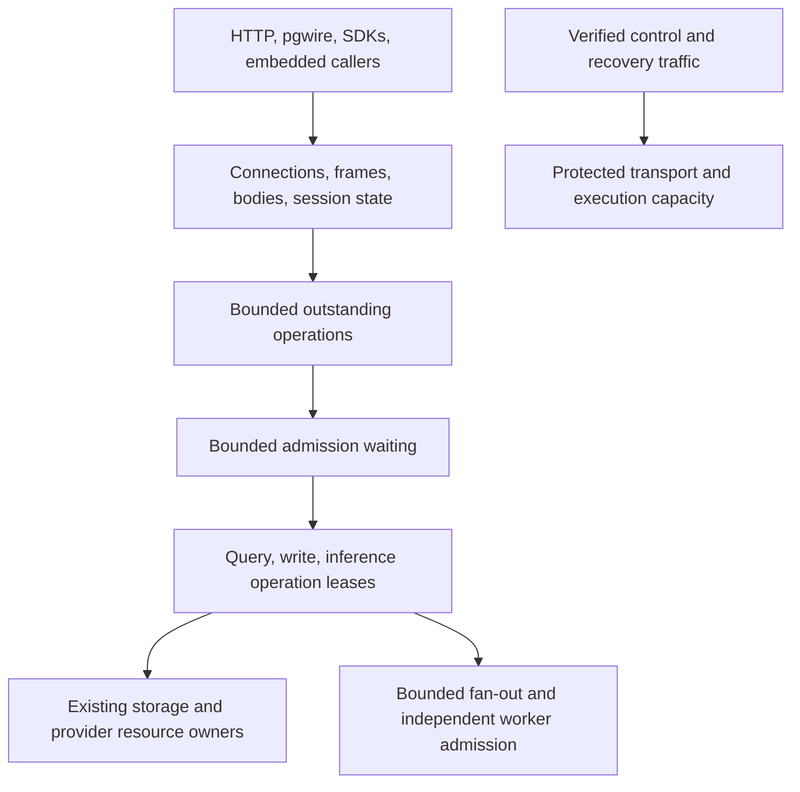

# Workload Admission and Scheduling

Status: bounded default query waiting, startup-resolved runnable capacity,
protected HTTP dispatch, a bounded SQL executor, reusable outbound clients, and
aggregate pgwire/session budgets are implemented. Python and TypeScript SDK
clients and the root Go Antfly/inference SDK clients also have bounded local
FIFO admission. Native session, H1/H2 dispatch, outbound reuse, and particular
retained-state paths have focused checks. Owned remote-read families remain
disabled by default; complete operator eligibility, distributed ownership,
resource-progress and default-policy qualification remain open. See
[implementation scope and restrictions](WORKLOAD_POOLING_IMPLEMENTATION.md).

Original source baseline: `e4d707de5634a8d758c606b4432037e1a1682052` on
`origin/main`, verified against GitHub on 2026-10-05. Active development uses one
branch, `codex/workload-scheduling`, in `.worktrees/workload-scheduling`, and
[PR #849](https://github.com/antflydb/antfly/pull/849). Subsequent main merges and
implementation evidence are recorded in the implementation ledger.
The current merge includes `origin/main` at `fc9bea9f20194754644605d796c00beeb1f325d0`.
Native ABI 37 fences the current required-preparation implementation; storage
owner ABI remains 101. Reader floor/catalog envelope 6 protects the new retained
agreement in required transaction records. Commit
`bb9088a5ef0e84a0dc3c9c8e89b86f5d39a8916e` preserves the original mode through
resolution and retry expiry without retaining effect sidecars or adding a history
key. Legacy records cannot be upgraded into contract evidence. Six focused native
targets and 25 ReleaseSafe package consumer checks pass. The earlier coordinator
foundation negotiates readiness before BEGIN and seals every participant before
decision. Production transport/storage adapters, eligible producers and migration
remain required before activation. The retained pgwire fix preserves completion
authority through held-cursor COMMIT. Distributed required preparation and the full
design remain in progress.

The full goal remains safe, bounded execution sharing across many connections
by default, with fair scheduling and bounded waiting, preserving session
semantics, query correctness, durability and control progress under overload.
The delivery milestones below are stages of that goal within the same branch
and PR. Full qualification is waived for this work; focused correctness and
integration verification remain required. The waiver does not establish that
automatic defaults or the full design are complete.

This document carries forward the architecture from [PR #849](https://github.com/antflydb/antfly/pull/849),
with a smaller first delivery and integration points checked against this baseline.
The [original design](https://github.com/antflydb/antfly/blob/8bb3345e340f8d3a47e1f4067c9d8e6ef7af4a12/zig/WORKLOAD_SCHEDULING.md)
remains the source for the broader scheduling proposal. Historical implementation,
operations, and qualification receipts describe that branch, not this baseline.

Historical references are pinned to the reviewed PR head:

| Reference | How to use it |
| --- | --- |
| [Implementation record](https://github.com/antflydb/antfly/blob/8bb3345e340f8d3a47e1f4067c9d8e6ef7af4a12/zig/WORKLOAD_SCHEDULING_IMPLEMENTATION.md) | Find candidate mechanisms and ownership audits to port selectively |
| [Operations guide](https://github.com/antflydb/antfly/blob/8bb3345e340f8d3a47e1f4067c9d8e6ef7af4a12/zig/WORKLOAD_SCHEDULING_OPERATIONS.md) | Identify prior opt-in policy, compatibility notes, and coverage limitations |
| [Validation record](https://github.com/antflydb/antfly/blob/8bb3345e340f8d3a47e1f4067c9d8e6ef7af4a12/zig/WORKLOAD_SCHEDULING_VALIDATION.md) | Locate test scenarios and receipts; rerun ported tests on the new baseline |
| [Qualification gates](https://github.com/antflydb/antfly/blob/8bb3345e340f8d3a47e1f4067c9d8e6ef7af4a12/zig/WORKLOAD_SCHEDULING_QUALIFICATION.md) | Reuse relevant workload definitions without inheriting release approval |

## Decision and customer contract

Build transport-independent admission inside Antfly. Many connected clients share
a smaller, bounded amount of expensive execution capacity. Idle connections do
not reserve query execution. Brief bursts can wait within count, byte, and time
bounds; sustained overload receives an explicit response. Each execution node
enforces its own limits. Local, self-hosted, and Cloud deployments use the same
mechanisms; Cloud supplies the resource envelope and customer policy.

This provides the useful resource-sharing behavior of a connection pooler without
requiring an extra service. Antfly owns native execution resources rather than a
pool of PostgreSQL backend sessions. Keep protocol session state on its existing
owner and borrow execution capacity when operations need it. Preserve SQL session
semantics, query results, consistency, recall, and durability.

The first delivery is bounded operation admission across HTTP and pgwire. Its
leases count admitted operations, including existing resource waits; they are
not CPU runnable permits. Fine-grained suspension and fairness are later work.
Connection efficiency and measured default selection are separate deliveries.

## Current baseline

These are existing mechanisms, not completed claims for the new design:

| Surface | Current behavior | Required integration |
| --- | --- | --- |
| [Foreground admission](pkg/antfly/src/common/request_admission.zig) | Process-local fail-fast counters and single-release leases; zero disables the count gate | Add bounded waiting while preserving explicit limits and the fast path |
| [Configuration](pkg/antfly-embedded/src/common/config.zig) | Query/write/inference defaults are 32/16/32; pgwire defaults to 32 connections and is disabled | Keep these semantics during the initial rollout; define automatic sizing separately |
| [Route policy](pkg/antfly/src/api/request_admission_policy.zig) and [HTTP adapter](pkg/antfly/src/api/httpx_handler.zig) | Operation classification, admission, body ownership, and overload responses | Audit coverage and acquire one operation lease at the actual owning boundary |
| [HTTP server](lib/httpx/src/server/server.zig) and [shared runtime](lib/httpx/src/server/http_runtime.zig) | Separate bounded listener, connection, and request-task execution; aggregate body budgeting; H1 disconnect observation and H2 limits | Size outstanding handler capacity separately from operation execution; queued handlers must not block release/control work |
| [DATA runtime](pkg/antfly/src/data/runtime.zig) and [standalone runtime](pkg/antfly/src/standalone/runtime.zig) | Deployment-specific HTTP capacities and body budgets; standalone connection sizing reserves descriptor headroom | Reconcile effective budgets across roles rather than inheriting library defaults |
| [pgwire listener](pkg/antfly/src/pgwire/server.zig) and [protocol](pkg/antfly/src/pgwire/protocol.zig) | Bounded connections, per-connection memory, prepared statements, portals, cursors, deadlines, cancellation handshake headroom | Budget aggregate session state and separate connected-session capacity from executing operations |
| [Native SQL adapter](pkg/antfly/src/api/sql_pgwire.zig) | Preparation and execution admission; retained stream resources and detached-page reacquisition | Extend the native admission owner; avoid a second lease around the protocol adapter |
| [Retained reads](pkg/antfly/src/api/retained_read_owner.zig) and [SQL sessions](pkg/antfly/src/api/sql_session.zig) | Explicit owners for snapshots/results and transaction state | Preserve owner lifetime and identity; account retained state independently where supported |
| [Waiters](pkg/antfly/src/storage/admission_waiter.zig), [dense admission](pkg/antfly/src/storage/dense_work_admission.zig), and [resource manager](pkg/antfly/src/storage/resource_manager.zig) | Existing lower-level queues and resource reservations | Record acquisition order and wait time; retain these authorities during coarse admission rollout |
| [Outbound client](lib/httpx/src/client/client.zig) and [pool](lib/httpx/src/client/pool.zig) | TCP/TLS reuse, H2 support, default pool limits of 20 total and 5 per host; H1 pool exhaustion returns errors | Audit reusable owner lifetimes and total endpoint concurrency before changing pool behavior |

Current SQL cursors can retain execution admission together with a live snapshot;
detached retained output can reacquire admission for subsequent operations. Do
not assume every idle portal already releases execution admission. The first
delivery preserves existing coarse ownership until a release/reacquire boundary
is proven safe. Connected clients, executing requests, and retained snapshots
must be reported separately.

The original C30/C40 observations motivate testing around capacity 32. They do
not establish a new capacity value or demonstrate the cause of every failure.

## Resource model and ownership

Use independent budgets for transport/session state, outstanding operations,
waiting, admitted operations, and retained execution/output state. Reserve bytes
before retaining request bodies or decoded expansion. Transfer ownership without
an accounting gap; queue byte counters can reference an existing reservation
without charging the same allocation twice.

| Owner | Holds | Releases when |
| --- | --- | --- |
| Connection/session | Socket, protocol buffers, identity, settings, prepared plans | Disconnect and joined session cleanup |
| Outstanding operation | Owned request and cancellation context, response lifetime | Local work and required cleanup end or state transfers to another owner |
| Queue entry | Queue count and references to charged request bytes | Grant, expiry, rejection, or acknowledged cancellation |
| Operation lease | Existing query/write/inference concurrency slot | Existing execution owner completes or reaches an already verified detach boundary |
| Retained state | Snapshot, transaction, portal, cursor spool, output buffers | Actual destruction or transfer to a separately charged owner |
| Recovery obligation | Existing durable identity and required completion work | Existing transaction/recovery protocol establishes completion |

Initial queue entries must not acquire execution scratch, snapshots, locks, or
large result buffers. Bounded authentication and planning may precede execution
admission; identify and retain their separate limits. Preparation and schema
cache acquisition order must not create a cycle with execution admission.

An idle session holds no new operation lease. An idle transaction still retains
its durable session and transaction resources. A suspended portal may retain a
snapshot and its existing coarse lease; report that limitation and cap its
lifetime. A slow reader retains charged buffers until they are actually freed.
No connection count or per-connection byte limit substitutes for an aggregate
process memory bound.

## First delivery: bounded execution waiting

Extend the existing admission/waiter conventions with a FIFO queue per operation
class. Fixed limits remain authoritative. Every queue has a maximum count,
retained-byte allowance, and wait duration. The wait expires at the earlier of
the configured ceiling and the original operation deadline. Zero wait preserves
fail-fast behavior. Reject work that cannot fit the supported request envelope.

Use this lifecycle:

`received -> outstanding admitted -> queued -> operation admitted -> draining -> completed`

1. Queue insertion and count/byte reservation form one atomic ownership change.
2. Grant transfers ownership exactly once; cancellation racing grant either
   retires the entry or returns the granted lease exactly once.
3. Check deadline/cancellation immediately before the admitted callback begins.
   Expired queued work never executes.
4. Completion releases the operation lease only after the existing execution
   owner is quiescent. Client-visible cancellation is not proof of quiescence.
5. Shutdown stops grants, retires waiters, and joins active/cleanup owners before
   freeing borrowed callbacks or cancellation sources.
6. No scheduler mutex is held during I/O, execution, callbacks, or arbitrary wakes.

Waiting must use a runtime that supports the required suspension behavior. A
task API alone is not evidence that an OS thread is released. Measure native and
evented runtime behavior on the pinned Zig toolchain. The first implementation
must demonstrate bounded thread/task growth and that waiters cannot exhaust the
executor needed to complete admitted work or service cancellation. If that
requires transport/runtime changes, land them before enabling queues.

HTTP and pgwire enter through the same native operation owners. HTTP SQL and
pgwire SQL must have equivalent capacity, deadlines, and error meaning. Audit
document lookups, MCP, internal RPC, embedded, serverless, and job entry points;
record deliberate exemptions and avoid double acquisition on nested calls.
Each delivery names its supported paths; unintegrated paths retain documented
legacy behavior and cannot be advertised as sharing a new universal policy.

Each worker remains responsible for its resources. Existing distributed calls
must preserve the caller's remaining budget across admission, resource waiting,
and remote execution. Do not restart a timeout at each hop or serialize a local
monotonic timestamp as a shared clock. Reuse current wire contracts where valid;
version any necessary extension and define rolling-peer behavior.

Protected control/recovery work needs verified classification and bounded
capacity for connections, request dispatch, body bytes, execution, and cleanup.
Health-listener isolation and pgwire cancellation handshake headroom are useful
existing foundations. A request-task reserve alone cannot promise progress under
descriptor or heap exhaustion. Test the exact protected paths under saturation
and state the limits of the guarantee. Public workload hints cannot access them.

### Writes and transaction controls

Queue fresh writes only before execution and durable admission. Preserve each
path's existing irrevocable boundary, transaction identity, receipts, and recovery
handoff. COMMIT, ROLLBACK, ACK, and cleanup must not wait behind fresh foreground
work in a way that prevents that work from releasing resources.

After an irrevocable decision, deadline/disconnect can end response waiting but
cannot discard required completion. Keep the existing joined or durable owner;
report uncertainty conservatively. Do not automatically retry mutations. If a
write path cannot satisfy this ownership contract, retain its current fail-fast
behavior and document it before enabling write waiting on that path.

This delivery does not require a new physical-completion compiler, LSM pool,
WAL format, Raft acceptance contract, or storage ABI. Bugs found in existing
recovery paths receive focused fixes and tests rather than importing #849's
whole completion subsystem.

## Connection and session efficiency delivery

- Audit outbound clients by actual lifetime: service-owned reusable clients,
  short-lived clients, per-host limits, streams, and pool cleanup. Reuse is only
  useful while the owning client survives requests.
- Bound endpoint concurrency across all pool owners. If pool waiting is added,
  bound its count/time and consume the original deadline; protect transaction
  control transport and preserve uncertain-write classification.
- Measure idle HTTP/pgwire socket costs in descriptors, threads, virtual stacks,
  and resident memory. Do not raise connection limits to hide execution rejection.
- Add aggregate session/prepared-plan/portal/cursor budgets and idle transaction
  limits before claiming large idle-client scale. Preserve authentication,
  settings, catalog identity fences, and original cursor snapshots.
- Release computation capacity during output draining only at a verified owner
  boundary. Reacquire before further computation; never replay a cursor query or
  mutation to resume it. Keep coarse admission on paths lacking that boundary.

Prepared statements remain connection-owned; session and transaction settings
keep their current commit/rollback rules. This design does not rotate clients
through shared SQL sessions or adopt PgBouncer's session-feature restrictions.

## Configuration, errors, and observability

Preserve explicit `admission.*.max_concurrent_requests` values and legacy zero
as disabling that count gate. Zero does not disable transport or memory safety
and must not silently become automatic sizing. Initial waiting is opt-in. The
following are design concepts; finalize fields in the canonical configuration
schema and generate bindings before shipping:

| Concept | Meaning |
| --- | --- |
| Outstanding count and bytes | Hard retained-operation envelope |
| Queue count, bytes, and wait | Finite burst allowance within the original deadline |
| Fixed or automatic operation sizing | Explicit mode; resource-based initial sizing is separate from adaptive tuning |
| Session and retained-output budgets | Aggregate ceilings and finite idle/duration limits |
| Protected capacity | Verified control/recovery partitions within the same process envelope |

Reject contradictory settings. A limit reduction prevents new grants until
usage fits; it does not revoke live state. Retire excess waiters explicitly when
queue policy shrinks. Expose configured/effective values and policy version.

HTTP admission saturation retains 429 behavior with stable reason/stage and
retry guidance when known; unavailable/draining retains the existing 503
convention. Preserve the existing deadline status convention. Establish and test
pgwire SQLSTATE mappings against the current adapter, including extended-query
drain-until-Sync and ReadyForQuery transaction status. Known pre-execution
rejection can say execution did not start; missing evidence and unknown writes
must never be presented as safely retryable.

SDK reuse and optional local waiting reduce avoidable pressure but cannot enforce
node capacity across clients. Read retries require an explicit safe contract,
bounded attempts, and the original deadline. Streaming responses retain their
local admission owner until close or accounted transfer.

Metrics distinguish connected sessions, outstanding/queued/admitted operations,
queued and retained bytes, queue/resource/execution/output wait, rejection reason,
cancellation stage, and recovery progress. Include thread/task and descriptor
usage for runtime qualification. Preserve existing metric meanings and bound
label cardinality. Report timing from original submission, including retries.

## Qualification and default-selection delivery

For this implementation branch, the user waived full qualification. The complete
resource/performance sweep below remains a reference for future full validation,
not a pending builder or approval gate. Default activation still requires focused
evidence for the supported production correctness and resource-bound contracts.
See the current [completion audit](WORKLOAD_POOLING_IMPLEMENTATION.md#completion-audit-against-the-full-delivery-goal)
for the remaining implementation and verification requirements.

Correctness gates precede performance claims:

| Scenario | Required assertion |
| --- | --- |
| Enqueue allocation/count/byte failure | No execution, leaked reservation, or partially linked waiter |
| Grant vs timeout/cancel/disconnect/shutdown | One owner; exactly one release; no expired queued callback starts |
| Full queues and all handler lanes occupied | Existing execution can finish; verified control/cleanup paths progress |
| Idle sessions, suspended portals, slow readers | No unbounded thread/task/state growth; retained resources remain charged |
| Prepared/session/transaction state across waits | Same settings, identity fences, snapshots, results, and transaction status |
| Mixed HTTP and pgwire; nested/remote calls | Shared operation limits at the owner; no double lease or fresh hop deadline |
| Disconnect after durable write admission | Original identity/receipt and required recovery survive; no automatic replay |
| Policy reduction and restart/drain | Live state stays valid; waiters retire; counters reconcile after quiescence |

Use deterministic virtual-time/state-machine tests for races and real sockets
for runtime suspension, disconnect, H1/H2 dispatch, pgwire cancellation, and slow
consumer behavior. Existing #849 tests are candidate fixtures to port and rerun;
their historical passing receipts are not evidence for this branch.

For each supported small/large CPU-memory-FD envelope, retain a versioned
qualification manifest **before** running the candidate. It fixes offered rate,
connection count, operation capacity, queue count/bytes/wait, data/query semantics,
recall, seed, warm/cold mode, and numerical acceptance thresholds. Required
thresholds are low-load p95 regression allowance, completed-throughput floor,
queue/end-to-end p95/p99 limits, process memory/thread/FD ceilings, maximum
control-operation latency, and recovery-to-baseline time. No default ships with
these thresholds left unspecified or chosen after observing results.

Compare current main, fixed-capacity waiting, and proposed automatic defaults
under identical resource limits. Sweep C1/5/10/20/30/40/60/80 and beyond saturation;
include many idle clients with few active operations, burst arrivals, controlled
open-loop sustained overload, mixed cheap/expensive reads and writes, background
maintenance, slow inference, and slow output consumers. Count all retries,
failures, queue expiry, and submitted/completed work. Closed-loop throughput
alone can conceal offered load.

Hard queue count/byte limits and configured wait deadlines must hold exactly,
subject to declared timer resolution. Check actual process memory as well as
tracked reservations; incomplete allocation coverage cannot justify a total-heap
guarantee. After overload stops, queued work must retire within its bound and
metrics/resources must recover within the manifest's numerical threshold.

Only then choose automatic initial sizing from available CPU, memory/container
limits, descriptor headroom, and retained-state costs, with conservative detection
fallbacks. Publish the formula, effective limits, and supported envelopes. This
document intentionally selects no universal replacement for capacity 32 and no
new default connection count or wait duration.

## Delivery sequence and separate work

1. Inventory the admission owners/acquisition order and protected paths on current
   main; specify the queue state machine and canonical opt-in configuration.
   Port focused waiter tests and integrate fixed bounded waiting at native HTTP
   and pgwire operation boundaries. Preserve unsupported paths explicitly.
2. Qualify runtime suspension and connection/session efficiency; add necessary
   transport capacity, reusable client lifetime, and aggregate state safeguards.
   Keep each change independently reviewable with fixed/fail-fast rollback.
3. Retain focused correctness and integration evidence, then implement and
   review automatic sizing and bounded-wait defaults within the same branch and
   PR. The full qualification campaign is waived; default behavior still needs
   evidence matching its safety, fairness and overload guarantees.

Within the original broader design, helper/fan-out accounting, verified
operator suspend/resume, weighted fairness, bounded backfill and large-request
barriers, cooperative quanta, demotion, and distributed uncertainty ledgers remain
later work. FIFO operation queues do not establish within-class latency isolation
or a bound on every remote attempt. Adaptive tuning follows reliable fixed-mode
telemetry and needs hard bounds, hysteresis, bounded steps, and fallback.

Durable physical completion is a separate storage/recovery project. Its original
[completion requirements and limitations](https://github.com/antflydb/antfly/blob/8bb3345e340f8d3a47e1f4067c9d8e6ef7af4a12/zig/WORKLOAD_SCHEDULING_COMPLETION.md)
and [LSM design](https://github.com/antflydb/antfly/blob/8bb3345e340f8d3a47e1f4067c9d8e6ef7af4a12/zig/WORKLOAD_LSM_COMPLETION.md)
remain historical references. Preserve accepted-write ownership in every delivery;
the basic pooling project makes no new promise of allocation-free physical
completion after consensus acceptance.

Cloud exposes effective capacity, queue time, pressure, and overload reasons;
it forwards deadlines and keeps its own queues bounded. Account-wide policy and
adaptive scaling are later product work, not a synchronous dependency for engine
admission. Neither client limits nor additional gateway replicas may substitute
for node resource safety.

## Current resource integration

### Transaction completion before the commit decision

Status: durable effect storage, required-BEGIN commit gate, accepted-plan DB
materialization, sealed-frame serving catalog leases and explicit local file
eligibility implemented. Distributed prepare orchestration, peer/ordered-migration
policy and completion reservations remain pending.
The physical artifact inventory and
transaction batch publication credit are implemented, but neither funds every
future transaction replay effect. The following ordering is required before
extending that credit to replay or claiming bounded mandatory completion.

The current coordinator preserves the public sync level. In
[`executeMultiTableCommitOnce`](pkg/antfly/src/api/distributed_txn.zig), it prepares
all participants, resolves the first participant durably, disables abort, then
resolves followers with the caller's sync level. Only `propose` is promoted to
`write` for the coordinator. `TransactionIntentRequest` has no sync level;
`PrepareFanoutTask` therefore cannot communicate the requested generated work.
Participant resolution calls the ordinary mutation pipeline, where
`generatedPrecomputeModeForSyncLevel` selects generated precomputation for
`enrichments` and `full_index`. Consequently a follower can encounter producer
failure or new resource admission after the coordinator's commit decision.
These are source observations, not fault-injection qualification.

Recovery reinforces the need for durable preparation: server
`resolveParticipant` resolves at `write`, and embedded
`resolveFinalizedTransactionIntentsForRecovery` resolves at `propose`. A durable
effect plan must survive these weaker acknowledgement levels. Recovery must not
reconstruct a different effect set from the retry's sync level or rerun a
nondeterministic producer whose output was accepted before the decision.

| Phase | Required ownership and behavior |
| --- | --- |
| Prepare request | Carry an explicit, versioned preparation contract independently of acknowledgement/visibility level. All participants receive the same requested producer semantics before any commit decision. |
| Speculative preparation | On the proposal leader or embedded caller, use the original controlled preparation owner to compute eligible synchronous generated effects. Do this before Raft proposal/application and outside apply/catalog/storage writer fences. Reject producer failure, allocation failure and unavailable credit here. |
| Durable prepare | Atomically persist intents, the preparation contract, immutable generated effects and remaining work descriptors, catalog identities, and completion reservations before voting prepared. Revalidate the observations used by speculative preparation under the existing apply fence. |
| Coordinator decision | Require a compatible durable prepare from every participant before writing the first committed participant record. A stronger retry cannot silently upgrade a prepared contract. |
| Participant commit | Consume the persisted effect plan and existing reservations. Choose visibility waits from the request, but choose mutation effects from durable preparation. Do not invoke a fresh mandatory producer or replay-credit grant. |
| Recovery and acknowledgement | Restart, leadership change, lost replies and weaker recovery sync levels preserve the same effects. Keep each reservation until its actual durable dependency is retired; transaction resolution alone does not retire HA delivery debt. |
| Abort | Atomically retire prepared effects and their reservations with intent cleanup. Retry remains idempotent, including uncertain physical commits. |

The durable representation must cover the semantics of
[`PrecomputedGeneratedBatch`](pkg/antfly-embedded/src/storage/db/execution_resources.zig):
artifact writes/deletes, derived documents, dense/sparse embeddings, generated
references and coverage outcomes. Persisting only artifact keys or an inference
memo loses effects. Bind the representation to the intent revision, transaction
identity and pinned catalog identities, validate checksums and checked lengths,
and account its retained bytes, decoder scratch and eventual publication bytes.
Repeated preparation must reuse the accepted revision or atomically replace its
effects and grants while the transaction remains pending. It must not rerun a
producer merely because a prepare response was lost.

[`prepared_transaction_effects`](pkg/antfly-embedded/src/storage/db/prepared_transaction_effects.zig)
provides the first part of this representation. Its checksummed `ATPE` v1 frame
binds all seven effect families to the transaction ID, intent revision, intent
digest, catalog digest, optional schema version and preparation mode. It omits
request-local text JSON roots and their accounting, while retaining schema and
write-plan generation fields. Encoding checks its exact size and decode-storage
bound before allocating the frame. Decoding validates tags, lengths, checksum,
identity and full consumption before allocating one independently owned backing
buffer. Limits are 64 MiB encoded and 256 MiB decoded; copying and hashing check
original controls every 4 KiB. A fixed wire fixture and allocation/control failure
tests cover the format.

The transaction manager can now seal a frame against an existing prepared intent
revision. It derives the input digest from actual sorted intent keys and encoded
values, transaction begin/creation identity and revision, and reads the schema
binding from the durable lease. The DB owner supplies the catalog digest and
mode under its apply fence; that digest must include table/shard identity as
well as catalog generations before integration. A seal validates those bindings, charges its actual
retained bytes to the DocStore durable backlog, and freezes further intent writes.
Identical retries reuse the accepted frame and revision; conflicting generated
results cannot replace it. A rejected grant leaves the prior prepare mutable.

Loading a sealed plan owns its decoded slab independently of the input buffer.
Plan-aware low-level resolution verifies the accepted frame fingerprint and
revision, and retires the frame and its retention credit with intent resolution.
The transaction manager accepts all effect mutations from its trusted materializer.
The DB adapter loads accepted effects under apply ownership, clones all seven
families into its preparation allocator, and supplies them to the ordinary
artifact/replay/coverage pipeline without running a fresh mandatory producer.
The decoded slab remains separately owned until the call finishes. The exact
catalog bytes and physical table/shard/range identity are checked under apply
before staging and at the atomic decision. A mismatch preserves the obligation;
the sealed frame now retains these serving definitions through atomic completion.
Legacy commit resolution refuses sealed plans. Abort can retire opaque or corrupt
plans. Unexpected plans left beside already-resolved committed records remain
fenced for repair rather than being silently garbage-collected. Terminal decision
conflicts retain priority over plan errors. Native WAL reopen, quota, replacement,
retry and ownership tests cover this storage lifecycle.

An opt-in storage BEGIN atomically persists a checksummed preparation requirement
and its immutable mode alongside the transaction record and ordered receipt.
Required transactions cannot use legacy commit resolution even before their first
intent or seal. Incremental intent writes remain legal until sealing. Existing
legacy transactions cannot upgrade to this contract after BEGIN; identical retries
reuse the requirement and its charge. The requirement shares the bounded durable
publication pool and retires atomically on abort or accepted-plan consumption.
Native ABI 31 also fences the accepted-plan owner added to transaction resolution;
the ATPE effect format
is unchanged.

Generic transaction-manager recovery defers committed requirements and accepted
plans. DB recovery first attempts accepted-plan materialization, including plans
with no row intents. Unsealed, corrupt or unavailable-catalog obligations remain
deferred while unrelated legacy recovery drains. Only atomic plan consumption
proves completion; a terminal decision with no row intents is insufficient.
Authoritative abort retires opaque preparation metadata through ordinary hooks.

Normal HTTP/SQL/embedded PREPARE does not invoke sealing yet. This API therefore
does not establish a new final vote, negotiated peer support, generated production
before the decision, negotiated catalog-retention policy or mandatory completion grants.
The durable pool charge funds the frame itself, not future replay/output or
working memory. Raw-backend bypass and import/downgrade eligibility still require
the protocol's migration fence before activation. Existing caller apply ownership
and non-yielding retained controls are required around the storage transition.

A sealed frame also serves as a durable lease on the current index, enrichment
and resolver catalogs. Catalog publication and reconciliation reject changes
while any frame remains; exact byte-identical publication is allowed. Presence
checks use bounded keys-only metadata seeks, including malformed or orphan frames.
They do not decode effect payloads or allocate a new lease record. The existing
frame retention charge funds the lease. Commit and abort retire it in the same
physical batch as the effects or intent cleanup. Schema and physical ownership
checks also recognize frames whose ordinary schema sidecar is missing.

Speculative producer work does not hold this lease. The DB-owned final seal
rechecks the actual catalog/namespace digest under apply before publishing the
frame; a stale attempt leaves no pin. Serving mutation paths reject an existing
lease before pausing dependent workers and recheck before publication. Unchanged
producer/resolver refreshes and exact ordered alignment continue to work.
The initial native-ABI-33/storage-owner-ABI-101 implementation added local activation through
`DB.enablePreparedTransactionProtocol()`. It atomically publishes permanent reader
floor and catalog-envelope version 5. DB-owned required BEGIN checks both and the
permanent replacement baseline before creating a record. Older readers reject
that format. Activation refuses unfenced preparation records and ordered catalog
authority; it does not constitute a peer capability vote or coordinated migration.
Commit/abort and later catalog changes retain the floor. Native ABI 35 adds a
validated owner/revision/import witness: required BEGIN reads both scalar floors
and checks that witness without hydrating the resolver document. Aborted catalog
staging leaves it valid; raw or ambiguous catalog commits and physical-generation
adoption require validation before eligibility can resume. Full peer negotiation,
ordered/import migration and predecision completion reservations remain open.

Existing producer eligibility remains authoritative:
[`shouldPrecomputeGeneratedRequest`](pkg/antfly-embedded/src/storage/db/mutation_preparation.zig)
defers committed-graph/neighbor-context work and PDF page images. Preserve those
descriptors and their separately funded postcommit execution; do not mark their
coverage complete during prepare. Extending the public precommit guarantee to
those producers would require another semantic design, not moving them into the
ordinary text precompute path. `propose`, `write` and `full_text` must not acquire
synchronous inference obligations merely to simplify reservation accounting.

Replay funding has two inputs: the prepared immutable effects and the exact
current physical artifact inventory of each affected document. Derive the wire
bound from the actual CJ2 field/list multiplicities and endpoint-hint encoding,
using checked arithmetic; do not treat artifact count as a byte budget or
assume the existing batch JSON expansion formula funds replay. Pinned catalogs
must cover every catalog that can change those possible effects. Sealed frames
now retain the serving index, enrichment and resolver definitions; replay growth
still needs its own predecision reservation and atomic adjustment.

Background changes to an intent-owned document can increase its later deletion
or replacement replay. Such a mutation must update artifact inventory and the
affected prepared transaction's replay reservation in the same backend batch,
under the existing shared publication mutation gate. If growth cannot be funded,
reject the background mutation before it changes physical state. Shrinking work
releases only the amount no longer owed. Commit consumes the funded current view
under apply ownership. Inventory updates, reservation RMW and aggregate debt
staging need an explicit ordering that avoids recursive capture and cannot
commit one without the others. Invalidated/unknown legacy inventory requires
predecision reconciliation; it must never be interpreted as zero or become a
new reason to refuse resolution of an already committed legacy transaction.

Use a new envelope version that old peers reject rather than an optional JSON
field they may ignore. Replicated application consumes already prepared data;
followers must not perform independent inference. Legacy pending transactions
retain their resolution policy and drain through an explicit migration fence.
Import, restore, downgrade and raw-backend bypass need an eligibility rule for
the new guarantee. A legacy prepare without this contract cannot be advertised
as funded merely because it has the existing batch-credit sidecar.

Implementation order and proof obligations:

1. Add the durable preparation contract and canonical effect codec, strict wire
   negotiation and idempotent revision rules through server, local and embedded
   entry points. Verify round trips, malformed/truncated lengths, allocation
   failure, old-peer rejection, restart and abort cleanup.
2. Move eligible generated work to controlled speculative preparation, persist
   the accepted effects with the vote, and consume them at resolution. Verify
   follower producer failure occurs before the first commit decision, lost
   prepare replies do not regenerate, and restart at `write`/`propose` preserves
   the accepted result. Cover every generated effect family and deferred work.
3. Fund derived replay from that plan plus current inventory and atomically
   adjust credits on background growth. Verify saturation, replacement, shrinking,
   concurrent namespace views, uncertain commit, restart/import/migration, graph
   endpoint hints, and independent batch/replay HA acknowledgements.

This protocol is only part of completion ownership. Backend working memory,
CPU, I/O and dependencies still need a minimum executable recovery bundle, and
the broader fairness, overload, transport and default-policy requirements of
the original design remain open. Full Linux qualification remains waived.

The [implementation ledger](WORKLOAD_POOLING_IMPLEMENTATION.md#resource-and-entry-point-integration)
tracks the API request and persistent allocation envelopes, HTTP output lifetime accounting, shared
pgwire deadline ownership, isolated bounded pgwire transport execution, and
context-aware MCP/A2A/extension/NDJSON, internal, embedded, serverless, and administrative paths. The
[idle-client qualification harness](qualification/workload-pooling/README.md)
records actual process resource costs against fixed startup and authenticated-cursor manifests. These
changes do not qualify a total-process heap cap or automatic scheduling defaults;
independent backend/model owners and uncooperative legacy callbacks remain explicit release work.
