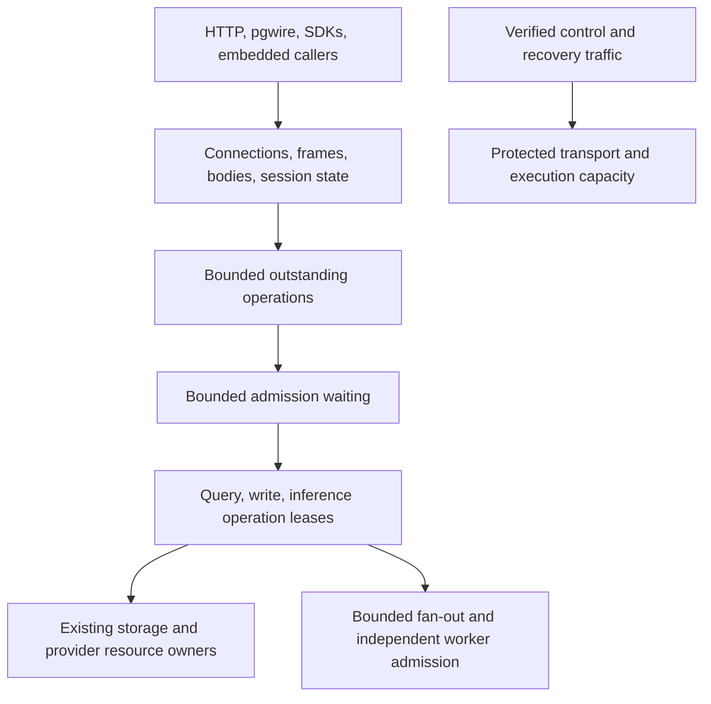

# Workload Admission and Scheduling

Status: bounded default query waiting, startup-resolved runnable capacity,
protected HTTP dispatch, a bounded SQL executor, reusable outbound clients, and
aggregate pgwire/session budgets are implemented. Python and TypeScript SDK
clients and the root Go Antfly/inference SDK clients also have bounded local
FIFO admission. Native session, H1/H2 dispatch, outbound reuse, and particular
retained-state paths have focused checks. Owned remote-read families remain
disabled by default; complete operator eligibility, distributed ownership,
resource-progress and default-policy qualification remain open. See
[implementation scope and restrictions](WORKLOAD_POOLING_IMPLEMENTATION.md).

Original source baseline: `e4d707de5634a8d758c606b4432037e1a1682052` on
`origin/main`, verified against GitHub on 2026-10-05. Active development uses one
branch, `codex/workload-scheduling`, in `.worktrees/workload-scheduling`, and
[PR #849](https://github.com/antflydb/antfly/pull/849). Subsequent main merges and
implementation evidence are recorded in the implementation ledger.
The current merge includes `origin/main` through `beb332c973eaf78876f9ef798d3d959fe41f307d`
(merge commit `66b5522209`).

Native ABI 51, storage-owner ABI 109, engine descriptor 29, required preparation
file floor 10 and data-Raft protocol 28 fence persistent binding, original cohort handoff and typed
recovery status. New stable SQL/HTTP sessions retain their original routed
cohort before BEGIN. Required status compares actual saved mode and binding and
represents successful absence explicitly; read errors cannot authorize a fresh
BEGIN or follower cleanup. Legacy terminal aborts remain final.

Source `4c8ab4ee1a7143dc0e06b1e887475e7b0cb5afb7` adds key-plan derivation from canonical prepared requests
and every accepted-effect family, with field/action coverage guards, conservative
graph/tombstone bounds and owned deduplicated document prefixes. The new writer
entry derives its reservation from the stored frame and checks original lifetime
and file eligibility before payload lookup. The 66-case native run and 25/25
unchanged-consumer composition checks pass. The prepared request still needs its
authoritative intent/catalog provenance binding; this does not enable normal
PREPARE or supply derived-log/recovery resources. See the implementation ledger
for the exact proof and remaining full-design work.

Source `28afa047da9b0f97af35f9e5bdc80c866bc02c38` adds internal durable HA replay grants bound to stored
prepared frames and known physical inventory. Background writes atomically update
inventory and reserved publication bytes; materialization keeps credit until HA
ACK and final validation avoids cold frame/replay value reads. Six focused suites
qualify 163 executions, with the required-DB fixture-only
correction and exact source comparison recorded in the implementation ledger.
The unchanged consumer passes 25/25 composition steps. Reader floor 11 and private
owner version fences do not enable the full preparation protocol: complete plan
sizing, derived-log/recovery resource grants, legacy migration and normal drivers
remain open. Strong required providers and automatic scheduling defaults remain
unqualified; the full design is incomplete.

Source `65194cc0a474e11f500a5b7c64737322de64f69e` derives a conservative retirement wire shape from
known physical artifact inventory and shares canonical CJ2 sizing with the live
encoder. It covers both deletion/artifact copies and graph owner/endpoint hints,
with checked arithmetic and a real DB-deletion fixture. The 45-case wire and
14-case inventory suites pass. This is only the current-inventory contribution;
request/new effects, persistence envelopes, durable grants and recovery resource
ownership remain separate. See the implementation ledger for exact scope.

Source `5e48b391853a4a1069ce0370b5de70c88d531bff` validates the complete binary replay envelope before
allocating decoder metadata and exposes checked decoded-allocation payload sizes.
The 147-case replay-allocation suite and 43-case wire suite pass, including all
4096 field/hint shapes and zero-allocation malformed-record rejection. Existing
native/private ABI versions and CJ2 wire bytes remain unchanged. Allocator
provenance, retained scratch, input storage and future durable completion grants
remain separate from this payload bound; see the implementation ledger.

Source `c7de4b1b80ee26ce2643229f7cc39e6aaef21dbf` adds original call-scoped checks before,
during and after producer child CPU admission, preserving the first refusal and
physical child ownership until owning finish. Native 51/runnable 18/API 57 fence
the private layouts. The current focused run and immutable public consumer pass;
see the [implementation ledger](WORKLOAD_POOLING_IMPLEMENTATION.md) for evidence
and the separate remaining completion-funding work before PREPARE.

Source `97e121f317cb2c742730edd30e243a2d48ef9809` independently admits producer
CPU after eligible holder retirement. The parent parks, the child inherits its
original restrictions, and child retirement precedes checked parent CPU return
and holder reentry. Foreground write teams provide a scoped producer parent
without activating completion. Dense, sparse and nested asset contexts preserve
the child. Scoped provider fanout and PDF prefetch stay disabled. Native 50,
runnable 17 and API 56 fence the private layout changes; durable formats and
shared status numbers remain unchanged. The 81-step focused run passes 46
provider/admission cases, 21 PDF/funding cases and 16 write-team cases. The
immutable package passes 25/25 ReleaseSafe consumer build steps. Complete
eligibility, independent parallel children and durable completion reservations
before PREPARE remain unfinished; required-mode providers remain disabled.

Source `decfefff899c926b0ac7ccb3a07ac2ca6118d65f` retires owned policy and capture
admissions around eligible controlled document/relational precompute. Reentry
uses the original root and controls, checks the saved policy tuple, preserves
both expiry domains and retires partial admissions. Caller CPU remains held;
external snapshot/borrowed policy paths and in-apply fallback retain their
existing holders. The 69-step focused run passes 45 provider/admission cases,
including actual publication-start rejection before row commit. The immutable
package passes 25/25 ReleaseSafe consumer build steps. This enables
the next independently funded producer phase; it does not complete that CPU
handoff or durable reservations before PREPARE. Full design work remains open.

Source `634626b904c19a1cc190ce0a7691b0ca99de2628` removes the per-request executor
from controlled owner writes. Request IO survives pre-decision callbacks;
configured host IO supplies requests without an explicit executor. Clock-only
IO is separate, explicit invalid descriptors fail, and owner transitions sleep
on their original executor. Seven admission cases, eight context cases,
42 provider regressions and three unchanged-source IO cases pass, with 87/87
focused build steps and 25/25 immutable-package ReleaseSafe consumer steps.
The small linked visibility fixture proves its contract; source-controller and
range-dispatch coverage remain semantic only. Full archive/cold-source runtime
remain unqualified. The full design is incomplete.

Source `fc34f7465f4bd2d8019ee59fac80de149bb8fa8b` carries original lifetime,
the supplied provider IO descriptor and projected deadlines through ordinary controlled native batch preparation.
Owned runtime/config copies intersect inherited provider controls; rejected
outputs retire without changing the shared lifecycle guard or configuration.
Native error translation preserves the already latched original cause without
polling foreground authority after durability. Request counters still reach the
resident runtime. The caller retains CPU while holders live; controlled
preparation leaves provider fanout and PDF prefetch disabled until independent
producer execution is funded.

The latest merged source passes 76/76 focused build steps with 42 provider/
admission/telemetry cases and 21 PDF/funding cases. Two cached private error-name
round trips retain unchanged-source evidence. Main's foreign-executor lifetime
case and three Bloom cases also pass with the pinned joinable Zig library.
The immutable merged package has 4548 matching public sources and passes 25/25
ReleaseSafe consumer build steps. Qualification binds 5264 unchanged native
inputs in `preparation-latest-main-verified.json`. Conflict resolution preserves
both admission and storage-test catalog exports and dynamic reader-version
coverage. Normal commit hooks pass. The consumer checks module composition;
source-controller coverage is semantic only. Full linked archive/cold-source
runtime remain unqualified. The same worktree, branch and PR remain in use.

Source `aec0358112df715a12fac03bd0184a82df57a60d` hardens provider control boundaries. Fallible
original authority survives composed cancellation and boolean transport polling;
input preparation and returned output remain fenced. Scoped asset dispatch cannot
select an unscoped batch or planner, while controlled scalar fallback and atomic
transport compatibility remain available. The focused 88-step run, two private name round-trip cases and 25-step
immutable-package ReleaseSafe consumer pass.
Original provider contexts now reach ordinary controlled generated preparation.
Independent producer CPU/children outside holders, durable accepted effects and
completion reservations before PREPARE, and required-mode activation remain
unfinished. The full design remains incomplete.

Source `7ca0f1d0b40aa424d5de9ca8ebfe8881772706cb` funds precommit producer invocation and
coordinator planning metadata from the original preparation allocator, retained
through physical joins. Native windows and inference outputs keep their existing
grants and raw backing. Explicit scheduler allocator ownership and quota/error
regressions pass with 76/76 focused build steps and 25/25 immutable-package
ReleaseSafe consumer steps. Original provider execution
controls, durable completion resource reservations and required-mode providers
remain open.

Source `4e43317f563766329da969438208fbba16ae1571` adds scoped resource admission to borrowed
original executions. The same owner admits CPU and the complete resource bundle;
temporary callbacks detach on every return, while physical allocation credit
survives CPU finish until actual retirement. Read and child adapters preserve
original restrictions through queueing and post-grant policy validation.
Runnable ABI 16 and API ABI 55 reject older callback layouts. The focused resource
and 100-step native integration runs pass, as does the 25-step immutable-package
ReleaseSafe consumer. Original generated-effect producers,
completion bundles and required-mode providers remain unfinished and disabled.

Source `248aa89954b727b4675491ed2826239ae4b1ff7c` carries original completion
execution through ordinary native ACK and ACK-many, including both local worker
adapters. Funded scratch, controlled record/membership reads and atomic staging
preserve exact failures without partial acknowledgement. Apply/store-gate
contention returns retry debt to the existing owner. Native absence after cleanup
remains a no-op; retained coordinator self-ACK still follows durable response
recording. Mixed-version scalar fallback requires an explicit typed unsupported
HTTP response, rather than an error name that could be original rejection.
Runtime-failure ABI 66 adds InvalidParticipant at 0x1000E with all old numbers
preserved. The focused 94-step native run, direct WAL scenarios and 25-step
immutable-package ReleaseSafe consumer pass. The full linked archive and source
cold-open runtime remain unqualified; required preparation providers and funded
original producers remain unwired.

Source `b24235bc0854ba92ac66706438466c185634f799` carries original admission through
typed ordinary native PREPARE, borrowing every intent field. Validation and
principal parsing use preparation budgets; snapshot-held validation checks
lifetime without lending CPU, and controlled relational rows retain one worker.
Controlled validation avoids an uncontrolled schema-mode apply wait and rejects
policy transitions without trying to finalize them. Actual native contention,
original-error, schema/transform, private-plan and restart regressions pass with
94/94 focused build steps and 25/25 immutable-package ReleaseSafe consumer steps.
Required
providers, funded producers and authenticated hidden PREPARE/completion remain
open; neither required mode nor the full design is activated by this change.

Source `53099a8ffc4f296b90240aa57ec5c42030d3a9df` carries original execution and
cancellation through ordinary native commit/abort and atomic participant
acknowledgement. Contended completion returns to the same durable retry owner; the
later indexed commit pipeline also bounds admission with retained CPU. Original
visibility lending resumes only after service holders retire. Actual full-text
commit and retry, pre-holder lending/canceled reentry, restart and original error
identity checks pass alongside the coordinator and packaged-source checks.
Storage-owner ABI 108 and runtime-failure ABI 66 preserve the new
completion-pending identity. Controlled hidden completion and required preparation
remain closed pending their authenticated native Plan, provider and producer work.

Source `e1c19bf0a44c40bd220cfffd4c4cffffbc68257a` carries original admission through a typed native
transaction BEGIN. Validation workspace is admitted before backing allocation;
CPU is lent only before policy/apply holders, original failures remain errors,
and the durable restore plan is checked under apply ownership. Successful BEGIN
remains authoritative after physical completion. Ten native storage cases,
156 coordinator/companion cases, both startup profiles and 25 packaged-source
consumer steps pass. The actual source controller has semantic analysis only;
full linked archive runtime qualification remains open. This ordinary BEGIN fix
does not wire or activate required preparation providers.

Source `488b54d1a194399c5a04490069be51547de92552` shares the durable reader
epoch between local admission and capability negotiation. Stale readiness claims
now fail before BEGIN; restart checks preserve rejection without a transaction
or apply receipt. The focused coordinator/durable suites and immutable package
consumer pass. Actual required mutation providers remain unwired.

Source `090dc709dce3b77143bc5444f9013c7e1fd13625` adds independently funded
current online status-owner preparation with bounded scheduling metadata,
original expiry, adaptive admitted workspace and fresh metadata/quorum
confirmation. Pending owners cannot serve status; original failures remain
errors. Committed apply work preempts initial online certification, and checked
I/O suspension leaves foreground CPU available. The focused build and
public-package consumer checks pass. The storage-controls repairs now pass all
51 cases with no crashes, plus 119 physical resource-accounting cases. The merged
source passes 13 focused native targets, 109 Python SDK tests, 143 TypeScript SDK
tests and type checking, and 25 immutable-package ReleaseSafe consumer steps.
See the latest implementation ledger section and its verified receipt.
Required mutation providers and original producers,
hidden-owner preparation, fresh route authority, transport,
migration/activation, completion resource bundles and broader fault
qualification remain open. Full linked storage-owner runtime remains unqualified
and full Linux qualification remains waived.

The full goal remains safe, bounded execution sharing across many connections
by default, with fair scheduling and bounded waiting, preserving session
semantics, query correctness, durability and control progress under overload.
The delivery milestones below are stages of that goal within the same branch
and PR. Full qualification is waived for this work; focused correctness and
integration verification remain required. The waiver does not establish that
automatic defaults or the full design are complete.

This document carries forward the architecture from [PR #849](https://github.com/antflydb/antfly/pull/849),
with a smaller first delivery and integration points checked against this baseline.
The [original design](https://github.com/antflydb/antfly/blob/8bb3345e340f8d3a47e1f4067c9d8e6ef7af4a12/zig/WORKLOAD_SCHEDULING.md)
remains the source for the broader scheduling proposal. Historical implementation,
operations, and qualification receipts describe that branch, not this baseline.

Historical references are pinned to the reviewed PR head:

| Reference | How to use it |
| --- | --- |
| [Implementation record](https://github.com/antflydb/antfly/blob/8bb3345e340f8d3a47e1f4067c9d8e6ef7af4a12/zig/WORKLOAD_SCHEDULING_IMPLEMENTATION.md) | Find candidate mechanisms and ownership audits to port selectively |
| [Operations guide](https://github.com/antflydb/antfly/blob/8bb3345e340f8d3a47e1f4067c9d8e6ef7af4a12/zig/WORKLOAD_SCHEDULING_OPERATIONS.md) | Identify prior opt-in policy, compatibility notes, and coverage limitations |
| [Validation record](https://github.com/antflydb/antfly/blob/8bb3345e340f8d3a47e1f4067c9d8e6ef7af4a12/zig/WORKLOAD_SCHEDULING_VALIDATION.md) | Locate test scenarios and receipts; rerun ported tests on the new baseline |
| [Qualification gates](https://github.com/antflydb/antfly/blob/8bb3345e340f8d3a47e1f4067c9d8e6ef7af4a12/zig/WORKLOAD_SCHEDULING_QUALIFICATION.md) | Reuse relevant workload definitions without inheriting release approval |

## Decision and customer contract

Build transport-independent admission inside Antfly. Many connected clients share
a smaller, bounded amount of expensive execution capacity. Idle connections do
not reserve query execution. Brief bursts can wait within count, byte, and time
bounds; sustained overload receives an explicit response. Each execution node
enforces its own limits. Local, self-hosted, and Cloud deployments use the same
mechanisms; Cloud supplies the resource envelope and customer policy.

This provides the useful resource-sharing behavior of a connection pooler without
requiring an extra service. Antfly owns native execution resources rather than a
pool of PostgreSQL backend sessions. Keep protocol session state on its existing
owner and borrow execution capacity when operations need it. Preserve SQL session
semantics, query results, consistency, recall, and durability.

The first delivery is bounded operation admission across HTTP and pgwire. Its
leases count admitted operations, including existing resource waits; they are
not CPU runnable permits. Fine-grained suspension and fairness are later work.
Connection efficiency and measured default selection are separate deliveries.

## Current baseline

These are existing mechanisms, not completed claims for the new design:

| Surface | Current behavior | Required integration |
| --- | --- | --- |
| [Foreground admission](pkg/antfly/src/common/request_admission.zig) | Process-local fail-fast counters and single-release leases; zero disables the count gate | Add bounded waiting while preserving explicit limits and the fast path |
| [Configuration](pkg/antfly-embedded/src/common/config.zig) | Query/write/inference defaults are 32/16/32; pgwire defaults to 32 connections and is disabled | Keep these semantics during the initial rollout; define automatic sizing separately |
| [Route policy](pkg/antfly/src/api/request_admission_policy.zig) and [HTTP adapter](pkg/antfly/src/api/httpx_handler.zig) | Operation classification, admission, body ownership, and overload responses | Audit coverage and acquire one operation lease at the actual owning boundary |
| [HTTP server](lib/httpx/src/server/server.zig) and [shared runtime](lib/httpx/src/server/http_runtime.zig) | Separate bounded listener, connection, and request-task execution; aggregate body budgeting; H1 disconnect observation and H2 limits | Size outstanding handler capacity separately from operation execution; queued handlers must not block release/control work |
| [DATA runtime](pkg/antfly/src/data/runtime.zig) and [standalone runtime](pkg/antfly/src/standalone/runtime.zig) | Deployment-specific HTTP capacities and body budgets; standalone connection sizing reserves descriptor headroom | Reconcile effective budgets across roles rather than inheriting library defaults |
| [pgwire listener](pkg/antfly/src/pgwire/server.zig) and [protocol](pkg/antfly/src/pgwire/protocol.zig) | Bounded connections, per-connection memory, prepared statements, portals, cursors, deadlines, cancellation handshake headroom | Budget aggregate session state and separate connected-session capacity from executing operations |
| [Native SQL adapter](pkg/antfly/src/api/sql_pgwire.zig) | Preparation and execution admission; retained stream resources and detached-page reacquisition | Extend the native admission owner; avoid a second lease around the protocol adapter |
| [Retained reads](pkg/antfly/src/api/retained_read_owner.zig) and [SQL sessions](pkg/antfly/src/api/sql_session.zig) | Explicit owners for snapshots/results and transaction state | Preserve owner lifetime and identity; account retained state independently where supported |
| [Waiters](pkg/antfly/src/storage/admission_waiter.zig), [dense admission](pkg/antfly/src/storage/dense_work_admission.zig), and [resource manager](pkg/antfly/src/storage/resource_manager.zig) | Existing lower-level queues and resource reservations | Record acquisition order and wait time; retain these authorities during coarse admission rollout |
| [Outbound client](lib/httpx/src/client/client.zig) and [pool](lib/httpx/src/client/pool.zig) | TCP/TLS reuse, H2 support, default pool limits of 20 total and 5 per host; H1 pool exhaustion returns errors | Audit reusable owner lifetimes and total endpoint concurrency before changing pool behavior |

Current SQL cursors can retain execution admission together with a live snapshot;
detached retained output can reacquire admission for subsequent operations. Do
not assume every idle portal already releases execution admission. The first
delivery preserves existing coarse ownership until a release/reacquire boundary
is proven safe. Connected clients, executing requests, and retained snapshots
must be reported separately.

The original C30/C40 observations motivate testing around capacity 32. They do
not establish a new capacity value or demonstrate the cause of every failure.

## Resource model and ownership

Use independent budgets for transport/session state, outstanding operations,
waiting, admitted operations, and retained execution/output state. Reserve bytes
before retaining request bodies or decoded expansion. Transfer ownership without
an accounting gap; queue byte counters can reference an existing reservation
without charging the same allocation twice.

| Owner | Holds | Releases when |
| --- | --- | --- |
| Connection/session | Socket, protocol buffers, identity, settings, prepared plans | Disconnect and joined session cleanup |
| Outstanding operation | Owned request and cancellation context, response lifetime | Local work and required cleanup end or state transfers to another owner |
| Queue entry | Queue count and references to charged request bytes | Grant, expiry, rejection, or acknowledged cancellation |
| Operation lease | Existing query/write/inference concurrency slot | Existing execution owner completes or reaches an already verified detach boundary |
| Retained state | Snapshot, transaction, portal, cursor spool, output buffers | Actual destruction or transfer to a separately charged owner |
| Recovery obligation | Existing durable identity and required completion work | Existing transaction/recovery protocol establishes completion |

Initial queue entries must not acquire execution scratch, snapshots, locks, or
large result buffers. Bounded authentication and planning may precede execution
admission; identify and retain their separate limits. Preparation and schema
cache acquisition order must not create a cycle with execution admission.

An idle session holds no new operation lease. An idle transaction still retains
its durable session and transaction resources. A suspended portal may retain a
snapshot and its existing coarse lease; report that limitation and cap its
lifetime. A slow reader retains charged buffers until they are actually freed.
No connection count or per-connection byte limit substitutes for an aggregate
process memory bound.

## First delivery: bounded execution waiting

Extend the existing admission/waiter conventions with a FIFO queue per operation
class. Fixed limits remain authoritative. Every queue has a maximum count,
retained-byte allowance, and wait duration. The wait expires at the earlier of
the configured ceiling and the original operation deadline. Zero wait preserves
fail-fast behavior. Reject work that cannot fit the supported request envelope.

Use this lifecycle:

`received -> outstanding admitted -> queued -> operation admitted -> draining -> completed`

1. Queue insertion and count/byte reservation form one atomic ownership change.
2. Grant transfers ownership exactly once; cancellation racing grant either
   retires the entry or returns the granted lease exactly once.
3. Check deadline/cancellation immediately before the admitted callback begins.
   Expired queued work never executes.
4. Completion releases the operation lease only after the existing execution
   owner is quiescent. Client-visible cancellation is not proof of quiescence.
5. Shutdown stops grants, retires waiters, and joins active/cleanup owners before
   freeing borrowed callbacks or cancellation sources.
6. No scheduler mutex is held during I/O, execution, callbacks, or arbitrary wakes.

Waiting must use a runtime that supports the required suspension behavior. A
task API alone is not evidence that an OS thread is released. Measure native and
evented runtime behavior on the pinned Zig toolchain. The first implementation
must demonstrate bounded thread/task growth and that waiters cannot exhaust the
executor needed to complete admitted work or service cancellation. If that
requires transport/runtime changes, land them before enabling queues.

HTTP and pgwire enter through the same native operation owners. HTTP SQL and
pgwire SQL must have equivalent capacity, deadlines, and error meaning. Audit
document lookups, MCP, internal RPC, embedded, serverless, and job entry points;
record deliberate exemptions and avoid double acquisition on nested calls.
Each delivery names its supported paths; unintegrated paths retain documented
legacy behavior and cannot be advertised as sharing a new universal policy.

Each worker remains responsible for its resources. Existing distributed calls
must preserve the caller's remaining budget across admission, resource waiting,
and remote execution. Do not restart a timeout at each hop or serialize a local
monotonic timestamp as a shared clock. Reuse current wire contracts where valid;
version any necessary extension and define rolling-peer behavior.

Protected control/recovery work needs verified classification and bounded
capacity for connections, request dispatch, body bytes, execution, and cleanup.
Health-listener isolation and pgwire cancellation handshake headroom are useful
existing foundations. A request-task reserve alone cannot promise progress under
descriptor or heap exhaustion. Test the exact protected paths under saturation
and state the limits of the guarantee. Public workload hints cannot access them.

### Writes and transaction controls

Queue fresh writes only before execution and durable admission. Preserve each
path's existing irrevocable boundary, transaction identity, receipts, and recovery
handoff. COMMIT, ROLLBACK, ACK, and cleanup must not wait behind fresh foreground
work in a way that prevents that work from releasing resources.

After an irrevocable decision, deadline/disconnect can end response waiting but
cannot discard required completion. Keep the existing joined or durable owner;
report uncertainty conservatively. Do not automatically retry mutations. If a
write path cannot satisfy this ownership contract, retain its current fail-fast
behavior and document it before enabling write waiting on that path.

This delivery does not require a new physical-completion compiler, LSM pool,
WAL format, Raft acceptance contract, or storage ABI. Bugs found in existing
recovery paths receive focused fixes and tests rather than importing #849's
whole completion subsystem.

## Connection and session efficiency delivery

- Audit outbound clients by actual lifetime: service-owned reusable clients,
  short-lived clients, per-host limits, streams, and pool cleanup. Reuse is only
  useful while the owning client survives requests.
- Bound endpoint concurrency across all pool owners. If pool waiting is added,
  bound its count/time and consume the original deadline; protect transaction
  control transport and preserve uncertain-write classification.
- Measure idle HTTP/pgwire socket costs in descriptors, threads, virtual stacks,
  and resident memory. Do not raise connection limits to hide execution rejection.
- Add aggregate session/prepared-plan/portal/cursor budgets and idle transaction
  limits before claiming large idle-client scale. Preserve authentication,
  settings, catalog identity fences, and original cursor snapshots.
- Release computation capacity during output draining only at a verified owner
  boundary. Reacquire before further computation; never replay a cursor query or
  mutation to resume it. Keep coarse admission on paths lacking that boundary.

Prepared statements remain connection-owned; session and transaction settings
keep their current commit/rollback rules. This design does not rotate clients
through shared SQL sessions or adopt PgBouncer's session-feature restrictions.

## Configuration, errors, and observability

Preserve explicit `admission.*.max_concurrent_requests` values and legacy zero
as disabling that count gate. Zero does not disable transport or memory safety
and must not silently become automatic sizing. Initial waiting is opt-in. The
following are design concepts; finalize fields in the canonical configuration
schema and generate bindings before shipping:

| Concept | Meaning |
| --- | --- |
| Outstanding count and bytes | Hard retained-operation envelope |
| Queue count, bytes, and wait | Finite burst allowance within the original deadline |
| Fixed or automatic operation sizing | Explicit mode; resource-based initial sizing is separate from adaptive tuning |
| Session and retained-output budgets | Aggregate ceilings and finite idle/duration limits |
| Protected capacity | Verified control/recovery partitions within the same process envelope |

Reject contradictory settings. A limit reduction prevents new grants until
usage fits; it does not revoke live state. Retire excess waiters explicitly when
queue policy shrinks. Expose configured/effective values and policy version.

HTTP admission saturation retains 429 behavior with stable reason/stage and
retry guidance when known; unavailable/draining retains the existing 503
convention. Preserve the existing deadline status convention. Establish and test
pgwire SQLSTATE mappings against the current adapter, including extended-query
drain-until-Sync and ReadyForQuery transaction status. Known pre-execution
rejection can say execution did not start; missing evidence and unknown writes
must never be presented as safely retryable.

SDK reuse and optional local waiting reduce avoidable pressure but cannot enforce
node capacity across clients. Read retries require an explicit safe contract,
bounded attempts, and the original deadline. Streaming responses retain their
local admission owner until close or accounted transfer.

Metrics distinguish connected sessions, outstanding/queued/admitted operations,
queued and retained bytes, queue/resource/execution/output wait, rejection reason,
cancellation stage, and recovery progress. Include thread/task and descriptor
usage for runtime qualification. Preserve existing metric meanings and bound
label cardinality. Report timing from original submission, including retries.

## Qualification and default-selection delivery

For this implementation branch, the user waived full qualification. The complete
resource/performance sweep below remains a reference for future full validation,
not a pending builder or approval gate. Default activation still requires focused
evidence for the supported production correctness and resource-bound contracts.
See the current [completion audit](WORKLOAD_POOLING_IMPLEMENTATION.md#completion-audit-against-the-full-delivery-goal)
for the remaining implementation and verification requirements.

Correctness gates precede performance claims:

| Scenario | Required assertion |
| --- | --- |
| Enqueue allocation/count/byte failure | No execution, leaked reservation, or partially linked waiter |
| Grant vs timeout/cancel/disconnect/shutdown | One owner; exactly one release; no expired queued callback starts |
| Full queues and all handler lanes occupied | Existing execution can finish; verified control/cleanup paths progress |
| Idle sessions, suspended portals, slow readers | No unbounded thread/task/state growth; retained resources remain charged |
| Prepared/session/transaction state across waits | Same settings, identity fences, snapshots, results, and transaction status |
| Mixed HTTP and pgwire; nested/remote calls | Shared operation limits at the owner; no double lease or fresh hop deadline |
| Disconnect after durable write admission | Original identity/receipt and required recovery survive; no automatic replay |
| Policy reduction and restart/drain | Live state stays valid; waiters retire; counters reconcile after quiescence |

Use deterministic virtual-time/state-machine tests for races and real sockets
for runtime suspension, disconnect, H1/H2 dispatch, pgwire cancellation, and slow
consumer behavior. Existing #849 tests are candidate fixtures to port and rerun;
their historical passing receipts are not evidence for this branch.

For each supported small/large CPU-memory-FD envelope, retain a versioned
qualification manifest **before** running the candidate. It fixes offered rate,
connection count, operation capacity, queue count/bytes/wait, data/query semantics,
recall, seed, warm/cold mode, and numerical acceptance thresholds. Required
thresholds are low-load p95 regression allowance, completed-throughput floor,
queue/end-to-end p95/p99 limits, process memory/thread/FD ceilings, maximum
control-operation latency, and recovery-to-baseline time. No default ships with
these thresholds left unspecified or chosen after observing results.

Compare current main, fixed-capacity waiting, and proposed automatic defaults
under identical resource limits. Sweep C1/5/10/20/30/40/60/80 and beyond saturation;
include many idle clients with few active operations, burst arrivals, controlled
open-loop sustained overload, mixed cheap/expensive reads and writes, background
maintenance, slow inference, and slow output consumers. Count all retries,
failures, queue expiry, and submitted/completed work. Closed-loop throughput
alone can conceal offered load.

Hard queue count/byte limits and configured wait deadlines must hold exactly,
subject to declared timer resolution. Check actual process memory as well as
tracked reservations; incomplete allocation coverage cannot justify a total-heap
guarantee. After overload stops, queued work must retire within its bound and
metrics/resources must recover within the manifest's numerical threshold.

Only then choose automatic initial sizing from available CPU, memory/container
limits, descriptor headroom, and retained-state costs, with conservative detection
fallbacks. Publish the formula, effective limits, and supported envelopes. This
document intentionally selects no universal replacement for capacity 32 and no
new default connection count or wait duration.

## Delivery sequence and separate work

1. Inventory the admission owners/acquisition order and protected paths on current
   main; specify the queue state machine and canonical opt-in configuration.
   Port focused waiter tests and integrate fixed bounded waiting at native HTTP
   and pgwire operation boundaries. Preserve unsupported paths explicitly.
2. Qualify runtime suspension and connection/session efficiency; add necessary
   transport capacity, reusable client lifetime, and aggregate state safeguards.
   Keep each change independently reviewable with fixed/fail-fast rollback.
3. Retain focused correctness and integration evidence, then implement and
   review automatic sizing and bounded-wait defaults within the same branch and
   PR. The full qualification campaign is waived; default behavior still needs
   evidence matching its safety, fairness and overload guarantees.

Within the original broader design, helper/fan-out accounting, verified
operator suspend/resume, weighted fairness, bounded backfill and large-request
barriers, cooperative quanta, demotion, and distributed uncertainty ledgers remain
later work. FIFO operation queues do not establish within-class latency isolation
or a bound on every remote attempt. Adaptive tuning follows reliable fixed-mode
telemetry and needs hard bounds, hysteresis, bounded steps, and fallback.

Durable physical completion is a separate storage/recovery project. Its original
[completion requirements and limitations](https://github.com/antflydb/antfly/blob/8bb3345e340f8d3a47e1f4067c9d8e6ef7af4a12/zig/WORKLOAD_SCHEDULING_COMPLETION.md)
and [LSM design](https://github.com/antflydb/antfly/blob/8bb3345e340f8d3a47e1f4067c9d8e6ef7af4a12/zig/WORKLOAD_LSM_COMPLETION.md)
remain historical references. Preserve accepted-write ownership in every delivery;
the basic pooling project makes no new promise of allocation-free physical
completion after consensus acceptance.

Cloud exposes effective capacity, queue time, pressure, and overload reasons;
it forwards deadlines and keeps its own queues bounded. Account-wide policy and
adaptive scaling are later product work, not a synchronous dependency for engine
admission. Neither client limits nor additional gateway replicas may substitute
for node resource safety.

## Current resource integration

### Transaction completion before the commit decision

Status: durable effect storage, required-BEGIN commit gate, accepted-plan DB
materialization, sealed-frame serving catalog leases and explicit local file
eligibility implemented. Distributed prepare orchestration, peer/ordered-migration
policy and completion reservations remain pending.
The physical artifact inventory and
transaction batch publication credit are implemented, but neither funds every
future transaction replay effect. The following ordering is required before
extending that credit to replay or claiming bounded mandatory completion.

The current coordinator preserves the public sync level. In
[`executeMultiTableCommitOnce`](pkg/antfly/src/api/distributed_txn.zig), it prepares
all participants, resolves the first participant durably, disables abort, then
resolves followers with the caller's sync level. Only `propose` is promoted to
`write` for the coordinator. `TransactionIntentRequest` has no sync level;
`PrepareFanoutTask` therefore cannot communicate the requested generated work.
Participant resolution calls the ordinary mutation pipeline, where
`generatedPrecomputeModeForSyncLevel` selects generated precomputation for
`enrichments` and `full_index`. Consequently a follower can encounter producer
failure or new resource admission after the coordinator's commit decision.
These are source observations, not fault-injection qualification.

Recovery reinforces the need for durable preparation: server
`resolveParticipant` resolves at `write`, and embedded
`resolveFinalizedTransactionIntentsForRecovery` resolves at `propose`. A durable
effect plan must survive these weaker acknowledgement levels. Recovery must not
reconstruct a different effect set from the retry's sync level or rerun a
nondeterministic producer whose output was accepted before the decision.

| Phase | Required ownership and behavior |
| --- | --- |
| Prepare request | Carry an explicit, versioned preparation contract independently of acknowledgement/visibility level. All participants receive the same requested producer semantics before any commit decision. |
| Speculative preparation | On the proposal leader or embedded caller, use the original controlled preparation owner to compute eligible synchronous generated effects. Do this before Raft proposal/application and outside apply/catalog/storage writer fences. Reject producer failure, allocation failure and unavailable credit here. |
| Durable prepare | Atomically persist intents, the preparation contract, immutable generated effects and remaining work descriptors, catalog identities, and completion reservations before voting prepared. Revalidate the observations used by speculative preparation under the existing apply fence. |
| Coordinator decision | Require a compatible durable prepare from every participant before writing the first committed participant record. A stronger retry cannot silently upgrade a prepared contract. |
| Participant commit | Consume the persisted effect plan and existing reservations. Choose visibility waits from the request, but choose mutation effects from durable preparation. Do not invoke a fresh mandatory producer or replay-credit grant. |
| Recovery and acknowledgement | Restart, leadership change, lost replies and weaker recovery sync levels preserve the same effects. Keep each reservation until its actual durable dependency is retired; transaction resolution alone does not retire HA delivery debt. |
| Abort | Atomically retire prepared effects and their reservations with intent cleanup. Retry remains idempotent, including uncertain physical commits. |

The durable representation must cover the semantics of
[`PrecomputedGeneratedBatch`](pkg/antfly-embedded/src/storage/db/execution_resources.zig):
artifact writes/deletes, derived documents, dense/sparse embeddings, generated
references and coverage outcomes. Persisting only artifact keys or an inference
memo loses effects. Bind the representation to the intent revision, transaction
identity and pinned catalog identities, validate checksums and checked lengths,
and account its retained bytes, decoder scratch and eventual publication bytes.
Repeated preparation must reuse the accepted revision or atomically replace its
effects and grants while the transaction remains pending. It must not rerun a
producer merely because a prepare response was lost.

[`prepared_transaction_effects`](pkg/antfly-embedded/src/storage/db/prepared_transaction_effects.zig)
provides the first part of this representation. Its checksummed `ATPE` v1 frame
binds all seven effect families to the transaction ID, intent revision, intent
digest, catalog digest, optional schema version and preparation mode. It omits
request-local text JSON roots and their accounting, while retaining schema and
write-plan generation fields. Encoding checks its exact size and decode-storage
bound before allocating the frame. Decoding validates tags, lengths, checksum,
identity and full consumption before allocating one independently owned backing
buffer. Limits are 64 MiB encoded and 256 MiB decoded; copying and hashing check
original controls every 4 KiB. A fixed wire fixture and allocation/control failure
tests cover the format.

The transaction manager can now seal a frame against an existing prepared intent
revision. It derives the input digest from actual sorted intent keys and encoded
values, transaction begin/creation identity and revision, and reads the schema
binding from the durable lease. The DB owner supplies the catalog digest and
mode under its apply fence; that digest must include table/shard identity as
well as catalog generations before integration. A seal validates those bindings, charges its actual
retained bytes to the DocStore durable backlog, and freezes further intent writes.
Identical retries reuse the accepted frame and revision; conflicting generated
results cannot replace it. A rejected grant leaves the prior prepare mutable.

Loading a sealed plan owns its decoded slab independently of the input buffer.
Plan-aware low-level resolution verifies the accepted frame fingerprint and
revision, and retires the frame and its retention credit with intent resolution.
The transaction manager accepts all effect mutations from its trusted materializer.
The DB adapter loads accepted effects under apply ownership, clones all seven
families into its preparation allocator, and supplies them to the ordinary
artifact/replay/coverage pipeline without running a fresh mandatory producer.
The decoded slab remains separately owned until the call finishes. The exact
catalog bytes and physical table/shard/range identity are checked under apply
before staging and at the atomic decision. A mismatch preserves the obligation;
the sealed frame now retains these serving definitions through atomic completion.
Legacy commit resolution refuses sealed plans. Abort can retire opaque or corrupt
plans. Unexpected plans left beside already-resolved committed records remain
fenced for repair rather than being silently garbage-collected. Terminal decision
conflicts retain priority over plan errors. Native WAL reopen, quota, replacement,
retry and ownership tests cover this storage lifecycle.

An opt-in storage BEGIN atomically persists a checksummed preparation requirement
and its immutable mode alongside the transaction record and ordered receipt.
Required transactions cannot use legacy commit resolution even before their first
intent or seal. Incremental intent writes remain legal until sealing. Existing
legacy transactions cannot upgrade to this contract after BEGIN; identical retries
reuse the requirement and its charge. The requirement shares the bounded durable
publication pool and retires atomically on abort or accepted-plan consumption.
Native ABI 31 also fences the accepted-plan owner added to transaction resolution;
the ATPE effect format
is unchanged.

Generic transaction-manager recovery defers committed requirements and accepted
plans. DB recovery first attempts accepted-plan materialization, including plans
with no row intents. Unsealed, corrupt or unavailable-catalog obligations remain
deferred while unrelated legacy recovery drains. Only atomic plan consumption
proves completion; a terminal decision with no row intents is insufficient.
Authoritative abort retires opaque preparation metadata through ordinary hooks.

Normal HTTP/SQL/embedded PREPARE does not invoke sealing yet. This API therefore
does not establish a new final vote, negotiated peer support, generated production
before the decision, negotiated catalog-retention policy or mandatory completion grants.
The durable pool charge funds the frame itself, not future replay/output or
working memory. Raw-backend bypass and import/downgrade eligibility still require
the protocol's migration fence before activation. Existing caller apply ownership
and non-yielding retained controls are required around the storage transition.

A sealed frame also serves as a durable lease on the current index, enrichment
and resolver catalogs. Catalog publication and reconciliation reject changes
while any frame remains; exact byte-identical publication is allowed. Presence
checks use bounded keys-only metadata seeks, including malformed or orphan frames.
They do not decode effect payloads or allocate a new lease record. The existing
frame retention charge funds the lease. Commit and abort retire it in the same
physical batch as the effects or intent cleanup. Schema and physical ownership
checks also recognize frames whose ordinary schema sidecar is missing.

Speculative producer work does not hold this lease. The DB-owned final seal
rechecks the actual catalog/namespace digest under apply before publishing the
frame; a stale attempt leaves no pin. Serving mutation paths reject an existing
lease before pausing dependent workers and recheck before publication. Unchanged
producer/resolver refreshes and exact ordered alignment continue to work.
The initial native-ABI-33/storage-owner-ABI-101 implementation added local activation through
`DB.enablePreparedTransactionProtocol()`. It atomically publishes permanent reader
floor and catalog-envelope version 5. DB-owned required BEGIN checks both and the
permanent replacement baseline before creating a record. Older readers reject
that format. Activation refuses unfenced preparation records and ordered catalog
authority; it does not constitute a peer capability vote or coordinated migration.
Commit/abort and later catalog changes retain the floor. Native ABI 35 adds a
validated owner/revision/import witness: required BEGIN reads both scalar floors
and checks that witness without hydrating the resolver document. Aborted catalog
staging leaves it valid; raw or ambiguous catalog commits and physical-generation
adoption require validation before eligibility can resume. Full peer negotiation,
ordered/import migration and predecision completion reservations remain open.

Existing producer eligibility remains authoritative:
[`shouldPrecomputeGeneratedRequest`](pkg/antfly-embedded/src/storage/db/mutation_preparation.zig)
defers committed-graph/neighbor-context work and PDF page images. Preserve those
descriptors and their separately funded postcommit execution; do not mark their
coverage complete during prepare. Extending the public precommit guarantee to
those producers would require another semantic design, not moving them into the
ordinary text precompute path. `propose`, `write` and `full_text` must not acquire
synchronous inference obligations merely to simplify reservation accounting.

Replay funding has two inputs: the prepared immutable effects and the exact
current physical artifact inventory of each affected document. Derive the wire
bound from the actual CJ2 field/list multiplicities and endpoint-hint encoding,
using checked arithmetic; do not treat artifact count as a byte budget or
assume the existing batch JSON expansion formula funds replay. Pinned catalogs
must cover every catalog that can change those possible effects. Sealed frames
now retain the serving index, enrichment and resolver definitions; replay growth
still needs its own predecision reservation and atomic adjustment.

Background changes to an intent-owned document can increase its later deletion
or replacement replay. Such a mutation must update artifact inventory and the
affected prepared transaction's replay reservation in the same backend batch,
under the existing shared publication mutation gate. If growth cannot be funded,
reject the background mutation before it changes physical state. Shrinking work
releases only the amount no longer owed. Commit consumes the funded current view
under apply ownership. Inventory updates, reservation RMW and aggregate debt
staging need an explicit ordering that avoids recursive capture and cannot
commit one without the others. Invalidated/unknown legacy inventory requires
predecision reconciliation; it must never be interpreted as zero or become a
new reason to refuse resolution of an already committed legacy transaction.

Use a new envelope version that old peers reject rather than an optional JSON
field they may ignore. Replicated application consumes already prepared data;
followers must not perform independent inference. Legacy pending transactions
retain their resolution policy and drain through an explicit migration fence.
Import, restore, downgrade and raw-backend bypass need an eligibility rule for
the new guarantee. A legacy prepare without this contract cannot be advertised
as funded merely because it has the existing batch-credit sidecar.

Implementation order and proof obligations:

1. Add the durable preparation contract and canonical effect codec, strict wire
   negotiation and idempotent revision rules through server, local and embedded
   entry points. Verify round trips, malformed/truncated lengths, allocation
   failure, old-peer rejection, restart and abort cleanup.
2. Move eligible generated work to controlled speculative preparation, persist
   the accepted effects with the vote, and consume them at resolution. Verify
   follower producer failure occurs before the first commit decision, lost
   prepare replies do not regenerate, and restart at `write`/`propose` preserves
   the accepted result. Cover every generated effect family and deferred work.
3. Fund derived replay from that plan plus current inventory and atomically
   adjust credits on background growth. Verify saturation, replacement, shrinking,
   concurrent namespace views, uncertain commit, restart/import/migration, graph
   endpoint hints, and independent batch/replay HA acknowledgements.

This protocol is only part of completion ownership. Backend working memory,
CPU, I/O and dependencies still need a minimum executable recovery bundle, and
the broader fairness, overload, transport and default-policy requirements of
the original design remain open. Full Linux qualification remains waived.

The [implementation ledger](WORKLOAD_POOLING_IMPLEMENTATION.md#resource-and-entry-point-integration)
tracks the API request and persistent allocation envelopes, HTTP output lifetime accounting, shared
pgwire deadline ownership, isolated bounded pgwire transport execution, and
context-aware MCP/A2A/extension/NDJSON, internal, embedded, serverless, and administrative paths. The
[idle-client qualification harness](qualification/workload-pooling/README.md)
records actual process resource costs against fixed startup and authenticated-cursor manifests. These
changes do not qualify a total-process heap cap or automatic scheduling defaults;
independent backend/model owners and uncooperative legacy callbacks remain explicit release work.

### Owned prepared-input snapshots

`TxnManager.capturePreparedIntents` now returns an allocator-owned snapshot
containing both the exact intent bytes and the contract hashed from those bytes.
Writes, deletes and prepared-row envelopes borrow the retained owned entries;
the capture does not clone their payloads a second time. The existing contract
API uses this same capture implementation internally and releases its snapshot.
Its digest framing and persisted formats are unchanged.

The producer-facing capture rejects terminal decisions, conflicts with the
required mode recorded at BEGIN, and existing immutable seals. The seal check
uses an admitted keys-only seek and rejects opaque/corrupt frames without reading
their effect payloads. Recovery retains its separate existing contract path for
a durable COMMIT whose intents still await application. Original admission
rejections unwind snapshot ownership, including failures during hashing.

`DBCore.capturePreparedTransactionInputs` checks durable protocol eligibility and
binds the owned input snapshot to the current catalog and physical identity under
the caller's apply fence. The caller must retain catalog/route leases during
production and revalidate at the final seal. This does not certify an arbitrary
caller-supplied DerivedBatch, include later auxiliary/group replay mutations,
reserve a derived-log quota or fund the minimum executable RAM/CPU/I/O/dependency
bundle. Normal PREPARE drivers and strong provider activation remain off; the
full scheduling objective remains incomplete. No native ABI, reader version or
durable format changes are required by this internal owner addition.

`prepared-input-snapshot-v3.json` and its raw log record 74 executed tests across
the prepared-effect, required-DB, replay-plan and durable replay-credit targets:
88/88 build steps, zero skips, failures or leaks. New cases retain producer bytes
across a later prepare, reject stale intent/catalog seals, enumerate caller-owned
allocation failures and original checkpoints, and refuse terminal/mode conflicts
before allocating an input snapshot. Opaque seals are also rejected. Full Linux
qualification remains waived; this run does not requalify public source packaging
or the full storage archive.

### Resolution consumes the validated input owner

Accepted-effect resolution now retains `PreparedResolutionInputs`: the decoded
accepted effects and the exact `PreparedIntentSnapshot` used to validate their
contract. The DB resolver builds its writes, deletes, durable relational-row map,
known intent keys and expected revision from that retained batch. It no longer
validates against one snapshot and collects a second input batch for application.
Legacy transactions retain their existing collection path. The convenience
`loadPreparedEffects` API uses the same validation and releases only the input
owner before returning its independently owned decoded effects.

The paired load is captured under the existing apply fence and retains both
allocator-owned inputs across staging. Final revision/catalog/fingerprint checks
remain in force; a durable COMMIT awaiting application uses this recovery path
without reopening producer admission. No ABI, reader version or durable format
changes are introduced. The new tests cover ownership after backend close,
allocation failures, every enumerated original checkpoint (including NotFound),
contract mismatch, and relational update/delete plus accepted output across
restart and idempotent retry. The protocol cancellation matrix now distinguishes
an injected rejection from an ordinal not reached by a shorter lock-wait path;
all actually injected rejections must retain their original identity.

`prepared-resolution-inputs-v3.json` and its raw log record 103 test executions
across prepared effects, required DB preparation and canonical replay encoding:
79/79 build steps, zero skips, failures or leaks. This establishes the resolution
input handoff, not predecision capture of every auxiliary/group physical and
replay mutation. Complete request preparation under retained schema/catalog/route
leases, atomic replay grants, derived-log quota and executable recovery bundles
remain required before normal PREPARE driver activation. The full scheduling
objective remains incomplete. Full Linux qualification is waived; public source
packaging and the full storage archive were not requalified by this run.

### Atomic accepted-frame and HA replay reservation seal

The trusted `TxnManager.sealPreparedEffectsAndReplayPlan` path validates the
stored intent/catalog contract and route binding, derives the replay key plan
from the supplied canonical request and decoded accepted effects, then publishes
the immutable frame, HA replay grant/claims and extra receipt in one backend
batch. A refused grant leaves no newly sealed frame or receipt; inputs remain
mutable within their separate intent-admission envelope. An identical retry
preserves debt, while changing the plan cannot replace an accepted reservation.

Backend batch callbacks now carry the borrowed scalar/key reservation and
confirmed-abort cancellation into the DocStore owner. Ordinary batch staging is
separate from commit so the grant is attached before publication. All three
transaction resolution writer branches release an existing prepared grant on
an authoritative abort before deleting its frame, in the same batch. Failed
allocation or original cancellation rolls the entire transition back. Raw
backends lacking the reservation capability fail closed. Native ABI 53 and
storage owner ABI 111 reject older callback layouts; reader version 11 and all
durable codecs remain unchanged.

This API trusts the caller to supply the complete canonical request, including
auxiliary/group physical and replay effects under retained schema/catalog/route
witnesses. It does not certify an arbitrary DerivedBatch or fund the derived-log
quota and executable recovery RAM/CPU/I/O/dependency bundle. The normal committed
resolution driver does not yet materialize/consume this HA grant. Normal
PREPARE drivers and strong provider activation remain off; the full scheduler
objective and migration/legacy eligibility requirements remain incomplete.

`prepared-replay-atomic-seal-verified.json` binds source commit `5875031295`,
5,286 native/schema input hashes and all 4,559 packaged public sources. The final
native run passed 72 custom-runner cases plus two owner-boundary cases, 97/97
build steps, with no skips, failures or leaks. Five new cases cover atomic
frame/grant/receipt publication, retry conflicts, saturated-pool refusal,
allocation/checkpoint rollback for both sealing and abort, and unsupported raw
backends. The unchanged independent ReleaseSafe package consumer passed 25/25
compile steps. Generated error-table and storage control-catalog checks also
passed. This is module-consumer qualification, not a full provider/storage
archive or cold-runtime qualification. Full Linux qualification remains waived.

### Committed resolution consumes the HA replay grant

Funded committed resolution now stages the exact canonical replay outbox before
deleting the accepted frame, within the same backend batch as local replay,
primary/effect changes and the terminal record. The DocStore outbox hook consumes
the existing reservation and releases its document claims while retaining the
HA replay debt. No new HA byte/record credit is acquired. Terminal completion
retries skip this transition and cannot rebuild old outboxes over newer data.

A funded transition without replay or with a payload exceeding its bound fails
before publication, retaining the prepared frame, grant and pending record.
Raw adapters without the replay reservation/cancellation capabilities reject
imported grant metadata instead of bypassing owner accounting. Confirmed abort
keeps its atomic cancellation path. Batch and replay outboxes retain independent
acknowledgements; deleting the replay outbox through the existing HA cleanup
path retires the replay grant. Missing publishers preserve the durable obligation.

Five new tests cover saturated-pool commit, both acknowledgement orders,
missing/oversized replay, caller allocation/checkpoint rollback, unsupported raw
adapters and actual DB commit/reopen/retry with retained HA debt. The restart case
also writes a newer row while the old replay is retained and verifies terminal
retries preserve it. Acknowledgement in these fixtures uses the explicit trusted
cleanup API; this is not external HA-cluster acknowledgement qualification.
`prepared-replay-commit-v4.json` and its log record 123 executed tests and 88/88
build steps, zero skips, failures or leaks, across prepared effects, required DB
preparation, durable replay credits and canonical replay encoding. No ABI,
reader-version or durable-format changes are introduced by this integration.

This supersedes the earlier limitation that committed resolution cannot consume
the sealed grant. It does not certify the predecision canonical request or its
auxiliary/group physical effects, fund the separate derived-log quota or reserve
the minimum executable recovery RAM/CPU/I/O/dependency bundle. Normal required
PREPARE negotiation and strong provider defaults remain off. Legacy/import/
restore eligibility and the full original scheduling/default-policy scope remain
incomplete. Full Linux qualification remains waived. Public package consumer and
full storage/provider archive qualification were not rerun for this private
behavior change.

### Authoritative primary-key floor at the replay seal

The funded seal now retains the exact intent snapshot used for its digest while
building the replay plan. Every non-metadata stored write contributes a mandatory
changed-key and possible-overwrite allowance; every stored deletion contributes
its deleted-key allowance. Their logical document roots are always included, so
existing physical artifact retirement is funded by the live inventory even when
the supplied DerivedBatch omits the primary keys entirely. Private metadata
intents use the same classification as transaction application and do not acquire
phantom document roots.

`deriveWithPrimaryKeys` tracks only borrowed authoritative keys and marks lanes
already covered by the supplied request or accepted effects. It adds missing
lanes without duplicating an existing allowance or reducing supplied
multiplicity. Possible overwrites are conservative because this layer has no
certified absence/read-set proof. The planner changes scalar budgets and roots,
not actual replay notifications or primary application semantics. Input and
accepted-effect decode owners retire before the publication writer opens; the
plan retains only its owned root prefixes and scalar wire totals.

Three new planner cases cover missing lanes/roots, reuse of supplied coverage,
duplicates/preserved documents, binary IDs, allocation failures and original
checkpoints. A new seal case uses an empty supplied request, real primary write/
delete intents and private metadata, verifies the existing embedding inventory's
retirement allowance, then commits its retirement and acknowledges replay. The
DB restart regression now overwrites an existing 512-byte document ID with an
empty supplied request; canonical changed/overwritten replay fits, survives
restart and HA retention, and terminal retries preserve a newer local write.

`prepared-primary-floor-v3.json` and its raw log record 137 executions across the
planner, prepared-effect, required DB, replay-credit and canonical encoding
suites: 97/97 steps, zero skips, failures or leaks. No ABI, reader version or
durable format changes are introduced. Public package/provider/archive
qualification was not rerun; full Linux qualification remains waived.

This establishes the primary-intent minimum, not full predecision certification.
Complete auxiliary/group/generated physical effects and replay keys still need
canonical preparation under retained schema/catalog/route witnesses. Separate
derived-log quota, minimum executable recovery bundles, legacy/import/restore
eligibility, normal required PREPARE negotiation and the original broader
scheduler/default-policy scope remain incomplete. Strong provider defaults stay
off and the full goal remains active.

### Assembled physical mutations must use preowned document roots

`deriveFromMutations` now derives the canonical replay shape and document-root
projection from the final primary-store write/delete lists. It covers auxiliary
physical user keys as well as original inputs; control/identity/replay metadata
outside the document namespace does not invent document roots. It reads only
keys and replay metadata, never mutation values, and returns owned root prefixes
plus scalar wire totals. Noncanonical empty-list encodings are rejected rather
than deriving a scalar size smaller than their wire representation.

Funded committed resolution derives this plan from its complete assembled batch
before materializing replay or deleting the frame. Every affected document root
must have a matching owner and frame-bound claim in the existing grant, and the
actual replay must fit its budget. A missing auxiliary root fails atomically even
when the replay bytes fit; reserved auxiliary writes and deletions succeed.
The ordinary materialization path still validates the entire grant/claim set
before releasing claims. Transactions without grants retain their existing path.
No ABI, reader version or durable format changes are introduced.

Three new planner cases cover primary and embedding keys, deleted document
roots, metadata exclusion, duplicate roots, malformed keys and noncanonical
records. A 4 KiB bounded allocator successfully plans mutations
with 64 KiB values, proving the planner does not copy those values. Caller-owned
allocation failures and every enumerated original checkpoint unwind their
owners. A new transaction case exercises auxiliary writes and absent deletions
with both covered and unreserved roots, including byte budgets large enough for
the refused replay. `prepared-physical-plan-v2.json` and its log record 141 test
executions and 97/97 build steps, zero skips, failures or leaks.

This is final assembled-key coverage at local resolution, not complete
predecision capture or certification of values/read dependencies. The pure
assembly derivation is shared groundwork for moving preparation before the vote;
that move still needs an owned complete plan and retained schema/catalog/route
and mutable read-set witnesses. Separate derived-log quota, minimum executable
recovery RAM/CPU/I/O/dependency funding, migration/legacy eligibility, normal
required PREPARE negotiation and original broader scheduling/default-policy
scope remain incomplete. Strong provider defaults stay off. External HA-cluster,
public source consumer and full provider/storage archive qualification were not
rerun here. Full Linux qualification remains waived.

### Detached mutation bytes before prepared resolution publication

Prepared committed resolution now captures the complete assembled explicit
writes, deletes and replay bytes into one owned allocation before acquiring the
local backend writer. The checked allocation bound includes descriptor alignment;
copying polls the original control in bounded chunks and unwinds on failure.
Order, duplicate writes and binary keys are preserved. Ordinary transaction
resolution retains its existing path.

Accepted DB resolution charges this allocation and manager scratch to the
existing relational preparation working-set budget. Quota refusal leaves the
transaction pending, its frame present and its document unpublished; both
refusal and successful publication release their preparation budget.

`owned-mutation-batch-v2.json` records 129 passing executions and 88/88 build
steps, with zero skips, failures or leaks. New cases cover input mutation/free
independence, an unaligned exactly bounded allocator, allocation/checkpoint
cleanup, quota refusal and funded publication. No ABI, reader or durable format
changes are introduced.

This owner is created before the local writer, not before the global vote. It
does not own catalog/schema/route/read witnesses or native commit participants,
and is not an executable recovery bundle. Moving full preparation before the
vote, separate derived-log funding, minimum recovery resources, normal required
PREPARE negotiation and broader scheduler/default-policy work remain incomplete.
Strong provider defaults stay off. Public consumer/provider archive and external
HA qualification were not rerun; full Linux qualification remains waived.

### Main integration: separate compatibility epochs

Merged origin/main at `6e014d9b45b10e66a8906fc0964f663475217257` into the
existing workload-scheduling branch. Both sides' appended regression cases and
Lite restore/backup targets are retained. Main owns reader versions 10/11 for
curation provenance and scoped curation; required preparation now uses 12 and
replay retention uses 13. Shared reader constants and encoding cover all floors,
and replay tests check both sidecars reject curation/preparation-only readers.
Main owns topology versions 36/37; root-signed remote initialization now requires
38, while resolver namespaces retain main's floor of 37. Mixed-peer admission
must distinguish these capabilities. Earlier qualification records describe their
historical numbers; they do not qualify the merged source. Strong defaults and
normal required PREPARE activation remain off.

`owned-mutation-main-merge-v2.json` and its raw log verify the merged source:
237 test executions, 127/127 build steps, zero skips, failures or leaks across
preparation, replay credit/encoding, remote-initialization metadata, Lite restore,
resolver HTTP and embedded API/DB targets. All native inputs stayed unchanged.
Full Linux qualification remains waived.

### Owned assembled bytes and authored native commit participant

`OwnedPhysicalPlan` now owns the complete explicit physical write/delete/replay
batch together with its authored-vector commit observer. The observer resolves
artifact keys against the final owned batch, preserving last-postimage semantics
without retaining the ingress descriptors. The combined owner can move before
callback attachment; its allocator and stable address must survive attachment
through backend commit. Schema/route/policy/read witnesses remain separate.

The mutation assembler constructs this owner for accepted prepared resolution
and native authored-vector ingress using its existing preparation allocator.
Detached bytes and participant maps/vectors share the preparation working-set
budget. Native content hashing polls the original control every 4 KiB; map and
vector assembly also poll it. Backend publication uses exactly these owned
bytes and the matching observer. After local commit joins the callbacks, the
extra owner retires before remote durability or derived-visibility waits.
Legacy non-authoritative ordinary batches retain their prior path.

Three new cases cover mutation/free of every input and ingress key, moving the
owner, actual erased callback attachment and validation of its emitted native
acceptance, reset without false acceptance, every caller allocation/original
checkpoint, and native metadata quota refusal when the detached slab itself
fits. The existing authored acceptance DB regression now runs in the focused
required-preparation suite, covering document/relational modes, transaction
resolution and reopen. `owned-native-physical-plan-v3.json` records 77 passing
executions and 70/70 build steps, zero skips, failures or leaks.

This is complete explicit byte ownership plus the authored-vector participant
at local publication, not complete predecision capture or an executable recovery
bundle. The assembler's orchestration and retained schema/catalog/route/policy
and mutable read-set witnesses still need to move ahead of the global vote.
Backend-synthesized effects, separate derived-log funding, minimum recovery
RAM/CPU/I/O/dependency ownership, migration eligibility, normal required PREPARE
negotiation and broader scheduler/default/session scope remain incomplete.
Strong defaults remain off. No ABI/reader/durable format changes are introduced
here; main's integrated floors remain preparation 12, replay retention 13 and
remote-initialization topology 38. Public consumer/provider/storage archive and
external HA qualification were not rerun; full Linux qualification remains waived.

### Retained preparation dependencies and transform ABA protection

The physical mutation owner now retains the schema view actually used by
preparation, existing extraction-plan and relational-index views, and a clone of
the original policy admission with unchanged expiry. It owns generated revision
entries, transform keys/timestamps/revisions and route boundary bytes. It records
core/store identity, root and schema namespace generations, identity namespace,
portable-import revision, the resolver catalog revision observed before
preparation, and extraction-plan generation. Validation runs under the caller's
apply/publication fence at capture and immediately before local publication.
Historical admitted schemas remain usable without becoming active again.

Immutable metadata is shared through retained references. Incoming witness keys
and arrays use the existing preparation allocator. Assembly which used no
immutable extraction snapshot records its generation without constructing a
whole catalog snapshot under the apply lock. The dependencies retire with the
physical/native owner after local commit, before remote or visibility waits;
all error paths release their references, leases and allocations.

Transform input capture now reads the document mutation revision from the same
MVCC snapshot as input JSON and timestamp. Ordinary and retained-plan validation
use the shared admitted read validator. This rejects delete/reinsert ABA even
when timestamp predicates still match, including absent-to-present-to-absent
changes. The revision probe retires before timestamp checks; validation no
longer constructs a predicate descriptor array proportional to the entire
transform batch. Original rejection identities remain intact.

Five new DB cases cover reference counts and policy expiry, current versus
historical schema lifetime, input retirement and generated ABA, root/catalog/
import/range invalidation, snapshot-free generation checks, every ownership
allocation and original NotFound/OutOfMemory/deadline rejection, present/absent
transform ABA, and a concurrent default write transform. That concurrent test
parks an increment derived from count 1, deletes/reinserts count 100 at the same
timestamp, and verifies bounded retry publishes 101. Existing native authored
acceptance, transaction resolution and reopen cases also pass.
`owned-preparation-dependencies-v8.json` and its log record 82 executions and
70/70 build steps, zero skips, failures or leaks.

These are retained existing semantic inputs and explicit read witnesses, not a
complete read certificate or durable route/read conflict authority. The catalog
revision covers same-store catalog writes; it is not a clock for all group or
backend metadata. General group/backend read coverage, live DB/execution-owner
lifetime, complete predecision capture, minimum executable recovery resources,
separate derived-log quota, migration eligibility, normal required PREPARE
negotiation and broader scheduler/default/session scope remain incomplete.
The caller must keep the DB/gate/allocator alive. Strong defaults remain off.
No ABI/RPC/durable format changes are introduced here. Public consumer/provider/
storage archive and external HA qualification were not rerun; full Linux
qualification remains waived.

### Owned group point reads and cursor observations

`prepared_read_set.Owned` captures unique point keys with value presence, length
and SHA-256, plus independent cursor transcripts for seek-after, seek-before,
next and previous operations. Seek arguments are owned; returned key/value bytes
are reduced to length/digest observations before source buffers retire. Empty
results and stopping rows are included, so validation detects inserted scan
members, empty-tail phantoms and changed boundaries. Unrelated writes which do
not change observed results remain valid.

The group overlay records underlying reads while its own staged writes/deletes
satisfy later overlay reads without becoming baseline observations. Capture
failure poisons the owner, including allocation errors and original controls;
caught failures cannot produce a partially sealed plan. All source cursors must
retire before sealing, and sealing clears borrowed control/failure addresses.
Poisoned sealed owners cannot transfer or validate. Copying/hashing polls in
4 KiB chunks. Incoming keys, commands and trace metadata use the preparation
allocator; source values are not retained.

A wrapper owns capture and first-error restoration around the physical mutation
implementation. Accepted prepared resolution and potential native authored-vector
writes capture group-overlay reads, seal/move them into the physical plan's
retained dependencies, and validate before local publication. Validation uses
one fresh immutable primary read and one live replay cursor at a time under
the caller's apply exclusion. The captured read owner retires after local commit
before remote/visibility waits, with the rest of the physical plan.

Three new unit cases cover point absence versus empty values, deduplication,
input retirement, overlay preimages, forward/reverse/interleaved cursor replay,
live-cursor transfer refusal, scan phantoms and stopping rows, changed values,
unrelated-write acceptance, every capture allocation and original control
rejection in capture/validation, and poisoned partial/sealed owner refusal.
A new DB case exercises native authored-vector writes which update grouped
metadata and survive reopen. Seven unchanged local production group cases also
pass, including publication, producer debt, ordered resolution, graph closure,
deleted descendants, scanner retirement and local effect-protocol compatibility.
`owned-group-read-set-v5.json` records 93 executions and 79/79 build steps, zero
skips, failures or leaks.

The full group target also requested provider archives with declared 24/28 GiB
bounds beyond the focused 20 GiB cap. That attempt ran no claimed tests.
`docstore-group-read-capture-test` runs the unchanged production group cases
through the local physical root; full archive and distributed protocol boundary
qualification remain unrun, consistent with the user's full-qualification waiver.
No ABI/RPC/reader/durable format change is introduced by this phase.

This is optimistic observation validation, not a durable read/conflict lease or
full predecision capture. Group baseline materializer callbacks and other direct
core/backend readers outside the overlay still need coverage. Existing metadata
predicate guards are whitelisted and range tracking covers row/index spans;
they do not yet protect arbitrary captured group metadata across a global vote.
Writer coverage, complete preparation/commit separation, owned live execution
and DB lifetimes, recovery resources/derived-log quota, migration/peer eligibility,
normal required PREPARE negotiation and broader scheduler/default/session scope
remain incomplete. Strong provider defaults remain off; the full goal is active.

### Preparation point observations beyond the group overlay (2026-10-20)

After merging origin/main at `dd49f55102`, preparation now shares a read-only
`prepared_read_set.observe` point adapter. It preserves caller-owned get buffers,
records absence and value fingerprints, frees a returned buffer if observation
fails, and uses the existing poisoned capture/original-control handling. Group
overlay baseline gets use the same adapter; staged overlay values remain local
postimages rather than source observations.

Resolver review's policy, receipt, override and resolution reads now use the
observed reader. Resolver configuration selection still runs under apply and is
protected separately by the retained catalog revision/schema namespace; this
change does not make live catalog access safe outside that fence. Group baseline
materializer callbacks use the physical reader for both document and relational
rows, including historical row decoding through the existing schema view path.
The callback context is stack-bound to the synchronous baseline page call.

Capture begins before graph lifecycle assembly once native-authored vector
eligibility is known. Lifecycle generation, retired-direct-graph TTL preimages,
and subsequent direct contender, cleanup-job, chunk-manifest and integrity
catalog point reads join the same owner. Ordinary paths retain get passthrough.
The capture still uses the preparation allocator and retires with the physical
plan. No ABI, wire, reader-version, or durable-format change is introduced.

Verified `observed-preparation-points-v1`: 79/79 build steps; 95 test executions
(prepared effects53, required preparation DB35, local grouped production7), with
no skips, failures or leaks. Existing exhaustive allocation/control rejection
coverage now exercises the shared adapter through the overlay. New DB tests
cover plain/relational baseline reads, missing rows, staged-vs-physical preimages,
unrelated writes, changed values and post-plan allocation retirement. Resolver
tests cover accepted decisions, rejected hash CAS and existing-receipt replay;
every observed point, including absences, detects a change after plan retirement.
Pinned Darwin Zig and worktree caches were used; full qualification remains
waived. Native inputs and log hashes are retained in the phase receipt.

This is still local optimistic observation validation. Earlier direct/probe
reads, imported/mixed graph contender scans and other backend helpers remain
outside the read surface. Their point/range observations, durable writer-honored
conflict authority, full predecision assembly/lifetime ownership and recovery
resources/derived-log quota remain required, along with migration/peer eligibility,
normal required PREPARE drivers and the broader scheduler/default/session scope.
Strong defaults remain off; the full objective is incomplete.

### Owned graph contender scan observations (2026-10-20)

Imported and mixed direct contender reconciliation now use the observed read
surface for local membership/counts, global winner scans and TTL/lifetime/
tombstone point reads. Imported TTL-state traversal no longer escapes into an
unobserved transaction. Raw-store callers keep ordinary behavior, and capture
eligibility is unchanged. Index/config selection remains inside the apply fence.

`ObservedReader` adds owned prefix results and borrowed streaming scans. The
shared owned cursor retains its read until close and records logical/physical
payload mode, first/last movement and forward upper-bound configuration as well
as seeks/next/prev. Validation replays those settings and operations against one
fresh immutable read. Upper bounds are applied before seek, preserving DocStore's
avoidance of unrelated payload decoding beyond the range. Callback stop, skip,
reverse and lower-exclusive behavior matches the current DocStore contract.
Stopped scans observe the selected winner; newly inserted earlier contenders
invalidate it, while later unvisited contenders do not. Failed scan allocations,
callbacks and original controls poison the owner and prevent partial transfer.

Final receipt `observed-contender-scans-v2`: 88/88 steps, 102 test executions
(prepared55, requiredDB36, grouped7, existing graph4), no skips/failures/leaks.
Unit coverage compares observed scans with DocStore across forward/reverse,
empty bounds, skip, exclusive lower, physical payload and early-stop modes;
checks owned prefix results, phantoms, unchanged outside-upper-bound values,
all exercised allocation failures and every original NotFound/OOM/deadline
checkpoint, plus callback failure poisoning. A DB case retires reconciliation
scratch, validates actual sidecar/count observations, inserts an earlier global
contender and proves both invalidation and the changed selected winner, then
checks local membership and count changes. Four unchanged local production
regressions cover priority fallback, TTL/reopen and restored provenance through
`docstore-prepared-contender-scan-test`, without full provider archive gates.

No ABI/wire/reader/durable-format change. This is optimistic validation under
current apply exclusion; it is not durable read authority across global vote.
Earlier probes, identity/route/schema and other graph/artifact/cleanup/merge
helpers still need coverage. Full predecision assembly and lifetime ownership,
writer-honored durable exclusion, executable recovery resources/derived-log
quota, migration/peer eligibility, normal required PREPARE drivers and the
broader scheduler/default/session scope remain incomplete. Strong defaults stay
off; full qualification remains waived. The full objective remains active.

### Borrowed preparation transactions and relational staging (2026-10-20)

The retained read surface now borrows existing primary read/probe transactions
through `observeTxn`. It records point values/absence, preserves sorted bulk
reads as one backend call, and wraps logical/physical cursors without taking
ownership of the transaction or its returned values. Closing a borrowed cursor
retires only that cursor and trace. Existing snapshot and caller cleanup order
are preserved.

Capture now begins just after acquiring apply: accepted prepared effects or
potential native vector-bearing primary writes are observed conservatively
before final extraction eligibility is known. Wrapped reads include integrity/
restore staging checks, artifact inventory compatibility/readiness/install,
split/merge/topology admission, planned cleanup guards, index readiness and
prior membership, and the sorted overwrite probe. Relational staging captures
base gets, range activation and reverse-owner scans while honoring its own
pending puts/deletes first. Earlier graph TTL/clear reads and ordered receipts
use the observed store; native authored-authority lookup is also observed.
Ordinary physical publication always finishes capture even when no physical
plan is retained, preventing a failed candidate from publishing and retiring
borrowed controls in both paths. Early committed marker/abort branches still
execute real effects and must be separated explicitly during the future split.

A related overload correctness fix propagates allocation failure while decoding
an existing graph edge. It previously treated that failure as no decodable
preimage and could renew the edge lifetime. The failure sweep verifies that
preparation either preserves the existing timestamp123 or returns OOM, without
changing stored bytes; it cannot substitute the new timestamp999.

Final `observed-preparation-transactions-v4`: 88/88 steps and 106 tests
(prepared58, requiredDB37, grouped7, existing graph4), no skips/failures/leaks.
New tests prove borrowed cursor closure preserves the source transaction,
immutable snapshots survive concurrent writes, source values are not freed by
the observer, live traces cannot seal, retired observations detect phantoms,
all capture allocations/original rejection checkpoints unwind (including bulk),
and real relational forward/reverse staging preserves source proofs through
stage/transaction retirement while excluding staged postimages. The graph TTL
fault sweep passes. Native source/log hashes are recorded with the receipt;
normal hooks and post-build cache cleanup are required for phase closure.

No ABI/wire/reader/durable-format change. Full qualification remains waived.
Pre-apply prepared graph reads, identity/route/cardinality/merge and other raw
helpers/cleanup planner/manifest callbacks still need read coverage. Durable
writer-honored metadata exclusion, full assembly before the global decision,
DB/execution lifetime ownership, executable recovery resources/derived-log quota,
migration/peer eligibility, normal required PREPARE drivers and the broader
scheduler/default/session scope remain incomplete. Strong defaults remain off;
the full objective remains active.

### Observed identity, range and merge inputs (2026-10-20)

Preparation helpers can now open owned read/probe scopes through the observed
reader. Each scope preserves its original snapshot, exposes read operations,
and explicitly aborts its snapshot after borrowed cursors close. Scoped and
standalone scans share the same mode/bound/direction/stop implementation;
null-observation scoped scans delegate to DocStore. Optional allocated reads
retain caller ownership while recording absence.

Identity fast/general preparation, ordinal statistics and pristine-summary
proofs now use observed scopes. Range counters and legacy row-count fallbacks,
merge state/cardinality, page/integrity values and range-tracking activation
also feed the retained read set. Related counter and row scans retain one
snapshot. Observed preparation invalidates the mutable bulk identity cache
under apply before assembly, so ordinal reservation and overwrite probes use
persistent inputs. Ordinary unobserved bulk paths retain the optimization.

The new failure sweep exposed preexisting identity allocation cleanup bugs.
Key/value builders now transfer key ownership immediately and unwind value/list
allocation failures correctly. Visibility-chunk transfers end before later
fallible work, preventing double frees of buffers already owned by output;
failed deleted-key appends free their untransferred keys. New chunk-map slots
start empty before fallible observation/decode, so cleanup cannot inspect
uninitialized state. Normal metadata byte formats and ordering are unchanged.

Final receipt `observed-identity-range-v6`: 97/97 steps; 144 test executions
(prepared62, DB38, grouped7, graph4, full identity33; four new identity tests run
in both selections), no skips/failures/leaks. Coverage includes all-new,
unchanged and general/delete identity plans; pristine root and mapping/state
witnesses after scratch retirement; legacy counts, range bounds, missing
counters and phantoms; active merge state/count/identity dependencies; exhaustive
allocation and original NotFound/OOM/deadline failures on pristine, populated
and deleting sources. Native primary bulk ingestion verifies cache invalidation,
ordinals, live/tombstone counts and authored acceptance through finish/reopen.
`docstore-identity-ownership-test` also runs all33 identity component cases.

This remains optimistic validation under apply. Earlier pre-apply graph reads,
cleanup/retirement planning, manifest callbacks and live core-cache inputs still
need coverage. Direct DocStore transaction/batch writes do not universally
consult TxnManager read guards; widening the metadata predicate whitelist would
not establish durable exclusion. Central writer coverage and mandatory control
progress must be proved before adding broader guards. Full assembly before
vote, DB/execution lifetimes, executable recovery resources/derived-log quota,
migration/peer eligibility, normal required PREPARE drivers and broader
scheduler/default/session scope remain incomplete. Strong defaults remain off.
No ABI/wire/reader/durable-format change; full qualification remains waived.

### Observed cleanup planning, retirement probes and child manifests (2026-10-20)

Graph cleanup now separates durable incoming-directory maintenance from pure
page planning. The planner accepts one caller-owned read snapshot; endpoint
jobs, incoming edges, readiness and owner-replay inputs use that snapshot and
can feed the preparation read set. Owner replay still proceeds without an
unrelated directory migration. The existing public helper performs maintenance
before opening the planning snapshot; mutation assembly explicitly preserves
that execution order under apply. This does not move durable migration into a
predecision dry run or finish the full preparation/execution split.

Retirement summary checks and bounded retirement-key pages now retain their
actual point and physical-cursor observations. Null-observation paths delegate
to the existing helpers. Child-range manifest reads use an observed, synchronously
borrowed adapter while preserving caller-owned decoded routing snapshots. An
opaque destination selector remains live policy, not a retained routing lease.
The allocation sweep also fixed a preexisting raw key-page leak when copying a
key succeeded but appending it failed.

Final receipt `observed-cleanup-planning-v3`: actual native exit zero, unchanged
source inputs, 106/106 build steps and 162 test executions (prepared66, DB38,
grouped7, graph4, identity33, existing cleanup/manifest14), with no skips,
failures or leaks. Four new cases cover read-only endpoint and owner planning,
empty proofs and incoming phantoms, retirement summaries and bounded pages,
manifest presence/absence across scratch retirement, exhaustive allocations and
original NotFound/OOM/deadline rejections. Explicit test-root imports ensure the
cleanup regression target discovers its existing cases. The earlier failed run
exposed missing test discovery and a fixture whose retirement insertion also
initialized readiness; the corrected fixture explicitly removes readiness.

Fetched origin/main remains `dd49f55102f81a430491a36a9932f46e697ef15a`, already
merged in this branch. No ABI/wire/reader/durable-format change. Full Linux
qualification remains waived; no public-consumer or full-archive requalification
is claimed. Earlier pre-apply graph reads and live core-cache/policy inputs still
need coverage. Durable writer-enforced metadata exclusion across the decision,
full assembly before vote, DB/execution lifetimes, executable recovery resources
and derived-log quota, migration/peer eligibility, normal required PREPARE
orchestration and the broader scheduler/default/session scope remain incomplete.
Strong defaults remain off; the full objective remains active.

### Speculative graph lifetime inputs before apply (2026-10-20)

Relational graph preparation now takes both coverage generation and TTL duration
from its owned immutable write-plan snapshot. It no longer borrows a live graph
index entry to build speculative artifacts. Snapshot policy survives retirement
of the underlying catalog entry and is fenced by the existing plan generation.

Primary graph-edge reads used to preserve an existing TTL now feed an observed
preparation stage under the original lifetime. This stage is sealed before
snapshot/apply admission; its copied keys/fingerprints retain no source cursor
or borrowed control. After coalescer reentry under apply, validation rejects a
changed, newly inserted or deleted edge and the ordinary bounded retry rebuilds
its effects. The check also applies to ordinary graph-only writes that do not
create an authored-vector physical plan. When a physical plan is retained, its
dependencies own the sealed pre-apply stage alongside the later metadata stage
and revalidate both at publication. Each stage has explicit cleanup ownership.

Final receipt `observed-preapply-graph-v4`: actual native exit zero, unchanged
inputs, 106/106 build steps and 166 test executions (prepared66, DB42, grouped7,
graph4, identity33, cleanup/manifest14), with no skips/failures/leaks. Four added
cases cover artifact-only changes/insertions/deletions while real relational
preparation is parked, immutable TTL/field policy after catalog retirement,
retained pre-apply absence after scratch retirement, and exhaustive allocations
plus original NotFound/OOM/deadline rejections. The concurrency fixture changes
no primary document row bytes; artifact writes can still advance owner mutation
revisions. Removing the new validation call in negative receipt
`observed-preapply-graph-negative-v1` produces the intended regression: expected
TTL456, found100 (41 pass/1 fail, no leaks). The final source restores validation
and explicitly asserts primary-row equality while the writer is parked. An
intermediate final run was stopped after review caught the assertion using the
document-mode key; the fixture now uses the relational-row key. The
first run's catalog test incorrectly attempted immediate reuse of
a deleted index name before artifact cleanup; the corrected test publishes a
separate index and proves the retired snapshot remains intact.

This is optimistic validation under apply, not writer-enforced authority across
the global decision. Live core/cache/table-catalog and opaque route-policy inputs,
complete pure assembly before vote, central writer coverage with mandatory
control progress, DB/execution lifetimes, funded executable recovery resources
and derived-log quota, restart/migration/peer eligibility and normal required
PREPARE orchestration remain open, as does the broader scheduler/default/session
scope. Strong defaults remain off. No ABI/wire/reader/durable-format change;
public-consumer/full-archive qualification was not rerun, and full Linux
qualification remains waived. The existing branch already includes origin/main
`dd49f55102f81a430491a36a9932f46e697ef15a`; no additional fetch was needed.

### Existing read guards enforced by native writers; main integration (2026-10-20)

Merged origin/main `3d3fef422e2130e5f789ca5ea1373466714358eb` in
`17f5a682661a67d892641f3a8b49e5a1d22aa530` in the canonical worktree/branch.
Conflict resolution retains controlled HTTP connection setup and upstream H1
TCP_NODELAY, both helper/test additions, the C allocator export, and merged error
identities. The new upstream direct-connection test supplies the control argument.
Released runtime detail IDs776/777/778 remain fixed; pooling's reserved range is
unchanged. Native54, storage-owner112, API59 and failure67 fence merged private
layouts/statuses; runnable18 and descriptor getterv29 are unchanged.

A shared transaction_read_guards module now defines the existing guard framing,
count and narrow metadata predicate surface for admission and physical writers.
DocStore transactions, batches and append adapters capture protected logical keys
and validate the final staged guard view immediately before native commit. Atomic
resolution can retire its own guard rows in the same batch; a remaining foreign
guard rejects publication. Capture failures poison later mutations/commit and
preserve the original cause. No source buffers or borrowed controls escape.

Guard admission and protected mutations acquire the existing shared publication
mutation gate before reading even an absent guard count. LSM commit serialization
alone does not serialize its staged writer lifetime. The gate closes that race
across store views while unrelated transaction/ACK metadata continues to commit.
No-reader writes retain no copied key set; installing guards after such a skipped
data capture in the same writer is rejected. Memory's snapshot-cloning bound and
namespace writers now enforce their advertised single-writer contract before
cloning and release the claim on OOM, abort and commit. This prevents a stale COW
writer from erasing newly admitted guards.

Final `writer-read-guards-main-v5`: all four native commands exit0, 5488 source
inputs unchanged, 158/158 build steps and 509 fresh executions, no failures/leaks.
The simple suites run prepared71, DB42, grouped7, graph4, identity33, cleanup14,
transactions/memory105, all DocStore88, HTTP lifetime16, logical query67 and
logical DB2; standalone error/failure contracts43/1/7 and independent runtime9
also pass. Five new guard cases cover every writer adapter, binary framing,
recursive range counters, catalog metadata, malformed state, exact unwind,
first-error poisoning, atomic retirement, cross-view admission races and
concurrent unrelated ACK durability. Two memory cases cover snapshot writer
exclusion and allocation cleanup. The existing native restart case directly
rejects physical bypass before/after reopen and with one shared reader remaining,
then successfully resolves its final writer.

The unchanged full HTTP artifact is reused from `writer-read-guards-http-v4`:
696 pass,14 skip, actual exit0. System Python's LibreSSL lacks TLS1.3; both final
receipts record the supported ANTFLY_TEST_TLS_PYTHON override using OpenSSL3.6.4.
All28 source-boundary fixture tests pass with pinned Zig0.17 and worktree-local
fixture/global caches; the initial PATH0.16 invocation was discarded. Fixture
checks do not qualify a production storage archive. Normal hooks remain enabled;
full Linux qualification is waived, and no public-consumer/provider image or
full-archive qualification is claimed. Linux uses pinned Nix glibc Zig.

This enforces existing guards, not a complete prepared-read certificate. Captured
arbitrary metadata/physical cursor dependencies still need semantic point/range
write authority and bound retirement; raw runtime/import/restore eligibility,
live policy/catalog/route inputs, full pure assembly before vote, funded minimum
executable recovery RAM/CPU/I/O/dependencies and derived-log quota, DB/execution
lifetimes and normal required PREPARE drivers remain open. Broader fair/default/
session/whole-node/tenant/remote rollout remains incomplete. Strong defaults stay
off, the full objective remains active, and nothing was pushed.

Merged origin/main d2a3003929 (backup preflight) after the writer-guard commit.
The single enrichment-runtime append conflict preserves both scheduler visibility
tests and upstream preflight tests. Regenerated engine error names with pinned
Zig 0.17; removed obsolete UnsupportedFieldPath. Shared native request layouts
are unchanged by this merge; private ABI epochs remain Native54/storage-owner112.
Focused backup-preflight, derived-visibility, writer-guard, prepared-effects and
grouped-source checks plus runtime error/failure identity checks all pass:
92/92 build steps, 395 test executions, no skips, failures or leaks. All four
native commands exited zero and source hashes remained unchanged. Evidence:
post-guards-main-v1.json/log in the cumulative integration receipt directory.
Full Linux qualification remains waived. Strong defaults and normal required
PREPARE drivers remain off; the full design is incomplete. No push.

### Counter and coverage preparation observations (2026-10-21)

Dense-artifact counter assembly and precomputed coverage now use the retained
observed reader. Capture includes sorted artifact overwrite/absence probes,
target counters and bootstrap state, staged promotion bytes, ordered producer
authority, terminal outcome markers/counters and fallback scan transcripts.
The helper chain accepts the read-only preparation surface; ordinary callers
retain the existing DocStore path. Added the observed transient probe adapter,
without exposing raw transactions or adding mutable runtime fields.

Three new required-preparation DB regressions prove scratch retirement, binary
keys, existing/missing/changed metadata, fallback gap insertion, unrelated ACK
progress, allocation cleanup and exact original NotFound/OOM/deadline rejection.
Added docstore-counter-materialization-test for four existing counter delta,
range ownership, bootstrap and derived-chunk regressions. Final receipt
prepared-counter-observations-v3: all four native commands exit0, 5491 input
hashes unchanged, 79/79 build steps. Coverage is 171 passing cases (45 required
DB, 71 effects, four counter behavior, 43/1/7 failure contracts), no skips,
failures or leaks. The 116 unchanged DB/effects cases reuse successful v2 runs;
v3 freshly executes four counter cases and 51 contract cases. Only the added
build target differs from v2. V1 failed solely on a fixture helper reference,
corrected before v2; v2 passes all 167 cases.

These are optimistic observations checked under apply, not durable arbitrary
metadata/range exclusion across a global decision. Live core/cache/policy/route
inputs, complete pure assembly, executable recovery funding and derived-log
quota, owner lifetimes, raw-writer/import/restore/restart/peer eligibility, normal
required PREPARE drivers and broader scheduler/default/session rollout remain
open. Existing metadata guard predicates and private ABI epochs are unchanged.
Strong defaults remain off. No full archive/public-consumer requalification;
full Linux qualification remains waived. No push; full goal remains active.

### Durable read observations (2026-10-21)

Added ATRO v1 for sealed point/cursor observations bound to the exact effect
contract, accepted frame digest, participant/topology/route and namespace.
Bounds: 64 MiB envelope and 65,536 combined observations. Empty upper bounds
and clearing a bound are now distinct; Native55/storage-owner113 fence older
native observations. Four codec regressions plus a native persistence/reopen
case pass in durable-read-observations-v3: 172 fresh executions, 70/70 steps,
all four native commands exit0, no skips/failures/leaks, 5491 unchanged inputs.
See WORKLOAD_POOLING_IMPLEMENTATION.md's matching entry for format and evidence.

The codec grants no lease or PREPARE vote. Atomic seal/observation admission,
semantic point/range writer enforcement with actor-bound retirement and control
progress, complete live dependency capture/pure assembly, executable recovery
funding and derived-log quota, DB/execution lifetimes, raw writer/import/restore/
restart/peer eligibility, normal required PREPARE and the broader fair/default/
session/whole-node/tenant/remote rollout remain incomplete. Strong defaults off;
full goal active. No push or new branch/worktree/PR. Full Linux qualification
remains waived; public-consumer/provider-image/full-archive checks not rerun.
